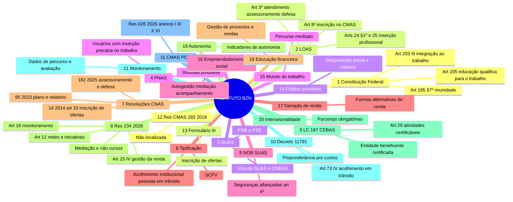

# AUDITORIA JURÍDICO-INSTITUCIONAL E MAPA DE ENQUADRAMENTO
## Instituto Brasa Zona Norte (Instituto BZN) perante o Conselho Municipal de Assistência Social de Porto Alegre (CMAS/POA)

**Objeto:** verificar como o Instituto BZN deve descrever e organizar o que já faz, e o que pretende fazer, para que sua atuação fique juridicamente coerente com o SUAS. A premissa é não atribuir natureza socioassistencial a atividades que não a possuem. O resultado serve de base para preencher o Formulário (Anexo) III do CMAS/POA.

**Data de referência:** 06/10/2026, com a legislação vigente nessa data, dentro dos limites de verificação descritos na Parte 0.
**Versão:** 1.0. É a etapa de auditoria. A reconstrução do Plano de Ação e o preenchimento do Formulário III ficam para a etapa seguinte, se solicitados.

> **Natureza deste documento.** É uma análise técnica de apoio, feita a partir dos documentos e normas indicados. Não substitui parecer jurídico assinado por profissional habilitado nem a manifestação do próprio CMAS, a quem cabe decidir sobre a inscrição (Lei 8.742/1993, art. 9º, § 2º).
>
> **Proteção de dados.** O documento não reproduz dados pessoais (nomes, documentos, endereços ou contatos de pessoas físicas) que constam dos arquivos analisados. Dirigentes e técnicos são referidos apenas pela função.

---

## SUMÁRIO

- [Parte 0 — Base documental, método e limites](#parte-0--base-documental-método-e-limites)
- [Parte 1 — Diagnóstico jurídico-institucional](#parte-1--diagnóstico-jurídico-institucional)
- [Parte 2 — Legislação aplicável, em ordem hierárquica](#parte-2--legislação-aplicável-em-ordem-hierárquica)
- [Parte 3 — "Lei da filantropia" e CEBAS](#parte-3--lei-da-filantropia-e-cebas)
- [Parte 4 — Análise da Resolução CMAS 283/2018](#parte-4--análise-da-resolução-cmas-2832018)
- [Parte 5 — Análise aprofundada da Resolução CNAS/MDS 234/2026](#parte-5--análise-aprofundada-da-resolução-cnasmds-2342026)
- [Parte 6 — Análise do Formulário III](#parte-6--análise-do-formulário-iii)
- [Parte 7 — Matriz de enquadramento de todas as atividades](#parte-7--matriz-de-enquadramento-de-todas-as-atividades)
- [Parte 8 — Mapa mental jurídico](#parte-8--mapa-mental-jurídico)
- [Parte 9 — Mapa de fronteira entre Assistência Social e outras políticas](#parte-9--mapa-de-fronteira-entre-assistência-social-e-outras-políticas)
- [Parte 10 — Riscos e vulnerabilidades do Plano de Ação atual](#parte-10--riscos-e-vulnerabilidades-do-plano-de-ação-atual)
- [Parte 11 — Recomendações de alteração](#parte-11--recomendações-de-alteração)
- [Parte 12 — Estrutura ideal para o Plano de Ação](#parte-12--estrutura-ideal-para-o-plano-de-ação)
- [Parte 13 — Estratégia para preenchimento do Formulário III](#parte-13--estratégia-para-preenchimento-do-formulário-iii)
- [Parte 14 — Checklist documental e operacional](#parte-14--checklist-documental-e-operacional)
- [Parte 15 — Conclusão executiva](#parte-15--conclusão-executiva)
- [Anexos — Verificação de fontes, normas revogadas e pendências](#anexos)

---

## LEGENDA OBRIGATÓRIA DE LEITURA

Atendendo à regra de não inventar fundamento legal, cada afirmação relevante leva uma das marcações abaixo.

| Marcação | Significado |
|---|---|
| **[NORMA]** | Norma expressa, com indicação de norma, artigo e inciso ou parágrafo. |
| **[INTERPRETAÇÃO]** | Leitura técnico-jurídica sustentável, mas que não está escrita literalmente na norma. |
| **[RECOMENDAÇÃO]** | Escolha estratégica ou de gestão. **Não é obrigação legal.** |
| **[FATO]** | Informação extraída dos documentos do Instituto, com o documento de origem indicado. |
| **[LACUNA]** | Informação ausente que precisa ser produzida ou obtida. |
| **[SEM BASE]** | "Não localizei fundamento normativo específico suficiente para sustentar essa afirmação." |

**Grau de verificação da fonte normativa:**

| Código | Significado |
|---|---|
| **V1** | Texto oficial integral conferido nesta auditoria (arquivo oficial enviado pelo Instituto). |
| **V2** | Conferido em fontes secundárias (busca na web, sites jurídicos e institucionais). Confirmar no texto oficial antes de citar literalmente em documento protocolado. |
| **V3** | Texto normativo consolidado e de conhecimento técnico corrente, não reconferido nesta sessão. Confirmar a redação literal. |
| **V4** | Norma ou documento **não localizado**. Nenhuma conclusão sobre seu conteúdo é afirmada. |

---

## PARTE 0 — BASE DOCUMENTAL, MÉTODO E LIMITES

### 0.1 Documentos do Instituto analisados

| # | Documento | Data | Observações relevantes |
|---|---|---|---|
| D1 | Requerimento de Inscrição: **Anexo I da Resolução CMAS/POA nº 026/2026** ("OSC de Assistência Social com sede no Município de Porto Alegre") | 20/07/2026 | Natureza assinalada: **Defesa de direito**. Síntese cita acolhimento e atendimentos psicológico, jurídico e psicopedagógico, além de cursos. Fundamento citado: Res. CNAS 33/2011. |
| D2 | **Plano de Ação 2026**: Anexo X da Res. CMAS/POA 026/2026 ("Assessoramento e Defesa e Garantia de Direitos") | 25/06/2026 | 8 cursos e workshops, 118 vagas. Fundamento citado: Res. CNAS 33/2011. |
| D3 | **Relatório de Atividades 2025**: Anexo XI da Res. CMAS/POA 026/2026 | 25/06/2026 | 7 cursos e workshops, 146 inscrições. Fundamento citado: Res. CNAS 33/2011. |
| D4 | **Estatuto Social** (3ª alteração, aprovada em AGE de 01/08/2025, registrada no 2º RTD/POA sob nº 5534/3) | 01/08/2025 | 42 artigos e 30 objetivos (art. 3º). Declara atuação em "assistência social, saúde e educação" (art. 1º). |
| D5 | Ata da AGE de 01/08/2025 (alteração estatutária e renúncias) | 01/08/2025 | Alteração "para adequação dos artigos às necessidades de órgãos governamentais". |
| D6 | Ata da Assembleia de 02/01/2026 (eleição da Diretoria 2026–2031 e abertura de filial; registro de filial nº 9153 em 13/04/2026) | 02/01/2026 | **Conselho Fiscal não eleito** "por não haver candidatos". **Filial no bairro Cristo Redentor, onde funciona a "Casa de Acolhimento Apascentar".** |
| D7 | Comprovante de Inscrição e Situação Cadastral no CNPJ | emitido em 30/06/2026 | CNPJ 30.586.482/0001-74, aberto em 21/05/2018, associação privada, **ativa**. CNAE principal **94.30-8-00**. 22 CNAEs secundários. |
| D8 | Fatura de telefonia em nome do Instituto (comprovante de endereço da sede) | 07/2026 | Sede na Av. Baltazar de Oliveira Garcia, 430, bairro São Sebastião. |
| — | Documentos pessoais do representante legal (CNH e comprovante de residência) | — | **Não analisados.** São dados pessoais sem relevância para a auditoria. |

**Fontes públicas complementares** (informação jornalística, a confirmar com o Instituto):
- Jornal do Comércio, abril/2025: "Instituto Brasa Zona Norte é o novo espaço cultural do bairro Sarandi" (<https://www.jornaldocomercio.com/cultura/2025/04/1198503-instituto-brasa-zona-norte-e-o-novo-espaco-cultural-do-bairro-sarandi.html>).
- Sul21: matéria sobre a **Casa de Acolhimento Apascentar**, que oferece hospedagem, alimentação, apoio emocional e acompanhamento espiritual gratuitos a **familiares de pacientes internados** em hospitais da zona norte de Porto Alegre, em geral vindos do interior e encaminhados pelos próprios hospitais (<https://sul21.com.br/?p=264561>).

### 0.2 Normas recebidas do Instituto (texto integral conferido, V1)

- **Resolução CNAS/MDS nº 234, de 14/05/2026**: página do DOU (publicada em 15/05/2026, Edição 90, Seção 1, p. 25).
- **Lei nº 8.742/1993 (LOAS)**: texto compilado do Planalto.
- **Decreto nº 11.791/2023**: texto do Planalto (DOU de 22/11/2023).
- **LC nº 187/2021**: o arquivo enviado era só a **ficha da norma no site da Câmara**, sem o texto integral. A ficha registra "não consta revogação expressa" e a promulgação de vetos em 08/07/2022. Os artigos da LC 187 citados aqui são, portanto, **V2**. O detalhamento operacional foi conferido no Decreto 11.791/2023, que é V1.

### 0.3 Documentos e normas NÃO recebidos ou NÃO localizados

| Item | Situação | Efeito na auditoria |
|---|---|---|
| **Formulário (Anexo) III** do CMAS/POA | Não enviado. Por busca, confirmou-se só o **título**: "Requerimento de Inscrição (Entidades com preponderância em outra área)" (V2). | A estratégia de preenchimento (Parte 13) é por estrutura e conteúdo, não campo a campo. |
| **Resolução CMAS/POA nº 283/2018** | **Não localizada** (V4). | A Parte 4 é **condicional** e não afirma o objeto da norma. |
| Texto integral da **Resolução CMAS/POA nº 026/2026** | Não enviado. Conhecidos os Anexos I, III (título), X e XI. | Requisitos municipais adicionais estão marcados como "conferir". |
| **Resolução CNAS/MDS nº 182/2025** | Não enviada; conferida por fontes secundárias (V2). | Incisos específicos citados com ressalva. |
| **Resolução CNAS nº 14/2014** | Não enviada; conferida por fontes secundárias (V2). | Idem. |

### 0.4 Limite técnico da pesquisa

O ambiente desta auditoria **bloqueou o acesso direto** aos sites oficiais (Planalto, DOU/in.gov.br, MDS, Prefeitura de Porto Alegre, blog do CNAS). A pesquisa legislativa complementar foi feita por mecanismo de busca, e o resultado está marcado como **V2**. O **Anexo A** lista o que deve ser reconferido no texto oficial antes de qualquer citação literal em documento protocolado.

### 0.5 Método

1. Leitura integral dos documentos D1 a D8.
2. Leitura integral, artigo por artigo, da Res. 234/2026, da LOAS e do Decreto 11.791/2023.
3. Pesquisa de vigência e objeto das demais normas: Res. CNAS 14/2014, 95/2023, 99/2023, 100/2023, 151/2024, 182/2025, 195/2025, 231/2026 e 239–240/2026, além do Decreto 6.308/2007, das Leis 14.995/2024 e 15.068/2024, PNAS, NOB/SUAS e Tipificação.
4. Confronto entre o que o Instituto **faz** (D3, D6, fontes públicas), o que **declara** (D1, D2, D4, D7) e o que a **norma exige**.
5. Classificação de cada atividade nas categorias A a E pedidas, com fundamento e condições.

---

## PARTE 1 — DIAGNÓSTICO JURÍDICO-INSTITUCIONAL

### 1.1 Quem é o Instituto BZN, segundo os próprios documentos

- **[FATO — D7]** É uma associação privada sem fins lucrativos, com CNPJ 30.586.482/0001-74, aberto em 21/05/2018 e situação **ativa**.
- **[FATO — D4, art. 1º]** O Estatuto o define como associação civil "de caráter beneficente e filantrópico, **que desenvolve ações nas áreas de assistência social, saúde e educação**".
- **[FATO — D4, art. 3º]** O Estatuto lista **30 objetivos**, que abrangem pelo menos oito políticas:
  - assistência social: itens 1, 4, 12, 13, 14 e 22;
  - educação: itens 16, 18 e 25;
  - trabalho e renda: itens 9, 11, 17, 19 e 20;
  - cultura: item 6;
  - esporte e lazer: item 5;
  - saúde: itens 8, 21 e 24;
  - meio ambiente e reciclagem: itens 10 e 23;
  - atividades de geração de recursos: itens 26 a 30 (eventos, bazares, shows, direitos autorais, consultoria, locação de imóveis).
- **[FATO — D7]** O CNAE principal é **94.30-8-00 (atividades de associações de defesa de direitos sociais)**. Há 22 CNAEs secundários:
  - ensino (creche, pré-escola, fundamental, apoio à educação, esportes, dança, artes cênicas, música, idiomas, informática, desenvolvimento profissional e gerencial);
  - cultura (produção teatral, musical e de dança, artes cênicas);
  - edição de livros e revistas;
  - condicionamento físico;
  - assistência psicossocial e à saúde a portadores de distúrbios psíquicos e dependência química (87.20-4-99);
  - assistência social em residências coletivas (87.30-1-99);
  - serviços de assistência social sem alojamento (88.00-6-00).
- **[FATO — D6]** Há uma **filial** registrada em 13/04/2026, no bairro Cristo Redentor, onde funciona a **Casa de Acolhimento Apascentar**. Segundo fonte jornalística, a Casa acolhe gratuitamente **familiares de pacientes internados** em hospitais da zona norte de Porto Alegre.
- **[FATO — fonte pública]** A sede foi apresentada pela imprensa, em 2025, como **"novo espaço cultural do bairro Sarandi"**, numa das áreas mais atingidas pelas enchentes de 2024.

### 1.2 O que o Instituto apresentou ao CMAS

- **[FATO — D1]** Pediu inscrição como **"OSC de Assistência Social com sede em Porto Alegre"** (Anexo I) e assinalou a natureza **"Defesa de direito"**.
- **[FATO — D2/D3]** Apresentou Plano 2026 e Relatório 2025 nos anexos de **assessoramento e defesa**. Ambos descrevem um "Projeto de Integração ao Mundo do Trabalho" cuja oferta **consiste em cursos e workshops**. O D1 afirma: "O Projeto utiliza **Cursos Livres e Capacitação como a principal estratégia de atendimento**".
- **[FATO — D1, D2, D3]** O fundamento normativo central declarado é a **Resolução CNAS nº 33/2011**.
- **[FATO — D1, item VII]** Na relação de "todos os estabelecimentos", só a **sede** foi informada. **A filial e a Casa Apascentar não aparecem** em nenhum dos documentos enviados ao CMAS.

### 1.3 Achados críticos (por ordem de gravidade)

| # | Achado | Base | Gravidade |
|---|---|---|---|
| **A1** | **O fundamento central está revogado.** A Res. CNAS 33/2011 foi **revogada pelo art. 21 da Res. CNAS/MDS 234/2026**, em vigor desde 15/05/2026 (art. 22). Plano e Relatório (25/06/2026) e Requerimento (20/07/2026) foram assinados **depois** da revogação e transcrevem o art. 2º da norma revogada como se estivesse vigente. | [NORMA] Res. 234/2026, arts. 21 e 22 (V1) | Crítica |
| **A2** | **Contradição frontal com a Res. 234/2026.** A norma diz que a AS, no mundo do trabalho, tem papel de "articulação e mediação, **e não como provedora de emprego ou cursos profissionalizantes**". Os documentos apresentam os cursos como "**principal estratégia de atendimento**". | [NORMA] Res. 234/2026, art. 1º, parágrafo único (V1) | Crítica |
| **A3** | **Omissão da filial e da Casa de Acolhimento Apascentar**, que é provavelmente a atividade com **maior aderência** à AS. Corresponde ao acolhimento provisório de pessoas em trânsito durante tratamento de doença grave, atividade certificável na área de AS. O Requerimento declara as informações "fidedignas" e pede **todos** os estabelecimentos. | [NORMA] Decreto 11.791/2023, art. 73, IV (V1); [FATO] D1-VII e D6 | Crítica |
| **A4** | **Tipologia inadequada.** "Defesa e garantia de direitos" não descreve uma oferta de cursos. Na Res. 234/2026, Socioaprendizagem e Acessuas são **atendimento**. Os programas e projetos de fortalecimento de redes e iniciativas são **assessoramento**, em leitura sistemática do art. 15, II, com a Res. 182/2025 ([INTERPRETAÇÃO]; ver 5.8). | [NORMA] LOAS, art. 3º, §§ 1º a 3º (V1); Res. 234/2026, art. 15, I e II (V1); Res. 182/2025, art. 12, VI (V2) | Alta |
| **A5** | **Preponderância não demonstrada.** O Estatuto é multiárea, o CNAE principal não é de AS, há relevantes atividades culturais e de geração de recursos, e **não há contabilidade segregada por área**. Isso torna duvidoso o pedido como "OSC de AS" (Anexo I) e favorece o Anexo III. | [NORMA] Decreto 11.791/2023, arts. 3º, § 3º, e 7º, § 1º (V1); Res. CNAS 14/2014, art. 10 (V2) | Alta |
| **A6** | **Público genérico** ("pessoas em situação de vulnerabilidade e risco social"), **sem critérios de priorização**, e adolescentes de 16–17 anos sem tratamento específico. | [NORMA] Res. 234/2026, art. 5º, §§ 1º e 2º, e art. 7º, § 4º (V1) | Alta |
| **A7** | **Ausência de percurso, acompanhamento, referenciamento e indicadores.** Não há registro de encaminhamentos, acompanhamento pós-curso, resultados ou monitoramento. | [NORMA] Res. 234/2026, arts. 8º, II, 15, VIII, 16, I e III, 17 e 18 (V1) | Alta |
| **A8** | **Equipe técnica insuficiente para a oferta declarada.** A assistente social trabalha 8 h/semana, e todos os facilitadores são voluntários. | [NORMA] Res. 234/2026, art. 3º, § 1º ("equipe técnica específica contratada"), art. 15, III, e art. 20 (V1) | Média-alta |
| **A9** | **Inconsistências entre as peças.** CNAEs do Requerimento diferem do cartão CNPJ. A cláusula de dissolução é citada como art. 6º, mas está no art. 8º, parágrafo único. A capacidade de 2025 aparece como 124 vagas no texto, mas a tabela soma 130. "146 usuários" são, na verdade, **inscrições**. Serviços citados no Requerimento (psicológico, jurídico, psicopedagógico) não constam do Plano. | [FATO] D1, D3, D4, D7 | Média |
| **A10** | **Fragilidades de governança.** O Conselho Fiscal não foi eleito, embora seja órgão estatutário obrigatório. O art. 12 (dirigentes não remunerados) contradiz o art. 27, § 2º (possibilidade de remuneração sem os limites legais). | [FATO] D4, arts. 12, 17, 27 e 32–33; D6. [NORMA] Decreto 11.791/2023, art. 5º, §§ 1º e 2º (V1) | Média |

### 1.4 Diagnóstico-síntese

**[INTERPRETAÇÃO]** O Instituto BZN é uma **OSC multiárea**. Tem uma sede de vocação cultural, educativa e comunitária e uma filial que mantém um acolhimento de familiares de pacientes. A documentação enviada ao CMAS tenta enquadrar **cursos de qualificação** como o núcleo socioassistencial da instituição, com base numa norma revogada. Ao mesmo tempo, **omite justamente a atividade de maior aderência à AS** (a Casa Apascentar).

O problema central não é de redação. É de **arquitetura**: falta separar, de um lado, o que é oferta socioassistencial (mediação, acolhida, acompanhamento, articulação, acolhimento) e, de outro, o que pertence a outras políticas (educação, cultura, saúde, trabalho), que o Instituto pode manter, mas **fora** do perímetro da inscrição no CMAS ou **articulado** a ele.

**[INTERPRETAÇÃO]** Com os documentos disponíveis, o **Formulário III (preponderância em outra área)** é o caminho mais prudente e defensável **neste momento**, para inscrever **ofertas** socioassistenciais específicas em vez da entidade como um todo (Parte 6). Essa conclusão é **provisória**. Pode mudar se a contabilidade segregada de 2025 e 2026 mostrar que a maior parte dos custos está nas ofertas socioassistenciais, sobretudo se a Casa Apascentar for o principal centro de custo.


---

## PARTE 2 — LEGISLAÇÃO APLICÁVEL, EM ORDEM HIERÁRQUICA

### 2.0 Pirâmide normativa aplicável ao caso

```
Constituição Federal (arts. 6º, 7º, 150, 194, 195 §7º, 203, 204, 205, 227)
 └─ Lei Complementar 187/2021 (certificação de entidades beneficentes — CEBAS)
     └─ Leis ordinárias: LOAS (8.742/1993) · ECA (8.069/1990) · CLT (aprendizagem) · MROSC (13.019/2014)
        · Voluntariado (9.608/1998) · LGPD (13.709/2018) · Acredita (14.995/2024) · Economia Solidária (15.068/2024)
         └─ Decretos: 6.308/2007 (entidades de AS) · 11.791/2023 (regulamenta a LC 187) · 9.579/2018 (aprendizagem)
             └─ Resoluções do CNAS: PNAS · NOB/SUAS · NOB-RH · Tipificação · 14/2014 · 95/2023 · 99/2023 · 100/2023
                · 151/2024 · 182/2025 · 195/2025 · 231/2026 · 234/2026
                 └─ Portarias federais: MDS 952/2023 (Socioaprendizagem) · MTE 3.872/2023 (aprendizagem)
                     └─ Resoluções do CMAS/POA: 026/2026 (inscrição; Anexos I, III, X, XI) · 283/2018 (não localizada)
                         └─ Atos do Instituto: Estatuto · Regimento · Plano de Ação · Relatório de Atividades
```

**[NORMA]** As ações das entidades de AS "observarão as normas expedidas pelo CNAS" (LOAS, art. 7º, V1), e compete ao CNAS "normatizar as ações e regular a prestação de serviços de natureza pública e privada no campo da assistência social" (LOAS, art. 18, II, V1).
**[INTERPRETAÇÃO]** Uma resolução do CMAS/POA, portanto, não pode contrariar as resoluções do CNAS. Se a Res. CMAS 026/2026 ou a 283/2018 ainda remeterem à Res. CNAS 33/2011, prevalece a Res. CNAS/MDS 234/2026, que a revogou.

### 2.1 Nível constitucional (V3: texto consolidado, conferir redação literal)

| Dispositivo | Conteúdo | Relação concreta com o Instituto BZN |
|---|---|---|
| CF, art. 6º | Trabalho e "assistência aos desamparados" como direitos sociais. | Fundamento geral da atuação. |
| CF, art. 7º | Direitos dos trabalhadores. | A Res. 234/2026 (art. 2º, I) remete a ele para definir o trabalho como direito. Base para incluir **orientação sobre direitos trabalhistas** no percurso. |
| CF, art. 7º, XXXIII, e art. 227, § 3º, I | Proibição de trabalho antes dos 16 anos, salvo como aprendiz a partir dos 14. | O público começa aos 16. As atividades práticas com adolescentes não podem configurar trabalho. |
| CF, art. 150, VI, "c" | Imunidade de **impostos** para instituições de educação e de AS sem fins lucrativos, atendidos os requisitos de lei (CTN, art. 14). | Distinta da imunidade de **contribuições** (CEBAS). Ver Parte 3. |
| CF, art. 194 | A seguridade social compreende saúde, previdência e assistência social. | Situa a AS como política própria, distinta da saúde. |
| CF, art. 195, § 7º | Imunidade de contribuições para a seguridade social das "entidades beneficentes de assistência social que atendam às exigências estabelecidas em lei". | É regulada pela LC 187/2021 (CEBAS). Ver Parte 3. |
| CF, art. 203, caput e I a VI | A AS é prestada "a quem dela necessitar, independentemente de contribuição". O **inciso III** prevê a "promoção da integração ao mercado de trabalho". O inciso VI (EC 114/2021) prevê a redução da vulnerabilidade socioeconômica de famílias em pobreza ou extrema pobreza. | É a **base constitucional da integração ao trabalho**. O critério de acesso é a **necessidade**, não apenas a renda. |
| CF, art. 204, I e II | Descentralização, com execução também por "entidades beneficentes e de assistência social", e participação da população. | Legitima a OSC como executora e a participação dos usuários. |
| CF, art. 205 | A educação visa ao "pleno desenvolvimento da pessoa, seu preparo para o exercício da cidadania e sua **qualificação para o trabalho**". | **Fronteira:** a qualificação para o trabalho é objetivo constitucional da **educação**. |
| CF, art. 227 | Prioridade absoluta para crianças, adolescentes e jovens, incluindo o direito à **profissionalização**. | Adolescentes de 16–17 anos atendidos exigem articulação com a escola (Res. 234/2026, art. 7º, § 4º). |

### 2.2 Nível de lei complementar

| Norma | Dados | Objeto e situação | Dispositivos relevantes | Relação com o BZN | V |
|---|---|---|---|---|---|
| **LC 187/2021** | 16/12/2021. Congresso Nacional. DOU de 17/12/2021. Vetos parcialmente derrubados (promulgação em 08/07/2022). | Certificação das entidades beneficentes e imunidade de contribuições (CF, art. 195, § 7º). Revogou a Lei 12.101/2009. **"Não consta revogação expressa"** (ficha da Câmara). | **Art. 2º:** entidade beneficente é a pessoa jurídica de direito privado sem fins lucrativos que presta serviço em AS, saúde ou educação, "**assim certificada**". **Art. 3º:** requisitos cumulativos para a imunidade. **Art. 29:** certificação na área de AS (atendimento, assessoramento ou defesa; habilitação e reabilitação de PcD; aprendizagem; acolhimento provisório em trânsito para tratamento de doença grave). | **Não é requisito para a inscrição no CMAS.** É etapa futura e opcional, mas exige desde já contabilidade segregada e estatuto adequado. A Casa Apascentar tem aderência ao art. 29 (Parte 3). | V2 (art. 29 conferido por espelhamento no Decreto 11.791/2023, art. 73, V1) |

### 2.3 Nível de lei ordinária

| Norma | Objeto e situação | Dispositivos relevantes | Relação concreta com o BZN | V |
|---|---|---|---|---|
| **Lei 8.742/1993 (LOAS)** | Organização da AS. Vigente, com alterações (Lei 12.435/2011 e posteriores). | **Art. 1º** (AS como política não contributiva de seguridade). **Art. 2º, I, "c"** (promoção da integração ao mercado de trabalho), **II** (vigilância socioassistencial), **III** (defesa de direitos) e **parágrafo único** (integração às políticas setoriais). **Art. 3º e §§ 1º a 3º** (atendimento, assessoramento, defesa). **Art. 4º, I a V** (princípios). **Art. 5º, II** (participação). **Arts. 6º-A, 6º-B §§ 1º e 2º, 6º-C** (proteções e vínculo SUAS). **Art. 6º-F, § 5º** (a sociedade civil pode cooperar na identificação de pessoas a inscrever no CadÚnico). **Art. 7º** (observância das normas do CNAS). **Art. 9º, caput e § 2º** (inscrição prévia no CMAS e fiscalização). **Art. 19, XI** (cadastro nacional de entidades, o CNEAS). **Art. 23** (serviços). **Art. 24, § 1º** (programas "com prioridade para a **inserção profissional e social**"). **Arts. 25 e 26** (projetos de enfrentamento da pobreza: apoio técnico a "iniciativas que lhes garantam meios, capacidade produtiva e de gestão", com articulação intersetorial). | É a **base de toda a atuação**. Os arts. 24, § 1º, e 25 são **fundamento legal direto** para programas e projetos de inserção profissional e de geração de renda em grupos populares. | **V1** |
| Lei 8.069/1990 (ECA) | Proteção integral. | **Art. 69** (direito do adolescente à profissionalização e à proteção no trabalho, respeitada a condição peculiar de desenvolvimento). **Art. 90, § 1º, e art. 91** (inscrição de programas e registro de entidades no CMDCA). | Público de 16–17 anos. **Possível** necessidade de registro no CMDCA se houver programa dirigido a adolescentes (Partes 10 e 14). | V3 |
| CLT, arts. 428 a 433 (Lei 10.097/2000) | Aprendizagem profissional. | **Art. 430, II:** entidades sem fins lucrativos de assistência ao adolescente e educação profissional, registradas no CMDCA (citado no Decreto 11.791/2023, art. 76, II, V1). | Só se aplica se o Instituto criar programa de **Socioaprendizagem** (estatuto, art. 3º, item 20). Hoje não executa. | V3 |
| Lei 13.019/2014 (MROSC) | Parcerias entre a administração pública e as OSCs. | **Art. 2º, I, "a"** (conceito de OSC). | **OSC não é o mesmo que entidade de AS.** Regula eventuais parcerias com o Município. | V3 |
| Lei 9.608/1998 (Voluntariado) | Serviço voluntário. | **Art. 2º:** exercício "mediante a celebração de **termo de adesão**". | Todos os facilitadores são voluntários. É preciso termo de adesão individual. | V3 |
| Lei 13.709/2018 (LGPD) | Proteção de dados. | **Arts. 7º e 11** (bases legais; dados sensíveis: saúde, religião). **Art. 14** (crianças e adolescentes). | Fichas de acolhida, NIS e CadÚnico, dados de saúde de familiares de pacientes (Casa), acompanhamento espiritual, fotos de participantes nos relatórios. O Estatuto já prevê proteção de dados (art. 37). | V3 |
| **Lei 14.995/2024** (Programa Acredita) | Programa do MDS de inclusão produtiva para famílias do CadÚnico: acesso a emprego, qualificação, empreendedorismo e microcrédito orientado. | — | **Parceiro natural de articulação** (Res. 234/2026, art. 7º) para as oficinas de empreendedorismo e gestão financeira. | V2 |
| **Lei 15.068/2024** (Lei Paul Singer) | Política Nacional de Economia Solidária e Sinaes. | — | Articulação com economia solidária (Res. 234/2026, arts. 7º, V, e 12, I). | V2 |
| Código Civil, art. 53; CTN, art. 14 | Associação para fins não econômicos; requisitos da imunidade de impostos. | — | Natureza jurídica do Instituto; distinção entre imunidades (Parte 3). | V3 |

### 2.4 Nível de decreto

| Norma | Objeto e situação | Dispositivos relevantes | Relação com o BZN | V |
|---|---|---|---|---|
| **Decreto 6.308/2007** (14/12/2007) | Regulamenta o art. 3º da LOAS (entidades e organizações de AS). **Não consta revogação expressa.** O Decreto 11.791/2023 (art. 74, II) e a Res. 234/2026 (preâmbulo) o citam como vigente. | **Art. 1º:** a entidade é de AS quando "seus atos constitutivos definirem expressamente sua natureza, objetivos, missão e público alvo, de acordo com as disposições da Lei nº 8.742". **Parágrafo único (características essenciais):** realizar atendimento, assessoramento ou defesa na área da AS; **universalidade do atendimento independentemente de contraprestação do usuário**; finalidade pública e transparência. **Art. 2º:** tipologias. | O Estatuto do BZN **define objetivos de AS, mas também de várias outras políticas**. Isso é relevante para a preponderância. Também sustenta a **gratuidade e a universalidade**. | V2 |
| **Decreto 11.791/2023** (21/11/2023; DOU de 22/11/2023) | Regulamenta a LC 187/2021. **Revogou o Decreto 8.242/2014** (art. 93). Sem alterações no texto compilado analisado. | **Art. 3º:** 12 meses de constituição; universalidade; **§ 3º: escrituração contábil segregada por área**. **Art. 5º:** documentos; **§§ 1º e 2º: limites para remuneração de dirigentes**; § 3º, I: auditoria independente quando a receita bruta superar o limite do art. 3º, II, da LC 123/2006. **Art. 7º, § 1º: "área de atuação preponderante" é aquela em que a entidade registra a maior parte de seus custos e despesas**; § 5º: dispensa para áreas não preponderantes até 30% dos custos e R$ 300 mil. **Art. 73, I a IV:** atividades certificáveis em AS, entre elas o **IV, "serviço de acolhimento institucional provisório de pessoas e de seus acompanhantes que estejam em trânsito e sem condições de autossustento durante o tratamento de doenças graves fora da localidade de residência"**; § 1º: execução "universal, não contributiva, continuada, permanente, planejada e sem discriminação"; **§ 3º: atividades que gerem recursos, registradas segregadamente**. **Art. 74:** inscrição no CMAS; **relatório de atividades "certificáveis ou não"**; CNEAS; **§ 3º, I: maior parte dos custos em ofertas socioassistenciais e certificáveis**. Art. 75, II: a entidade de assessoramento ou defesa que atua em mais de um município comprova a inscrição no CMAS da sede. Art. 76: aprendizagem (cadastro e CMDCA). Art. 84: placa. | **Define o critério objetivo de preponderância**, que também serve de referência técnica para o Formulário III (Parte 6). **Enquadra a Casa Apascentar** (art. 73, IV). Obriga a separar contabilmente bazares, eventos e locações (art. 73, § 3º). | **V1** |
| Decreto 9.579/2018 | Consolida atos sobre criança e adolescente, inclusive aprendizagem. | Art. 53, § 2º (prioridades da aprendizagem), citado na Res. 234/2026, art. 10. Cadastro do art. 50, § 5º, citado no Decreto 11.791/2023, art. 76, I. | Só se houver Socioaprendizagem. | V3 |

### 2.5 Resoluções do CNAS: pertinência de cada uma (atende ao item 7 do pedido)

| Norma | Data | Objeto | Situação | Dispositivos úteis | Pertinência ao BZN | V |
|---|---|---|---|---|---|---|
| **Res. CNAS 145/2004 (PNAS)** | 15/10/2004 | Política Nacional de AS. | Vigente. | Item 2.3 (objetivos). **Item 2.4 (usuários)**, que inclui pessoas com "**inserção precária ou não inserção no mercado de trabalho formal e informal**". Item 2.5.1 (PSB), que menciona "programa de inclusão produtiva e projetos de enfrentamento da pobreza" e "centros de informação e de educação para o trabalho, voltados para jovens e adultos". Seguranças afiançadas. | **Alta:** define público e seguranças. | V3 |
| Res. CNAS 269/2006 (NOB-RH/SUAS) | 13/12/2006 | Gestão do trabalho no SUAS. | Vigente. | Equipes de referência e princípios. | **Média:** a Res. 234/2026 (art. 20) manda compor a equipe "em conformidade com as diretrizes da NOB-RH/SUAS". | V3 |
| Res. CNAS 109/2009 (Tipificação) | 11/11/2009 | Tipificação Nacional dos Serviços Socioassistenciais. | Vigente, com alterações (entre elas a inclusão do SCFV de 18–59 anos, Res. CNAS 13/2014). | **SCFV** (PSB), que para adolescentes de 15–17 anos inclui "formação geral para o mundo do trabalho". **Serviço de Acolhimento Institucional, modalidade adultos e famílias** (PSE de alta complexidade), previsto também para "**pessoas em trânsito e sem condições de autossustento**". | **Alta para a Casa Apascentar.** Média para o SCFV, como alternativa futura. | V2/V3 |
| Res. CNAS 17/2011 e 9/2014 | 2011 / 2014 | Categorias profissionais de nível superior (17/2011) e ocupações de nível médio e fundamental do SUAS (9/2014). | Vigentes. | — | **Média:** composição e nomenclatura da equipe (educador social, técnicos). | V3 |
| **Res. CNAS 33/2012 (NOB/SUAS)** | 12/12/2012 | Organização do SUAS. | Vigente. | **Art. 4º, seguranças:** acolhida; renda; convívio ou vivência familiar, comunitária e social; **desenvolvimento de autonomia**; apoio e auxílio. Citado pela Res. 234/2026, art. 6º, VI. | **Alta:** dá a linguagem de "seguranças" e "aquisições" que o Plano deve usar. | V2 |
| **Res. CNAS 14/2014** | 15/05/2014 | Parâmetros nacionais para inscrição de entidades **e** de serviços, programas, projetos e benefícios socioassistenciais nos conselhos. | **Vigente**, alterada (art. 13) pela Res. 95/2023. **Em revisão pelo GT da Res. 195/2025.** | **Art. 10:** entidades sem atuação preponderante em AS que também atuam nessa área inscrevem seus serviços, programas, projetos e benefícios, demonstrando os critérios dos arts. 5º e 6º. **Art. 13:** plano e relatório anuais. | **Crítica:** é a **base nacional do Formulário III**. | V2 |
| **Res. CNAS/MDS 95/2023** | 13/02/2023 | Altera o art. 13 da Res. 14/2014: entrega anual, **até 30 de abril**, do plano de ação do ano e do relatório do ano anterior "que evidencie o cumprimento do Plano de ação, destacando informações sobre o **público atendido** e os **recursos utilizados**". Revogou a Res. CNAS/MC 63/2022. | Vigente. | — | **Alta:** prazo e conteúdo mínimo do relatório. O Relatório 2025 do BZN **não traz perfil do público nem valores**. | V2 |
| Res. CNAS/MDS 99/2023 | 2023 (fontes indicam 04/03/2023) | Caracteriza os usuários, seus direitos, organizações e participação no SUAS. Revogou a Res. CNAS 11/2015. | Vigente. | Usuários: pessoas e grupos "em situações de desproteção social, vulnerabilidades e riscos". | **Média:** base para a participação dos usuários e o conceito de usuário. | V2 |
| Res. CNAS/MDS 100/2023 | 20/04/2023 | Diretrizes para estruturação, funcionamento e acompanhamento dos conselhos de AS. | Vigente. | — | **Baixa:** dirige-se ao CMAS, não à OSC. | V2 |
| Res. CNAS/MDS 151/2024 | 23/04/2024 | Comunidades terapêuticas e entidades de cuidado a dependentes de álcool e drogas **não integram o SUAS** e não se inscrevem como entidades nos CMAS. Seus serviços socioassistenciais podem ser inscritos (Res. 14/2014). | Vigente (sem notícia de revogação). | — | **Baixa e por analogia:** nem todo "acolhimento" é socioassistencial, e ofertas podem ser inscritas isoladamente. A Casa Apascentar **não** é comunidade terapêutica, pelo que se sabe. | V2 |
| **Res. CNAS/MDS 182/2025** | 13/02/2025 (a Res. 234/2026 a cita como de "17 de fevereiro de 2025", provável data de publicação) | Caracteriza e estabelece diretrizes, parâmetros e critérios para serviços, programas e projetos de **assessoramento** e de **defesa e garantia de direitos**, ofertados isolada ou cumulativamente. **Revogou a Res. CNAS 27/2011.** | Vigente. | **Art. 9º, § 3º:** seguranças (acolhida, renda, convívio, autonomia, apoio e auxílio). **Art. 12:** conteúdo do assessoramento. O **inciso VI**, segundo fontes secundárias, prevê "assessorar e incentivar a promoção e integração ao mundo do trabalho, com ênfase no fortalecimento das redes de economia popular e solidária, economia criativa, economia circular, empreendedorismo social, nas tecnologias sociais...". | **Crítica:** é a norma da tipologia que o BZN assinalou. Indica que integração ao trabalho por redes e iniciativas é **assessoramento**. | V2 |
| Res. CNAS/MDS 195/2025 (+ 217/2025, 236/2026, 240/2026) | 13/05/2025 | GT para atualizar as Res. 33/2011, 34/2011 e 14/2014. Prorrogado (Res. 217/2025 e 236/2026) e com composição alterada (Res. 240/2026). | Vigente, com o GT ativo. | — | **Alta como alerta:** a **Res. 14/2014 (inscrição) pode ser substituída em breve**. Acompanhar o CNAS. | V2 |
| Res. CNAS/MDS 231/2026 | 2026 | Diretrizes para habilitação, reabilitação e inclusão à vida comunitária. A relação com a Res. 34/2011 está **a confirmar**. | Vigente. | — | **Baixa:** só se houver oferta específica para PcD. | V2 |
| **Res. CNAS/MDS 234/2026** | 14/05/2026 (DOU de 15/05/2026) | Integração e inclusão ao mundo do trabalho justo e digno. **Revogou a Res. CNAS 33/2011.** | **Vigente desde 15/05/2026.** | Arts. 1º a 22 (Parte 5). | **Crítica:** é a norma-chave do projeto de trabalho e renda. | **V1** |

### 2.6 Portarias e notas técnicas federais

| Norma | Objeto | Pertinência | V |
|---|---|---|---|
| Portaria MDS 952/2023 (29/12/2023) | Programas de aprendizagem na área da AS (Socioaprendizagem). Citada na Res. 234/2026, art. 10. | Só se o Instituto criar Socioaprendizagem (estatuto, item 20). | V2 |
| Portaria MTE 3.872/2023 | Aprendizagem profissional. Citada na Res. 234/2026, art. 10, § 1º. | Idem. | V2 |
| Nota Técnica DRSP/SNAS/MDS 02/2017 | Aprendizagem na AS. Citada na Res. 234/2026, art. 10, § 1º. | Idem. | V2 |

### 2.7 Normas municipais (Porto Alegre)

| Norma | Situação | Pertinência | V |
|---|---|---|---|
| **Res. CMAS/POA 026/2026** | Vigente. Rege a inscrição. Identificados: **Anexo I** (Requerimento: OSC de AS com sede em POA), **Anexo III** (Requerimento: entidades com preponderância em outra área), **Anexo X** (Plano de Ação: assessoramento e defesa) e **Anexo XI** (Relatório: assessoramento e defesa). | **Crítica:** é o procedimento aplicável. É preciso conferir no texto integral os documentos exigidos, os anexos para ofertas de **atendimento** e eventual definição municipal de "preponderância". | V2 (parcial) |
| **Res. CMAS/POA 283/2018** | **Não localizada.** | Ver Parte 4. | V4 |

### 2.8 Normas que NÃO podem mais ser citadas como vigentes

| Norma | Revogada por | V |
|---|---|---|
| **Res. CNAS 33/2011** (promoção da integração ao mercado de trabalho) | **Res. CNAS/MDS 234/2026, art. 21**, a partir de 15/05/2026 | V1 |
| Res. CNAS 27/2011 (assessoramento e defesa) | Res. CNAS/MDS 182/2025 | V2 |
| Lei 12.101/2009 (antigo CEBAS) | LC 187/2021 | V2 |
| Decreto 8.242/2014 | Decreto 11.791/2023, art. 93 | V1 |
| Res. CNAS 11/2015 (usuários) | Res. CNAS/MDS 99/2023 | V2 |
| Res. CNAS/MC 63/2022 | Res. CNAS/MDS 95/2023 | V2 |
| Res. CNAS 34/2011 (habilitação e reabilitação) | Em revisão pelo GT. **Verificar** se foi substituída pela Res. 231/2026. | V2 (não confirmado) |


---

## PARTE 3 — "LEI DA FILANTROPIA" E CEBAS

### 3.1 Existe uma única "lei da filantropia"? (item 3, "a")

**Não.** "Lei da filantropia" é expressão coloquial, sem correspondência com nenhuma lei atual que tenha esse nome ou esse objeto único.

**Histórico verificado no próprio texto compilado da LOAS (V1):**

- **[NORMA]** Na redação original, a LOAS falava em "certificado de **entidade de fins filantrópicos**" a ser pedido ao CNAS (art. 9º, § 3º, original). O art. 18, III e IV, original, dava ao CNAS a competência para "fixar normas para a concessão de registro e certificado de fins filantrópicos" e "conceder atestado de registro e certificado de entidades de fins filantrópicos".
- **[NORMA]** A MP 2.187-13/2001 trocou a expressão por "certificado de **entidade beneficente de assistência social**".
- **[NORMA]** A Lei 12.101/2009 revogou o § 3º do art. 9º e retirou do CNAS a concessão do certificado. Hoje o CNAS apenas "acompanha e fiscaliza o processo de certificação" e "aprecia relatório anual" (LOAS, art. 18, III e IV, redação da Lei 12.101/2009).
- **[NORMA]** A LC 187/2021 revogou a Lei 12.101/2009 (ementa da LC 187, V2) e passou a disciplinar a matéria.

**O que se costuma chamar de "filantropia" envolve, na verdade, institutos jurídicos diferentes:**

| Instituto | Fonte | Quem concede ou reconhece | Depende de CEBAS? |
|---|---|---|---|
| Imunidade de **contribuições sociais** (cota patronal do INSS, PIS etc.) | CF, art. 195, § 7º; **LC 187/2021**; **Decreto 11.791/2023**, art. 2º (V1) | Ministério certificador (MDS, na área de AS) | **Sim** |
| Imunidade de **impostos** (IR, IPTU, ITCMD etc.) para instituições de educação e AS sem fins lucrativos | CF, art. 150, VI, "c"; CTN, art. 14 (V3) | Autoaplicável, se cumpridos os requisitos do CTN | **Não** |
| Isenções federais (IRPJ/CSLL) de associações sem fins lucrativos | Lei 9.532/1997, arts. 12 e 15 (V3) | Lei | **Não** |
| Inscrição no CMAS | LOAS, art. 9º; Res. CNAS 14/2014 | CMAS | Não. É, ao contrário, **pré-requisito** do CEBAS-AS (Decreto 11.791/2023, art. 74, II). |

**[INTERPRETAÇÃO]** A autodeclaração do Estatuto (art. 1º: "de caráter beneficente e filantrópico") **não produz efeito jurídico** de certificação. Pela LC 187/2021, art. 2º (V2), entidade beneficente é a que está "**assim certificada**".

### 3.2 Qual é a legislação vigente sobre certificação de entidades beneficentes? (item 3, "b")

**[NORMA]** O conjunto vigente é:
- CF, art. 195, § 7º;
- **LC 187/2021**;
- **Decreto 11.791/2023**, que revogou o Decreto 8.242/2014 (art. 93, V1);
- os atos dos Ministérios certificadores, que disciplinam os procedimentos (Decreto 11.791/2023, art. 92, V1).

### 3.3 Importância da LC 187/2021 para o Instituto BZN (item 3, "c")

| Tema | Dispositivo | Significado para o BZN |
|---|---|---|
| Conceito de entidade beneficente | LC 187/2021, art. 2º (V2) | O BZN **não é** entidade beneficente certificada. Não deve usar o termo em documentos ao CMAS como se fosse. |
| Requisitos cumulativos para a imunidade | LC 187/2021, art. 3º (V2), detalhado no Decreto 11.791/2023, art. 5º (V1) | Dirigentes não remunerados, salvo exceções e limites; aplicação integral das rendas no país; escrituração regular e segregada; não distribuição de resultados; guarda de documentos por 10 anos; destinação do patrimônio na dissolução a entidade beneficente certificada ou pública. O Estatuto do BZN **já cumpre** parte disso (arts. 8º, parágrafo único, 11, 12 e 36, § 3º), mas tem a **contradição do art. 27, § 2º** (item 3.6). |
| Atividades certificáveis em AS | LC 187/2021, art. 29 (V2), espelhado no Decreto 11.791/2023, art. 73 (V1) | Atendimento, assessoramento ou defesa; habilitação e reabilitação de PcD; aprendizagem; e **acolhimento provisório de pessoas em trânsito durante tratamento de doença grave** (inciso IV). **A Casa Apascentar tem aderência direta a este último**, o que é decisivo para a estratégia futura. |
| Relação com o CMAS | Decreto 11.791/2023, art. 74, II (V1) | **A inscrição no CMAS é pré-requisito do CEBAS-AS**, mas o CEBAS **não** é pré-requisito da inscrição. São processos independentes. |

**[INTERPRETAÇÃO]** Para a etapa atual (inscrição no CMAS), a LC 187/2021 **não é a norma de regência**. Ela importa por dois motivos:
1. porque organiza o horizonte futuro de certificação;
2. porque o Decreto 11.791/2023 oferece o critério objetivo de **área preponderante**, que serve de referência técnica para o Formulário III (Parte 6).

### 3.4 Importância do Decreto 11.791/2023 (item 3, "d")

**[NORMA — V1]** Dispositivos de maior impacto para o Instituto:

1. **Art. 3º, caput:** exige período mínimo de **12 meses** de constituição. **§ 1º:** universalidade do atendimento. **§ 3º:** "A entidade que atue em mais de uma das áreas [...] deverá manter **escrituração contábil segregada por área**, de modo a evidenciar as receitas, os custos e as despesas de cada atividade desempenhada."
2. **Art. 5º, III:** o estatuto deve prever a destinação do patrimônio remanescente a entidades beneficentes certificadas ou públicas. O Estatuto do BZN prevê isso no **art. 8º, parágrafo único**, e não no art. 6º, como consta do Requerimento.
3. **Art. 5º, §§ 1º e 2º:** a remuneração de dirigentes estatutários só é admitida abaixo de 70% do teto do Executivo federal, sem parentes até o 3º grau e com total inferior a cinco vezes esse limite, em valores de mercado aprovados pelo órgão deliberativo superior.
4. **Art. 7º, § 1º:** "Considera-se área de atuação preponderante aquela em que a entidade registre a **maior parte de seus custos e de suas despesas** nas ações previstas em seus objetivos institucionais".
5. **Art. 73, IV:** acolhimento institucional provisório de pessoas e acompanhantes em trânsito durante tratamento de doença grave fora da localidade de residência.
6. **Art. 73, § 1º:** as ofertas devem ser "universal, não contributiva, continuada, permanente, planejada e sem discriminação".
7. **Art. 73, § 3º:** a entidade pode desenvolver **atividades que gerem recursos**, "registradas segregadamente em sua contabilidade e destacadas nas notas explicativas". É o caso de bazares, shows, artesanato comercializado e locação de salas.
8. **Art. 74, III:** exige o relatório das atividades do exercício anterior, "**certificáveis ou não**". **§ 3º, I:** a entidade deve comprovar que a maior parte dos custos foi para ofertas socioassistenciais e atividades certificáveis.
9. **Art. 75, II:** a entidade de assessoramento ou defesa que atua em mais de um município comprova a inscrição no CMAS **da sede**. O BZN atua só em Porto Alegre, então o CMAS competente é o de Porto Alegre.

### 3.5 Relação entre os conceitos (item 3, "e")

| Conceito | O que é | Fonte | Quem reconhece | Situação do BZN |
|---|---|---|---|---|
| **Entidade sem fins lucrativos** | Pessoa jurídica de direito privado (associação) que não distribui resultados. | CC, art. 53 (V3) | Registro civil | **Sim** [FATO — D4, D7] |
| **OSC** | Entidade privada sem fins lucrativos que não distribui resultados e os aplica no objeto social. | Lei 13.019/2014, art. 2º, I, "a" (V3) | — | **Sim** |
| **Entidade e organização de AS** | Sem fins lucrativos e que, isolada ou cumulativamente, presta atendimento, assessoramento ou defesa aos beneficiários da LOAS. Os atos constitutivos definem natureza, objetivos, missão e público conforme a LOAS. | LOAS, art. 3º (V1); Decreto 6.308/2007, arts. 1º e 2º (V2) | CMAS, pela inscrição | **Em análise.** Estatuto multiárea; preponderância não demonstrada (Parte 6). |
| **Inscrição no CMAS** | Condição de funcionamento no âmbito da AS. Pode ser da **entidade** (preponderante) ou de suas **ofertas** (não preponderante, Res. 14/2014, art. 10). | LOAS, art. 9º (V1); Res. CNAS 14/2014 (V2) | CMAS | **Pedido em curso**, com reenquadramento recomendado para o Anexo III. |
| **CNEAS e vínculo SUAS** | Cadastro nacional de entidades e ofertas. O "vínculo SUAS" é "o reconhecimento pelo [MDS] de que a entidade [...] integra a rede socioassistencial". | LOAS, arts. 6º-B, §§ 1º e 2º, e 19, XI (V1) | MDS, com dados do CMAS e do órgão gestor | **Não.** Depende da inscrição. |
| **Serviço, programa ou projeto socioassistencial** | Oferta concreta: **serviço** (LOAS, art. 23; Tipificação), **programa** (art. 24), **projeto** (arts. 25 e 26), de assessoramento ou defesa (Res. 182/2025) ou de integração ao mundo do trabalho (Res. 234/2026). | LOAS, arts. 23 a 26 (V1); Res. 109/2009; 182/2025; 234/2026 | CMAS (inscrição da oferta) | **Projeto de integração** (a reestruturar) e **Casa Apascentar** (a incluir). |
| **Entidade beneficente (CEBAS)** | Entidade sem fins lucrativos **certificada** em AS, saúde ou educação. | LC 187/2021, art. 2º (V2); Decreto 11.791/2023 (V1) | Ministério certificador | **Não certificada.** |

**Leitura em escada** [INTERPRETAÇÃO]. Cada degrau pressupõe o anterior, e nenhum é automático:

```
1º Ser associação sem fins lucrativos (OSC) ............................ ✔ o BZN já é
2º Ter ofertas socioassistenciais e INSCREVÊ-LAS no CMAS ................. ⧗ em curso
      (como entidade de AS — Anexo I — ou só as ofertas — Anexo III)
3º Ser cadastrada no CNEAS (vínculo SUAS) ................................ ✘ depende do 2º
4º (Opcional) Ser certificada como entidade beneficente (CEBAS) ........... ✘ depende do 2º e 3º + requisitos da LC 187
```

### 3.6 Por que ser OSC sem fins lucrativos não torna toda atividade "assistência social"

1. **[NORMA]** A entidade de AS se define pelo **que presta**: "atendimento e assessoramento aos beneficiários abrangidos por esta Lei" ou "defesa e garantia de direitos". Não se define por ser sem fins lucrativos (LOAS, art. 3º, V1).
2. **[NORMA]** A AS "realiza-se de forma integrada às **políticas setoriais**" (LOAS, art. 2º, parágrafo único, V1). Isso pressupõe que educação, saúde, trabalho e cultura têm objetos próprios.
3. **[NORMA]** No mundo do trabalho, a AS é articuladora e mediadora, "**não** [...] provedora de emprego ou cursos profissionalizantes" (Res. 234/2026, art. 1º, parágrafo único, V1). Além disso, "a integração e inclusão ao mundo do trabalho **não é responsabilidade exclusiva** da política de assistência social" (art. 7º, § 1º, V1).
4. **[NORMA]** O próprio regulamento do CEBAS reconhece que a entidade pode ter atividades **"certificáveis ou não"** (Decreto 11.791/2023, art. 74, III), atuar "em mais de uma das áreas" (art. 7º) e manter **atividades geradoras de recursos** que não são a sua finalidade (art. 73, § 3º, V1).
5. **[NORMA]** Existem entidades **sem atuação preponderante** em AS que mesmo assim inscrevem **ofertas** socioassistenciais (Res. 14/2014, art. 10, V2). Para entidades cujo foco é outra política, o CNAS determina inscrever **somente os serviços socioassistenciais** (Res. 151/2024, V2).
6. **[INTERPRETAÇÃO]** Gratuidade e público vulnerável são condições **necessárias**, mas **não suficientes**:
   - uma aula gratuita de matemática para crianças pobres continua sendo educação;
   - um atendimento odontológico gratuito continua sendo saúde;
   - um espetáculo gratuito continua sendo cultura.

   A natureza socioassistencial decorre de três coisas:
   - o **objeto**: seguranças e aquisições (NOB/SUAS, art. 4º; Res. 234/2026, art. 17);
   - o **método**: acolhida, convivência, acompanhamento, mediação, articulação;
   - o **lugar no sistema**: referenciamento na rede do SUAS (Res. 234/2026, art. 16, I).

### 3.7 Consequências práticas para o BZN

- **[RECOMENDAÇÃO]** Não usar "entidade beneficente" ou "filantrópica" nos documentos ao CMAS. Usar "associação civil sem fins lucrativos".
- **[RECOMENDAÇÃO]** O CEBAS **não** deve ser prioridade em 2026. O benefício (imunidade de contribuições sobre uma folha hoje pequena) não compensa o custo de conformidade, que inclui contabilidade segregada por área, eventual auditoria e supervisão ministerial.
- **[RECOMENDAÇÃO]** É preciso, desde já, construir a base que um CEBAS futuro exigiria, porque ela também é exigida para demonstrar preponderância no CMAS:
  - **contabilidade por centro de custo**, separando Casa Apascentar, projeto de trabalho e renda, atividades culturais e educativas e atividades geradoras de recursos (Decreto 11.791/2023, arts. 3º, § 3º, e 73, § 3º);
  - **eleição do Conselho Fiscal**;
  - **harmonização do art. 27, § 2º, do Estatuto** com o art. 12 e com o Decreto 11.791/2023, art. 5º, §§ 1º e 2º.
- **[INTERPRETAÇÃO]** Se um dia o Instituto buscar o CEBAS-AS, a **Casa Apascentar** (Decreto 11.791/2023, art. 73, IV) é o ativo mais forte. A preponderância de custos em AS (art. 74, § 3º, I) dependerá dela.

---

## PARTE 4 — ANÁLISE DA RESOLUÇÃO CMAS 283/2018

### 4.1 Situação da norma

**[LACUNA — V4]** O texto da Res. CMAS/POA 283/2018 **não foi enviado** e **não foi localizado**: o site do CMAS/POA estava bloqueado no ambiente da auditoria, e as buscas não retornaram o conteúdo. A busca confirmou apenas que o site do CMAS/POA lista uma "Resolução 283" entre as de 2018. **Por isso, nenhuma afirmação sobre o seu conteúdo é feita como certa.** A análise abaixo é **condicional**.

### 4.2 Respostas às perguntas do item 4

| Pergunta | Resposta |
|---|---|
| Ela trata de filantropia? | **Não é possível afirmar o conteúdo.** **[INTERPRETAÇÃO]** Mas uma resolução de conselho municipal **não pode** disciplinar a certificação de entidades beneficentes, matéria de lei complementar federal (CF, art. 195, § 7º; LC 187/2021) e de competência dos Ministérios (Decreto 11.791/2023, arts. 5º e 72, V1). **Ela não é, nem pode ser, a "lei da filantropia".** |
| Trata de CEBAS? | Mesma resposta. No máximo, uma resolução do CMAS disciplina a **inscrição**, que é **requisito** do CEBAS-AS (Decreto 11.791/2023, art. 74, II). Nunca a certificação. |
| Trata genericamente das entidades de AS? | **Não verificado.** Se tratasse da inscrição em geral, provavelmente estaria superada pela **Res. CMAS/POA 026/2026**, a norma usada pelo próprio Instituto nos Anexos I, X e XI. **Conferir** se a 026/2026 a revogou ou consolidou. |
| Trata especificamente de aprendizagem profissional? | É a **hipótese** sugerida pelo enunciado. **Não confirmada.** |
| Em quais circunstâncias seria aplicável ao BZN? | **Se** o objeto for aprendizagem, ela só se aplica caso o Instituto execute **programa de aprendizagem**, que hoje se chama **Socioaprendizagem** no SUAS (Res. 234/2026, art. 10, V1; Portaria MDS 952/2023, V2). Isso pressupõe: contrato de aprendizagem com empregador (CLT, arts. 428–433); programa cadastrado conforme o Decreto 9.579/2018 (art. 50, § 5º, citado no Decreto 11.791/2023, art. 76, I); **registro no CMDCA** (CLT, art. 430, II; Decreto 11.791/2023, art. 76, II). **[FATO]** O BZN **não executa** aprendizagem: não há menção a ela em D2 e D3, e D1 informa "Inscrição em outro conselho: não possui". |
| Que atividades do BZN poderiam eventualmente ser enquadradas nela? | Apenas um **futuro programa de Socioaprendizagem**, previsto genericamente no Estatuto (art. 3º, item 20). Estágio (Lei 11.788/2008) é política de **educação** e **não** se confunde com aprendizagem nem com AS. |
| Que atividades **não** devem ser enquadradas nela? | **Todas as atividades atuais:** cursos livres (educação financeira, gestão financeira, empreendedorismo, social media, maquiagem, confeitaria, artesanato), workshops (portaria, zeladoria, "Mercado CLT", "Conquiste seu Emprego"), atendimentos e a Casa Apascentar. **[INTERPRETAÇÃO]** Nenhuma delas tem contrato de aprendizagem, e curso livre não é aprendizagem. Workshop sobre currículo e entrevista também não é. |
| Continua vigente? Foi alterada ou substituída? | **Não verificado.** **[INTERPRETAÇÃO]** Se a norma tinha como base a Res. CNAS 33/2011 (base comum de inscrições de aprendizagem nos CMAS antes de 2026), ela precisa ser relida à luz da Res. 234/2026: art. 10 (Socioaprendizagem), art. 15, I (atendimento da PSB) e art. 21 (revogação da 33/2011). |

### 4.3 Conclusão sobre a Res. CMAS 283/2018

- **[RECOMENDAÇÃO]** **Não usar** a Res. 283/2018 como fundamento do Plano de Ação nem do Formulário III, nem como "fundamento genérico" da atuação. Se for norma de aprendizagem, seu objeto é estranho às atividades atuais.
- **[RECOMENDAÇÃO]** Pedir à Secretaria Executiva do CMAS/POA, por escrito:
  - cópia e situação de vigência da Res. 283/2018;
  - confirmação de que a **Res. 026/2026** é a norma vigente de inscrição, com a lista completa de anexos e documentos;
  - eventual orientação do CMAS posterior à Res. CNAS/MDS 234/2026.
- **[INTERPRETAÇÃO]** As normas que de fato regem o caso, em ordem de importância prática, são:
  1. **LOAS**;
  2. **Res. CNAS 14/2014** (art. 10: inscrição de ofertas);
  3. **Res. CNAS/MDS 234/2026** (trabalho e renda);
  4. **Res. CNAS/MDS 182/2025** (assessoramento e defesa);
  5. **Tipificação** (Casa Apascentar);
  6. **Res. CMAS/POA 026/2026** (procedimento).

  O documento do consultor **não** deve ser tratado como norma principal.


---

## PARTE 5 — ANÁLISE APROFUNDADA DA RESOLUÇÃO CNAS/MDS 234/2026

### 5.1 Identificação (V1)

- **Norma:** Resolução CNAS/MDS nº 234, de 14 de maio de 2026.
- **Órgão:** Conselho Nacional de Assistência Social, vinculado ao MDS. Aprovada na reunião ordinária de 05/05/2026.
- **Publicação:** DOU de 15/05/2026, Edição 90, Seção 1, p. 25.
- **Ementa:** "Define, caracteriza e estabelece parâmetros quanto ao processo de integração e inclusão ao mundo do trabalho justo e digno para o público da política de assistência social."
- **Vigência:** na data da publicação (art. 22).
- **Revogação:** **revoga a Resolução CNAS nº 33, de 28 de novembro de 2011** (art. 21).
- **Origem:** resultado do GT instituído pela Res. CNAS 195/2025.
- **Normas de referência citadas no preâmbulo:** LOAS (arts. 3º e 18), LC 187/2021, Decreto 6.308/2007, PNAS (Res. 145/2004), NOB-RH (Res. 269/2006), Tipificação (Res. 109/2009), NOB/SUAS (Res. 33/2012), Res. 14/2014 e Res. 182/2025.

### 5.2 Estrutura

| Capítulo | Artigos | Conteúdo |
|---|---|---|
| I — Definições gerais | 1º a 5º | Objeto; papel da AS; conceitos; planejamento, permanência e continuidade; requisitos para as OSCs; público. |
| II — Diretrizes | 6º | Sete diretrizes. |
| III — Intersetorialidade | 7º | Parcerias obrigatórias e papel mediador. |
| IV — Competências da AS | 8º | Cinco competências. |
| V — Provisões | 9º a 14 | Socioaprendizagem, Acessuas Trabalho, programas e projetos de redes e iniciativas, emprego apoiado. |
| VI — Características e aquisições | 15 a 17 | O que as provisões devem observar e o que o usuário deve adquirir. |
| VII — Monitoramento | 18 | Dados, vigilância e avaliação. |
| VIII — Disposições gerais | 19 a 22 | Trabalho justo, equipe, revogação e vigência. |

### 5.3 Leitura dispositivo a dispositivo, com relação ao BZN (todos [NORMA], V1)

| Dispositivo | O que estabelece | Situação do BZN hoje | O que precisa existir |
|---|---|---|---|
| **Art. 1º, caput** | As ofertas são implementadas pela rede socioassistencial, "**principalmente por meio das provisões das entidades e organizações da sociedade civil de assistência social**". | Favorável: reconhece a OSC como executora principal. | — |
| **Art. 1º, parágrafo único** | A AS "tem o papel de **articulação e mediação**, e **não como provedora de emprego ou cursos profissionalizantes**, evitando sobreposições entre políticas públicas e fragilização de sua identidade protetiva". | **Contrariado.** O D1 diz que o projeto usa "Cursos Livres e Capacitação como a **principal estratégia de atendimento**". | Reescrever a oferta para que o núcleo seja a mediação (5.5 e 5.6). |
| **Art. 2º, I** | O trabalho é direito constitucional (CF, art. 7º), garantido por **políticas de trabalho, emprego e renda**, articuladas às demais. | Ausente. | Reconhecer que a garantia do trabalho cabe a outras políticas. A AS medeia o acesso. |
| **Art. 2º, II** | Mundo do trabalho: espaços com trabalho justo e digno e "diversas formas de acesso ao direito do trabalho e **geração de renda**". | Os documentos falam em "mercado de trabalho". | Usar "mundo do trabalho" e incluir formas não assalariadas de renda. |
| **Art. 2º, III** | Promoção do acesso: ofertas voltadas à "**inserção e acompanhamento sociolaboral**", com vínculo formal ou outras formas de renda, ampliando a "capacidade de tomada de decisão sobre **projetos de vida**". | **Sem acompanhamento sociolaboral nem projeto de vida.** | Percurso com acompanhamento e projeto de vida. |
| **Art. 2º, IV e V** | Integração (participação, vínculos, acesso a direitos) e inclusão (acesso efetivo a direitos, renda e ofertas das políticas). | Mencionado de forma genérica. | Ações de acesso a direitos (documentação, CadÚnico, benefícios, direitos trabalhistas). |
| **Art. 3º, caput** | Provisão **planejada, permanente e continuada**, com intencionalidade, metodologias acessíveis, articulação intersetorial, **escuta ativa, adesão voluntária e respeito ao tempo do usuário**. | Parcial. Escuta e rodas de conversa são citadas. | Formalizar a metodologia. |
| **Art. 3º, § 1º** | Planejada é a provisão com "objetivos, método, **orçamento**, **monitoramento e avaliação**, com **equipe técnica específica contratada**". | **Sem orçamento em valores, sem monitoramento e avaliação**, equipe contratada mínima (assistente social 8 h/sem). | Orçamento do projeto, plano de monitoramento e equipe técnica proporcional. |
| **Art. 3º, § 2º** | Permanente é a provisão que **não é "provisória nem pontual"**. Mantém relação com públicos e territórios. | Workshops de 2 h são, isoladamente, **pontuais**. | Inserir os workshops num percurso. |
| **Art. 3º, § 3º** | Continuada é a provisão "sem interrupção, com **conexão, sequência e gradação entre as atividades**". | Cursos independentes, sem sequência. | Trilha com etapas (5.6). |
| **Art. 3º, § 4º** | A continuidade dos projetos de integração "tem organização distinta do atendimento nos serviços tipificados, caracterizando-se pelo **vínculo da entidade [...] com o público e o território**". | **Favorável:** o BZN tem vínculo territorial (Sarandi e São Sebastião, área atingida pela enchente de 2024). | Documentar esse vínculo (diagnóstico territorial). |
| **Art. 4º, I a IV** | Requisitos: I, atender ao art. 3º da LOAS; II, **planejamento anual de provisões**; III, inscrição como entidade de AS **"ou inscrição de seus serviços, programas e projetos"** no CMAS; IV, **CNEAS**. | **O inciso III admite expressamente o caminho do Formulário III.** | Planejamento anual, inscrição das ofertas e cadastro no CNEAS. |
| **Art. 4º, parágrafo único** | A oferta executada em outro município é inscrita no CMAS do local de execução. | Não se aplica: tudo ocorre em Porto Alegre. | — |
| **Art. 5º, caput** | Público: "pessoas e famílias em situação de **desproteção social**, agravada ou não por violação de direitos". | Público definido de forma genérica. | Usar o conceito de desproteção. |
| **Art. 5º, § 1º** | Públicos a priorizar: adolescentes, pessoas negras, indígenas, mulheres, PcD, LGBTQIAPN+, população de rua, migrantes, catadores, vítimas de violência, pessoas sem ou com baixa escolarização ou com defasagem série-idade, entre outros. | Parcial: o D1 cita mulheres provedoras solo e "famílias atípicas". | Adotar uma lista operável (Parte 7.6). |
| **Art. 5º, § 2º** | "**Devem ser criados critérios de priorização**", de forma não hierárquica: I, referenciados por CRAS, CREAS, Centro POP ou Unidade de Acolhimento; II, beneficiários de transferência de renda; III, inscritos no **CadÚnico**; IV, adolescentes e jovens da rede pública, em especial com defasagem ou risco de evasão; V a VIII, outras situações de violação. | **Inexistente.** | **Criar os critérios** (é obrigação: "devem"). |
| **Art. 6º, I a VII** | Diretrizes: trabalho como estruturador da identidade; AS como garantidora de direitos; protagonismo, autonomia, autoestima e **resiliência**; atendimento a partir do **conjunto de vulnerabilidades**, com referenciamento; seguranças (acolhida, convívio, autonomia, apoio e auxílio); ação intersetorial, **inclusive com empresas privadas**. As ofertas podem ser **isoladas ou cumulativas** com outras. | Parcial. | Mencionar as seguranças afiançadas. Parcerias com empresas são **admitidas** (inciso VII). |
| **Art. 7º, I a VI** | As ações "**devem ser realizadas em parceria com**": I, políticas de trabalho, emprego e renda; II, educação, qualificação profissional e inclusão educacional; III, formação profissional e técnica; IV, **sistemas públicos de intermediação de mão de obra**; V, economia solidária, empreendedorismo e associativismo; VI, OSCs, movimentos e redes comunitárias. | Só diálogo com CRAS e OSCs, CORAS e uma empresa. **Sem Sine, sem escola, sem rede de economia solidária.** | Parcerias documentadas (termos, ofícios, fluxos). |
| **Art. 7º, §§ 1º a 4º** | A integração **não é responsabilidade exclusiva** da AS (§ 1º). A AS é **mediadora** de percursos que podem incluir "retomada da escolarização, a **qualificação profissional**, o fortalecimento de empreendimentos solidários, o acesso à renda" (§ 3º). A articulação com a **educação** é "fundamental" para adolescentes e jovens no ensino regular (§ 4º). | Ausente. | Prever **encaminhamento** para qualificação externa e articulação com escolas (público de 16–17 anos). |
| **Art. 8º, I a V** | **Competências da AS:** I, identificar, mobilizar, sensibilizar e orientar sobre direitos do mundo do trabalho; II, **acompanhar e monitorar o percurso, inclusive após o encaminhamento**; III, mapear oportunidades locais e estratégias coletivas; IV, viabilizar acesso; V, apoiar **projetos de vida**. | Só o inciso I, parcialmente (busca ativa). | São os **verbos** da oferta socioassistencial. O Plano deve se organizar em torno deles. |
| **Art. 9º** | Provisões: I, Socioaprendizagem; II, Acessuas Trabalho; **III, programas ou projetos voltados ao fortalecimento de redes e iniciativas de integração e inclusão ao mundo do trabalho**. | O BZN cabe no **inciso III**. | Enquadrar expressamente no art. 9º, III, combinado com o art. 12. |
| **Art. 10** | Socioaprendizagem (Portaria MDS 952/2023): adolescentes, jovens e PcD. **Não é intermediação nem terceirização** (§ 2º). Categoria de **atendimento da PSB** (§ 4º). | Não executa. | Opção futura (Estatuto, item 20). |
| **Art. 11** | Acessuas Trabalho: responsabilidade do **órgão gestor**, com execução direta ou indireta. Envolve identificação, sensibilização, **desenvolvimento de habilidades e orientação para o mundo do trabalho**, mapeamento de oportunidades e monitoramento do percurso. | Não executa. Os workshops "Mercado CLT" e "Conquiste seu Emprego" **se assemelham** às ações do Acessuas. | Usar como **referência metodológica**. Só executar o Acessuas mediante parceria com o gestor municipal. |
| **Art. 12, I a VIII** | Programas e projetos de redes e iniciativas: **I**, economia popular e solidária; **II**, economia criativa (atividades culturais e artísticas, saberes do território); **III**, economia circular (reciclagem, reutilização); **IV**, **empreendedorismo social**, "projetos **autogeridos pelas(os) próprias(os) usuárias(os)**" que atendam situações sociais locais; **V**, estratégias de empreendedorismo social individuais e coletivas, "**desde que** desenvolvidas com **mediação institucional, acompanhamento técnico continuado e articulação com políticas públicas e serviços de apoio**"; **VI**, tecnologias sociais (plataformas colaborativas, aplicativos, redes solidárias); **VII**, **formas alternativas de renda** ("comércio informal estruturado para apoiar a feiras populares, hortas comunitárias, **prestação de serviço autônomo, grupos de produção**, cooperativas e associações"); **VIII**, emprego apoiado. | Os cursos **têm matéria-prima** para II, IV, V e VII, mas **faltam as condições** do inciso V. | Reorganizar os cursos como **estratégias do art. 12** (5.6 e Parte 7). |
| **Art. 13** | PcD: emprego apoiado e outras modalidades. | Sem oferta específica. | Só se houver PcD no público (acessibilidade e apoios). |
| **Art. 14** | Rol **não taxativo**: outras iniciativas são possíveis, "desde que alinhadas". | Favorável. | Demonstrar o alinhamento. |
| **Art. 15, I** | Socioaprendizagem e Acessuas são **atendimentos da PSB**, referenciados. | — | — |
| **Art. 15, II** | "As provisões do **art. 13** devem estar referenciadas [...], caracterizadas como **assessoramento** [...] conforme [...] **art. 12, incisos V e VI, da Resolução CNAS/MDS nº 182, de 2025**". | Ver questão interpretativa em 5.8. | — |
| **Art. 15, III** | Equipe "com **formação específica em metodologias de apoio à inclusão laboral**". | Sem evidência. | Capacitação da equipe, documentada. |
| **Art. 15, IV** | "**Garantir a formação e orientação quanto a gestão financeira de seus proventos e rendas**". | Existe o curso de educação financeira, mas como curso isolado. | Tornar a orientação sobre gestão da renda **elemento obrigatório do percurso** (Parte 7.4). |
| **Art. 15, V** | Considerar o **projeto de vida**, com foco em autonomia, empoderamento, dignidade e autogestão. | Citado como objetivo ("projetos de vida"), sem instrumento. | Instrumento de projeto de vida. |
| **Art. 15, VI** | "Desenvolver ações de atendimento e **apoio à família** da(o) usuária(o)". | **Inexistente.** | Ações com as famílias (encontros, orientação, encaminhamentos). |
| **Art. 15, VII** | Ações articuladas com o sistema de garantia de direitos e com educação básica e profissional, saúde e trabalho. | Fraco. | Fluxos documentados. |
| **Art. 15, VIII** | **Acompanhar e apoiar o usuário trabalhador**, a equipe e a empresa, visando inclusão, permanência e desenvolvimento. | **Inexistente.** | Acompanhamento pós-inserção. |
| **Art. 15, IX** | Desenho universal, acessibilidade e não discriminação. | A infraestrutura declara acessibilidade. | Comprovar (fotos, laudo, adaptações comunicacionais). |
| **Art. 15, X** | Informação, sensibilização e pactuação com empregadores. | Há uma parceria com empresa (2025). | Formalizar critérios protetivos (art. 19, § 2º). |
| **Art. 16, I a X** | **Características para reconhecimento como provisão do SUAS:** I, **referenciamento e contrarreferenciamento**; II, articulação; III, **atuação em grupos com foco na convivência, vínculos e habilidades sociais, com monitoramento**; IV, planejamento conforme a **realidade produtiva local** e os ciclos de vida; V, **formação político-cidadã**; VI e VII, acessibilidade e apoios a PcD; VIII, assessoramento a organizações, inclusive análise de postos de trabalho; IX, qualificação dos serviços e benefícios; X, rol não taxativo. | Os itens III e V aparecem só como "conteúdos transversais". **Faltam I, IV e o monitoramento.** | **São os critérios que o analista do CMAS vai procurar.** |
| **Art. 17, I a XIV** | **Aquisições dos usuários:** acolhida das demandas; acesso a encaminhamentos; autonomia; independência; empoderamento; conhecimento de direitos; **bem-estar socioemocional**; **projeto de vida**; trabalho justo e digno; **habilidade de autogerir a renda**; vínculos; inclusão social; cidadania; redução da pobreza multidimensional. | Não usadas. | Usar como **matriz de resultados e indicadores** (Partes 12 e 14). |
| **Art. 18, I a III** | **Monitoramento contínuo:** I, dados de **participação e percurso** (Prontuário SUAS ou equivalente); II, vigilância socioassistencial (vocação econômica do território); III, avaliação periódica com escuta, **indicadores de autonomia** e articulação efetivada. | **Inexistente.** | Plano de monitoramento (Parte 14). |
| **Art. 19 e §§** | Todas as formas visam renda e trabalho justo, superando a desproteção (caput). Orientar sobre trabalho justo e digno (§ 1º). **Vedados arranjos precarizantes**; priorizar inserção protegida e compatível com o ciclo de vida (§ 2º). | Não abordado. | Conteúdo sobre direitos trabalhistas e cláusulas protetivas nas parcerias. |
| **Art. 20** | Equipe técnica conforme a **NOB-RH/SUAS**, considerando o número de usuários, as especificidades e os territórios. | Equipe mínima. | Proporcionalidade documentada. |
| **Art. 21** | **Revoga a Res. CNAS 33/2011.** | **Os três documentos citam a 33/2011.** | **Substituir a citação.** |
| **Art. 22** | Vigência na publicação (15/05/2026). | — | — |

### 5.4 Mapa temático (atende à lista de temas do item 5)

| Tema | Dispositivos | Implicação para o BZN |
|---|---|---|
| Integração e inclusão ao mundo do trabalho | Arts. 2º, III a V; 3º; 9º | A oferta é de **inserção e acompanhamento sociolaboral**, não de curso. |
| Geração de renda | Arts. 2º, II e III; 12, VII; 17, X; 19 | Vínculo formal **ou outras formas** de renda. Legitima apoio a autônomos e grupos. |
| Autonomia | Arts. 2º, III; 6º, III; 15, V; 17, III e IV | Indicadores de autonomia são obrigatórios na avaliação (art. 18, III). |
| Empreendedorismo social | Art. 12, IV e V | Autogestão pelos usuários, impacto social local, mediação e acompanhamento continuado. |
| Economia popular e solidária | Arts. 7º, V; 12, I | Coletivo e autogestionário. Articular com a rede de economia solidária (Lei 15.068/2024). |
| Economia criativa | Art. 12, II | Atividades culturais e artísticas e saberes do território. **Artesanato tem forte aderência.** |
| Economia circular | Art. 12, III | Reciclagem e reuso, em grupos (Estatuto, item 23). |
| Formas alternativas de renda | Art. 12, VII | Feiras populares, **prestação de serviço autônomo**, **grupos de produção**. Acolhe confeitaria, maquiagem e artesanato **se** organizados assim. |
| Gestão financeira da renda | Arts. 15, IV; 17, X | **Obrigação** de garantir formação e orientação sobre gestão de "proventos e rendas". |
| Projeto de vida | Arts. 2º, III; 8º, V; 15, V; 17, VIII | Instrumento individual ou familiar, revisitado no percurso. |
| Inclusão socioprodutiva | Art. 12, I a III ("estratégias de inclusão socioprodutiva") | Grupos e coletivos produtivos. |
| Fortalecimento de vínculos | Arts. 2º, IV; 15, VI; 16, III; 17, XI | Trabalho em grupo **com foco em convivência** e apoio à família. |
| Desenvolvimento de capacidades | Arts. 6º, III; 11; 16, III; 17 | "Desenvolvimento de habilidades e orientação" (art. 11) é diferente de curso profissionalizante. |
| Articulação intersetorial | Arts. 6º, VII; 7º; 15, VII; 16, II | **"Devem" ser realizadas em parceria.** Obrigatório documentar. |
| Acompanhamento dos usuários | Arts. 2º, III; 8º, II; 15, VIII; 18, I | Inclusive **após** o encaminhamento e **após** a inserção. |
| Referenciamento | Arts. 6º, IV; 15, I e II; 16, I | Referência e contrarreferência com CRAS, CREAS e outros serviços. |
| Públicos prioritários | Art. 5º, §§ 1º e 2º | Critérios de priorização são obrigatórios. |
| Planejamento | Arts. 3º, § 1º; 4º, II; 16, IV | Com orçamento, monitoramento, equipe e base na realidade produtiva local. |
| Permanência | Art. 3º, §§ 2º e 4º | Não pontual. Vínculo com o território. |
| Continuidade | Art. 3º, §§ 3º e 4º | Sequência e gradação. |
| Monitoramento | Arts. 3º, § 1º; 16, III; 18 | Dados de percurso, vigilância e avaliação com indicadores de autonomia. |
| Equipe técnica | Arts. 3º, § 1º; 15, III; 20 | Específica, contratada, formada em inclusão laboral, proporcional ao público. |
| Articulação com educação | Arts. 7º, II, § 3º e § 4º; 15, VII | Retomada da escolarização (EJA); adolescentes no ensino regular. |
| Articulação com trabalho, emprego e renda | Arts. 2º, I; 7º, I e IV; 15, VII e X | Sine e intermediação pública; empregadores, com cláusulas protetivas. |

### 5.5 "Articulação e mediação, não provedora de emprego ou de cursos": significado jurídico e operacional

**Significado jurídico** [INTERPRETAÇÃO, ancorada no art. 1º, parágrafo único, e nos arts. 2º, I, 7º, § 1º, 8º e 16]:

1. **É uma norma de identidade e de competência.** Delimita o que a AS faz no campo do trabalho (art. 8º) e atribui a garantia do direito ao trabalho às **políticas de trabalho, emprego e renda** (art. 2º, I). A integração "não é responsabilidade exclusiva" da AS (art. 7º, § 1º).
2. **É critério de reconhecimento.** Uma oferta cujo núcleo é dar cursos ou empregos **não preenche** as características do art. 16. Por isso pode não ser reconhecida como provisão do SUAS, e o CMAS pode indeferir a inscrição dessa oferta ou exigir adequação.
3. **É regra de não sobreposição.** Impede que a legitimidade, os recursos e a inscrição socioassistencial substituam a educação profissional ou a intermediação de mão de obra ("evitando sobreposições").
4. **É proteção da identidade protetiva.** O fim da AS é afiançar **seguranças** e gerar **aquisições** (arts. 6º, VI, e 17). Empregabilidade não é, por si, o resultado socioassistencial.

**Significado operacional:**

| A Assistência Social **faz** (núcleo da oferta socioassistencial) | Não é papel da AS **prover como finalidade**, mas ela pode **mediar o acesso** |
|---|---|
| Identificar, mobilizar e sensibilizar (art. 8º, I) | Curso de qualificação profissional como produto final |
| Acolher e escutar as demandas e possibilidades (arts. 3º e 17, I) | Certificação profissional |
| Identificar o **conjunto de vulnerabilidades** (art. 6º, IV) | Intermediação de vagas (é papel do Sine; art. 7º, IV) |
| Construir com o usuário o **projeto de vida** (arts. 8º, V, e 15, V) | Emprego ou contratação |
| Trabalhar em **grupos de convivência**, vínculos e habilidades sociais (art. 16, III) | Crédito (é papel de programas como o Acredita) |
| Formação político-cidadã e orientação sobre **direitos trabalhistas** (arts. 16, V, e 19, § 1º) | Ensino regular e EJA (é papel da educação) |
| **Orientar a gestão da renda** (art. 15, IV) | Tratamento de saúde |
| **Mapear oportunidades** locais e coletivas (art. 8º, III) | |
| **Encaminhar e viabilizar acesso** (arts. 8º, IV, e 17, II) | |
| **Acompanhar o percurso**, inclusive após encaminhamento e inserção (arts. 8º, II, e 15, VIII) | |
| **Apoiar a família** (art. 15, VI) | |
| Mediar com empregadores (art. 15, X) | |
| Fortalecer **iniciativas coletivas** de renda (art. 12) | |
| Monitorar e avaliar (art. 18) | |

**[INTERPRETAÇÃO]** A norma **não proíbe** que uma OSC realize oficinas com conteúdo técnico. Ela proíbe que **a AS se identifique como provedora de cursos profissionalizantes**. Três dispositivos sustentam essa distinção:
- o art. 11 descreve o Acessuas, programa socioassistencial, como incluindo "**desenvolvimento de habilidades e orientação para o mundo do trabalho**";
- o art. 12, VII, inclui "grupos de produção" e "prestação de serviço autônomo";
- o art. 7º, § 3º, lista a "qualificação profissional" entre as estratégias do percurso, que a AS **media**.

A linha divisória está entre:
- **(a)** **oficina** de desenvolvimento de habilidades, orientação ou iniciação, **subordinada** a um percurso socioassistencial ou a uma estratégia coletiva de renda do art. 12; e
- **(b)** **curso profissionalizante** como produto autônomo, que é matéria de educação ou trabalho (CF, art. 205).

### 5.6 Como o BZN pode oferecer cursos, oficinas e ações de geração de renda sem descaracterizar a natureza socioassistencial?

**[RECOMENDAÇÃO]** Combinar os modelos 1 e 2:

**Modelo 1 — Percurso socioassistencial com oficinas integradas.** Este é o modelo do projeto a inscrever. O núcleo é a mediação, e as oficinas são componente.

```
ETAPA 1  Identificação e mobilização ........................ art. 8º, I
         (busca ativa, encaminhamentos do CRAS/CREAS, demanda espontânea)
ETAPA 2  Acolhida e escuta qualificada + aplicação dos critérios de priorização
         ................................................... arts. 3º; 5º §2º; 6º IV; 17 I
ETAPA 3  Plano de percurso / projeto de vida (com a família, quando couber)
         ................................................... arts. 8º V; 15 V e VI; 17 VIII
ETAPA 4  Grupo de convivência "Trabalho, Direitos e Projeto de Vida" (contínuo)
         – direitos trabalhistas, trabalho justo e digno, autoestima, gênero/raça,
           orientação para gestão da renda ........... arts. 15 IV; 16 III e V; 19 §1º
ETAPA 5  Oficinas temáticas vinculadas à estratégia escolhida no projeto de vida:
         – educação financeira / gestão da renda ................. art. 15 IV; 17 X
         – empreendedorismo social e gestão de pequenas iniciativas  art. 12 IV–V
         – orientação para o emprego (currículo, entrevista, direitos) art. 11 (referência)
         – iniciação em ofícios para grupos de produção/serviço autônomo
           (confeitaria, maquiagem, artesanato) ...................... art. 12 II e VII
ETAPA 6  Encaminhamentos intersetoriais: Sine, EJA/escola, qualificação profissional
         externa, CadÚnico/CRAS, Programa Acredita, economia solidária
         ................................................... art. 7º; 15 VII; 17 II
ETAPA 7  Apoio a iniciativas de renda (grupos, feiras, MEI) com acompanhamento técnico
         continuado ................................................ art. 12 V e VII
ETAPA 8  Acompanhamento pós-encaminhamento e pós-inserção (ex.: 30/90/180 dias)
         ................................................... arts. 8º II; 15 VIII
ETAPA 9  Monitoramento e avaliação (dados de percurso; indicadores de autonomia)
         ................................................... art. 18
TRANSVERSAL: referência/contrarreferência com o CRAS ................... art. 16 I
```

**Modelo 2 — Duas portas institucionais.** O Instituto mantém, **fora** da inscrição no CMAS, um "Centro de Formação e Cultura BZN" como atividade de educação e cultura (CNAEs 85.99 e 90.01). Ele fica aberto à comunidade, sem critérios socioassistenciais e com contabilidade própria. O **projeto socioassistencial inscrito** encaminha seus usuários a esse centro e a ofertas externas (art. 7º, II e III), e acompanha o percurso deles.
- **[INTERPRETAÇÃO]** Este modelo dá **transparência ao CMAS**: fica claro o que é AS e o que é educação ou cultura.
- **[INTERPRETAÇÃO]** Também preserva as atividades educativas e culturais do Instituto, sem "assistencializá-las".

**Modelo 3 — Socioaprendizagem (futuro).** Programa de aprendizagem com contrato de trabalho, de **atendimento da PSB** (art. 10 e art. 15, I). Exige estrutura própria: empregadores parceiros, cadastro do programa, registro no CMDCA e equipe. **Não é recomendado para 2026.**

### 5.7 Elementos que precisam existir para uma ação de capacitação integrar um programa ou projeto socioassistencial

| # | Elemento | Fundamento [NORMA, V1, salvo indicação] | Natureza |
|---|---|---|---|
| 1 | Público em **desproteção social** | Art. 5º, caput | Obrigatório |
| 2 | **Critérios de priorização** escritos | Art. 5º, § 2º ("devem ser criados") | Obrigatório |
| 3 | Acolhida e escuta das demandas | Arts. 3º e 17, I | Obrigatório |
| 4 | Identificação do conjunto de vulnerabilidades | Art. 6º, IV | Obrigatório |
| 5 | Projeto de vida | Arts. 8º, V, e 15, V | Obrigatório |
| 6 | Atuação em grupos com foco em **convivência, vínculos e habilidades sociais** | Art. 16, III | Obrigatório |
| 7 | Formação político-cidadã e orientação sobre trabalho justo e digno | Arts. 16, V, e 19, § 1º | Obrigatório |
| 8 | Formação e orientação sobre **gestão financeira dos proventos e rendas** | Art. 15, IV | Obrigatório |
| 9 | Apoio à **família** | Art. 15, VI | Obrigatório |
| 10 | **Articulação intersetorial** documentada | Arts. 7º, 15, VII, e 16, II | Obrigatório |
| 11 | **Referenciamento e contrarreferenciamento** | Art. 16, I | Obrigatório |
| 12 | **Encaminhamentos** | Arts. 8º, IV, e 17, II | Obrigatório |
| 13 | **Acompanhamento** do percurso, inclusive pós-encaminhamento e pós-inserção | Arts. 8º, II, e 15, VIII | Obrigatório |
| 14 | **Monitoramento e avaliação** com indicadores de autonomia | Arts. 3º, § 1º, e 18 | Obrigatório |
| 15 | **Equipe técnica** específica, contratada e formada | Arts. 3º, § 1º, 15, III, e 20 | Obrigatório |
| 16 | **Orçamento** | Art. 3º, § 1º | Obrigatório |
| 17 | Planejamento anual | Art. 4º, II | Obrigatório |
| 18 | Inscrição no CMAS e cadastro no CNEAS | Art. 4º, III e IV | Obrigatório |
| 19 | Aderência à **realidade produtiva local** | Art. 16, IV | Obrigatório |
| 20 | Continuidade, permanência e sequência | Art. 3º, §§ 2º a 4º | Obrigatório |
| 21 | Acessibilidade e não discriminação | Arts. 15, IX, e 16, VI | Obrigatório |
| 22 | Vedação de arranjos precarizantes | Art. 19, § 2º | Obrigatório |
| 23 | **Gratuidade** e universalidade | Decreto 6.308/2007, art. 1º, parágrafo único, II (V2); Res. 14/2014 (V2) | Obrigatório |
| 24 | Participação dos usuários | LOAS, art. 5º, II (V1); Res. 99/2023 (V2); Res. 14/2014 (V2) | Obrigatório |
| 25 | Oficina técnica **vinculada** a estratégia do art. 12 ou ao projeto de vida, e não como "principal estratégia" | Art. 1º, parágrafo único, e art. 12 | **[INTERPRETAÇÃO]** Condição para não descaracterizar |

### 5.8 Questões interpretativas relevantes

1. **Art. 15, II, remete ao "art. 13"** (emprego apoiado de PcD), mas cita os incisos V e VI do art. 12 da Res. 182/2025, que tratam do assessoramento à integração ao mundo do trabalho, inclusive por redes de economia solidária, criativa e circular e de empreendedorismo social (V2).
   - **[INTERPRETAÇÃO]** Há duas leituras:
     - **(a) literal:** só o emprego apoiado de PcD seria assessoramento;
     - **(b) sistemática:** as provisões do **art. 12** (programas e projetos de redes e iniciativas) também se caracterizam como **assessoramento**, porque a própria Res. 182/2025, art. 12, VI, já inclui no assessoramento "assessorar e incentivar a promoção e integração ao mundo do trabalho" por essas redes.
   - Nas **duas** leituras, a Res. 182/2025 sustenta que projetos de redes e iniciativas de trabalho são **assessoramento**.
   - **[RECOMENDAÇÃO]** Validar o enquadramento com a equipe técnica do CMAS/POA antes de protocolar.
2. **O art. 4º, III, admite a inscrição das ofertas.** O texto aceita "inscrição de seus serviços, programas e projetos". **[INTERPRETAÇÃO]** A Res. 234/2026 **não exige** que a OSC seja "entidade de AS" preponderante para ofertar integração ao mundo do trabalho. **O Formulário III é compatível com a norma.**
3. **O art. 3º, § 4º, flexibiliza a continuidade.** **[INTERPRETAÇÃO]** Projetos de integração não precisam ter a frequência de um serviço tipificado. Basta o vínculo com o público e o território. É uma **defesa** útil para o BZN, desde que exista a sequência do § 3º.
4. **O art. 7º, § 3º, inclui a "qualificação profissional" no percurso.** **[INTERPRETAÇÃO]** A qualificação é **estratégia acessada** por mediação. Ela não é proibida como componente, mas não pode ser o núcleo nem a identidade da oferta (art. 1º, parágrafo único).

### 5.9 Tipologia recomendada para cada oferta (preliminar)

| Oferta | Tipologia recomendada | Fundamento | Observação |
|---|---|---|---|
| **Projeto de Integração e Inclusão ao Mundo do Trabalho** (reestruturado) | **Assessoramento**, como principal, com **componente de defesa e garantia de direitos** | LOAS, art. 3º, §§ 2º e 3º (V1). Res. 234/2026, arts. 9º, III, 12 e 15, II (V1). Res. 182/2025, art. 12, VI (V2). Segundo fontes secundárias, a Res. 182/2025 também reconhece como assessoramento a "mobilização, formação e fortalecimento de indivíduos, famílias, grupos, coletivos" (V2). | **[INTERPRETAÇÃO]** É coerente com os Anexos X e XI do CMAS/POA, que o BZN já usa. Exige ênfase no **fortalecimento de iniciativas coletivas e da organização dos usuários**. A **alternativa** é **atendimento (PSB)**, se o projeto for desenhado como percurso individual referenciado ao CRAS, por analogia ao Acessuas (art. 15, I). |
| **Casa de Acolhimento Apascentar** | **Atendimento: proteção social especial de alta complexidade** (acolhimento provisório) | LOAS, art. 3º, § 1º (V1). Decreto 11.791/2023, art. 73, IV (V1). Tipificação, Acolhimento Institucional para adultos e famílias, "pessoas em trânsito e sem condições de autossustento" (V2). | **[LACUNA]** Depende de diagnóstico da Casa: capacidade, equipe, regras de convivência, registros e custos (Parte 7). |
| Orientação sociojurídica para acesso a direitos (se estruturada) | **Defesa e garantia de direitos** | LOAS, art. 3º, § 3º (V1); Res. 182/2025 (V2) | Só se for oferta continuada e planejada de acesso a direitos, não patrocínio de causas. |
| "Defesa e garantia de direitos" como tipologia **única** do projeto de cursos | **Não recomendada** | LOAS, art. 3º, § 3º: "defesa e efetivação dos direitos socioassistenciais, construção de novos direitos, promoção da cidadania [...]" (V1) | **[INTERPRETAÇÃO]** Uma oferta de cursos não se descreve como defesa de direitos. A escolha atual fragiliza o pedido. |


---

## PARTE 6 — ANÁLISE DO FORMULÁRIO III

### 6.1 Por que existe o Formulário III

- **[NORMA — V2]** A Res. CNAS 14/2014, art. 10, prevê que as entidades e organizações **sem atuação preponderante** na AS, mas que **também** atuam nessa área, inscrevam no Conselho **os seus serviços, programas, projetos e benefícios socioassistenciais**, demonstrando os critérios dos arts. 5º e 6º da mesma resolução.
- **[NORMA — V1]** O funcionamento das entidades de AS "depende de prévia inscrição" no CMAS, a quem cabe fiscalizá-las (LOAS, art. 9º, caput e § 2º).
- **[NORMA — V1]** A Res. 234/2026, art. 4º, III, admite expressamente, para a integração ao mundo do trabalho, a inscrição da OSC como entidade de AS **"ou [a] inscrição de seus serviços, programas e projetos"**.
- **[INTERPRETAÇÃO]** O Formulário III resolve um problema real. Muitas organizações atuam principalmente em educação, saúde ou cultura e mantêm **uma ou algumas** ofertas socioassistenciais. O CMAS precisa autorizar e fiscalizar essas ofertas sem reconhecer a organização, como um todo, como entidade de AS. A Res. CNAS 151/2024 aplica a mesma lógica às comunidades terapêuticas: a entidade não se inscreve, mas seus serviços socioassistenciais podem ser inscritos (V2).

### 6.2 Para qual tipo de entidade se destina

**[FATO — V2]** Por busca, confirmou-se o título do **Anexo III** da regulamentação do CMAS/POA: **"Requerimento de Inscrição (Entidades com preponderância em outra área)"**. Destina-se a OSCs cuja área preponderante **não** é a AS, mas que executam ofertas socioassistenciais em Porto Alegre.

### 6.3 Diferença entre os formulários I, II e III

| Formulário | Título | Objeto da inscrição | Situação da verificação |
|---|---|---|---|
| **Anexo I** | "Requerimento de Inscrição: Organização da Sociedade Civil (OSC) de Assistência Social com sede no Município de Porto Alegre" | **A entidade** como entidade de AS: atendimento, assessoramento ou defesa. | **V1:** é o documento D1, preenchido pelo BZN. |
| **Anexo II** | **Não verificado** | **[LACUNA]** Hipótese: OSC de AS **com sede em outro município** que executa ofertas em Porto Alegre (Res. 234/2026, art. 4º, parágrafo único). | **V4:** confirmar com o CMAS. |
| **Anexo III** | "Requerimento de Inscrição (Entidades com preponderância em outra área)" | **As ofertas** socioassistenciais (serviços, programas, projetos, benefícios), e não a entidade. | **V2** (título). O formulário não foi enviado. |

### 6.4 O que significa "não atuar de forma preponderante" na AS

- **[SEM BASE]** "Não localizei, nas normas verificadas, definição normativa expressa de 'preponderância' para fins de inscrição no CMAS." A Res. 14/2014 usa a expressão no art. 10 sem defini-la, segundo as fontes consultadas.
- **[NORMA — V1]** Existe um critério federal objetivo, mas **para fins do CEBAS**: "Considera-se área de atuação preponderante aquela em que a entidade registre a **maior parte de seus custos e de suas despesas** nas ações previstas em seus objetivos institucionais" (Decreto 11.791/2023, art. 7º, § 1º).
- **[INTERPRETAÇÃO]** Na ausência de definição municipal, esse critério é a **referência técnica mais segura**, por ser objetivo e verificável na contabilidade. Na prática, os conselhos também costumam considerar:
  - as finalidades estatutárias;
  - o CNAE principal;
  - o volume, a frequência e o público das atividades (relatório);
  - a equipe dedicada;
  - a visita técnica.
- **[LACUNA]** É preciso **conferir se a Res. CMAS/POA 026/2026 define "preponderância"** e com qual critério.

### 6.5 Consequências práticas do Formulário III para o BZN

| # | Consequência | Base |
|---|---|---|
| 1 | O CMAS inscreve as **ofertas**, e não o Instituto como "entidade de AS". O Instituto mantém, com transparência, sua identidade multiárea. | [NORMA] Res. 14/2014, art. 10 (V2) |
| 2 | O CMAS **fiscaliza as ofertas inscritas**. | [NORMA] LOAS, art. 9º, § 2º (V1) |
| 3 | As ofertas vão para o **CNEAS**, pelo fluxo CMAS → órgão gestor. | [NORMA] LOAS, art. 19, XI (V1); fluxo do CMAS/POA (V2); Res. 151/2024, por analogia (V2) |
| 4 | **Obrigações anuais** para as ofertas inscritas: plano do ano e relatório do ano anterior **até 30 de abril**, com destaque para o público atendido e os recursos utilizados. | [NORMA] Res. 14/2014, art. 13, na redação da Res. 95/2023 (V2) |
| 5 | Cumpre o requisito de inscrição da Res. 234/2026 para a integração ao mundo do trabalho. | [NORMA] Res. 234/2026, art. 4º, III (V1) |
| 6 | **CEBAS:** declarar não preponderância em AS **sinaliza** que a AS não é a área principal. O CEBAS-AS exige que a maior parte dos custos vá para ofertas socioassistenciais e atividades certificáveis. Não há impedimento legal automático, mas haveria **incoerência a explicar**. | [NORMA] Decreto 11.791/2023, arts. 7º, § 1º, e 74, § 3º, I (V1); [INTERPRETAÇÃO] |
| 7 | **Parcerias com o Município (MROSC):** editais da AS costumam exigir "inscrição no CMAS". A inscrição da **oferta** em regra atende quando o objeto da parceria é essa mesma oferta. | [RECOMENDAÇÃO] Conferir cada edital. |
| 8 | **Migração futura:** se a contabilidade segregada demonstrar preponderância em AS, o Instituto pode pedir a inscrição como entidade (Anexo I). | [INTERPRETAÇÃO] |

### 6.6 O BZN está corretamente enquadrado no Formulário III? (análise além do estatuto)

**Critério a critério:**

| Critério | Evidência disponível | Aponta para | Peso |
|---|---|---|---|
| Finalidades estatutárias | 30 objetivos em pelo menos 8 políticas. Art. 1º: "assistência social, saúde e educação" (D4). | III | Médio. **Sozinho não decide.** |
| CNAE | Principal 94.30-8-00 (defesa de direitos sociais, que não é CNAE de AS). Dos 22 secundários, a maioria é de ensino e cultura; três são ligados à AS ou ao cuidado (87.20, 87.30, 88.00) (D7). | III | Médio-baixo (o CNAE é declaratório). |
| Atividades executadas | **Sede, 2025:** 14 turmas de cursos e workshops, cerca de **133,5 h de atividade no ano** (soma das cargas horárias de D3); atendimentos psicológico, jurídico e psicopedagógico **sem registro de volume** (D1); espaço cultural, eventos e locações (D2, D4, imprensa). **Filial:** Casa Apascentar, com acolhimento **contínuo**, volume desconhecido (D6, imprensa). | **Cursos:** educação e trabalho (III). **Casa:** AS (I). | **Alto** |
| Público | Pessoas vulneráveis do território; familiares de pacientes vindos do interior (Casa). | Neutro, tendendo a I | Médio |
| Gratuidade | Declarada em todas as ofertas (D4, art. 2º; D2). | I (condição **necessária, não suficiente**) | Médio |
| Quantidade de beneficiários | 146 **inscrições** em 2025, sem dado de pessoas distintas; 118 vagas em 2026. Casa: desconhecido. | Indeterminado | Médio |
| Frequência e continuidade | Cursos de 2 h a 36 h, em ciclos. Casa: contínua. | Cursos: continuidade fraca. Casa: forte. | Médio |
| **Recursos empregados** | **Sem valores.** Fontes: doações, contribuição social, eventos, locação de salas (D2). | **Indeterminado e decisivo** | **Alto** |
| Equipe | Coordenação de 20 h/sem e assistente social de 8 h/sem, com vínculo CLT; demais voluntários (D2). | III (pouca dedicação socioassistencial na sede) | Médio |
| Objetivos e metodologia | Formação e qualificação, com conteúdos transversais de cidadania (D2, D3). | III (lógica educacional) | Médio |
| Resultados | Só inscrições, sem desfechos (D3). | — | Baixo |
| Articulação com políticas públicas | Diálogo com CRAS, CORAS Noroeste e uma empresa (D2, D3). | Neutro | Baixo |
| Relação com vulnerabilidade | Território atingido pela enchente de 2024 (D3); familiares de pacientes sem condições de autossustento (Casa). | I | Médio |
| **Proporção das atividades socioassistenciais** | **Desconhecida.** Depende da contabilidade e do peso da Casa. | **Decisivo** | **Alto** |

**Argumentos a favor do Formulário III (não preponderância):**
1. O Estatuto é declaradamente multiárea (arts. 1º e 3º).
2. O CNAE principal não é de AS, e a maioria dos secundários é de educação e cultura.
3. A principal atividade documentada da sede (cursos), **por força da Res. 234/2026, art. 1º, parágrafo único**, não é provisão socioassistencial em si. É atividade de educação ou qualificação.
4. A sede é apresentada publicamente como **espaço cultural**. Eventos, shows e locações são atividades estatutárias relevantes (itens 26 a 30).
5. A equipe técnica socioassistencial da sede é mínima.
6. Não há prova contábil de preponderância em AS.
7. Nada se perde: a Res. 234/2026 (art. 4º, III) aceita a inscrição das ofertas.

**Argumentos a favor do Anexo I (preponderância em AS):**
1. Pelo Estatuto (art. 2º), toda atividade é gratuita e dirigida a pessoas vulneráveis. O art. 3º, item 1, reproduz a linguagem da LOAS.
2. **A Casa Apascentar é acolhimento socioassistencial contínuo** (Decreto 11.791/2023, art. 73, IV; Tipificação). Hospedagem e alimentação diárias tendem a ser o **maior centro de custo**. Se forem, Casa e projeto socioassistencial podem superar 50% das despesas.
3. As atividades da sede se dirigem a um território vulnerabilizado pela catástrofe climática.
4. O CNAE 94.30 ("defesa de direitos sociais") é compatível com a tipologia de defesa e garantia de direitos.

**Incógnitas decisivas:**
- **(i)** demonstrativo de custos e despesas de 2025 **por área**;
- **(ii)** porte e custo da Casa Apascentar;
- **(iii)** volume das atividades culturais e educativas e das locações;
- **(iv)** eventual definição de preponderância na Res. CMAS/POA 026/2026.

**Conclusão [INTERPRETAÇÃO]:**
- **No estado atual da documentação, o Formulário III é adequado e é o caminho mais prudente.** O Anexo I exigiria demonstrar preponderância, o que o Instituto hoje **não consegue fazer**.
- Com os documentos atuais (cursos como núcleo, norma revogada, filial omitida), o Anexo I fica **muito vulnerável** a indeferimento ou diligência.
- **[RECOMENDAÇÃO] Regra de decisão:**
  1. Apurar custos e despesas de 2025 por área.
  2. Se as **ofertas socioassistenciais** (Casa Apascentar e projeto de integração, considerado só o componente efetivamente socioassistencial) somarem **mais da metade** do total, rediscutir com o CMAS a inscrição como entidade (Anexo I).
  3. Caso contrário, manter o **Formulário III**.

### 6.7 O que inscrever, e o que não inscrever, pelo Formulário III

| Oferta | Inscrever? | Tipologia | Condição |
|---|---|---|---|
| **Casa de Acolhimento Apascentar** (filial) | **Sim**, se cumprir os parâmetros | Atendimento: PSE de alta complexidade (acolhimento provisório) | Diagnóstico prévio (Parte 7). Regras de convivência participativas. **Acompanhamento espiritual facultativo e desvinculado da oferta.** Registros. Equipe. |
| **Projeto de Integração e Inclusão ao Mundo do Trabalho** (reestruturado) | **Sim** | Assessoramento, com componente de defesa | Reestruturação conforme a Parte 5.6. |
| Orientação sociojurídica para acesso a direitos | **Opcional** | Defesa e garantia de direitos | Só se houver oferta continuada e planejada, com registro. |
| Cursos como produto educacional autônomo (Centro de Formação) | **Não** | — | Mantidos fora da inscrição, com contabilidade própria (Modelo 2). |
| Atendimento psicológico clínico, psicopedagógico, odontológico | **Não** | — | São de saúde e educação (Parte 9). |
| Eventos, shows, bazares, locação de salas | **Não** | — | São atividades-meio de geração de recursos (Decreto 11.791/2023, art. 73, § 3º). |
| Acompanhamento espiritual | **Não** | — | Não é provisão socioassistencial. Deve ser facultativo. |


---

## PARTE 7 — MATRIZ DE ENQUADRAMENTO DE TODAS AS ATIVIDADES

### 7.1 Inventário completo das atividades identificadas

| # | Atividade | Fonte | Situação |
|---|---|---|---|
| 1 | Curso de Educação Financeira | D3: 2025, 4 turmas, 10 h, 40 vagas, **56 inscritos**, 16+ anos. D2: 2026, 2 turmas, 10 h, 16 vagas. | Executada e planejada |
| 2 | Curso de Gestão Financeira para Empreendedores | D2: 2026, 10 h, 16 vagas, 18+ anos | Planejada |
| 3 | Curso de Empreendedorismo / "Empreendedorismo Resiliente" | D3: 2025, 2 turmas, 12 h, 16 inscritos. D2: 2026, 12 h, 16 vagas, 18+ anos. | Executada e planejada |
| 4 | Curso de Social Media | D3: 2025, 2 turmas, 12 h, 16 inscritos. D2: 2026, 12h30, 20 vagas, 16+ anos. | Executada e planejada |
| 5 | Curso de Confeitaria | D3: 2025, 1 turma, 32 h, 6 inscritos | Executada; não prevista para 2026 |
| 6 | Curso de Maquiagem Profissional | D2: 2026, 36 h, 8 vagas, 16+ anos, com estúdio de maquiagem | Planejada |
| 7 | Workshop de Artesanato | D3: 2025, 2 turmas, 3 h, 12 inscritos. D2: 2026, 5 h, 12 vagas. | Executada e planejada |
| 8 | Workshop de Portaria | D3: 2025, 2 turmas, 2h30, 30 inscritos, 21+ anos, **em parceria com empresa privada do ramo de serviços e segurança** | Executada |
| 9 | Workshop de Zeladoria e Higienização | D3: 2025, 1 turma, 2h30, 10 inscritos, 21+ anos, mesma parceria | Executada |
| 10 | Workshop "Mercado CLT" (currículo, LinkedIn, entrevista) | D2: 2026, 2 h, 16 vagas, 18+ anos | Planejada |
| 11 | Workshop "Conquiste seu Emprego e Construa sua Carreira" | D2: 2026, 2 h, 14 vagas, 18+ anos | Planejada |
| 12 | Acolhimento e escuta | D1 | Declarada |
| 13 | Atendimento psicológico (crianças, adolescentes e adultos, "saúde mental") | D1; Estatuto, item 24 | Declarada, **sem registro em D2 e D3** |
| 14 | Atendimento e orientação jurídica | D1; Estatuto, item 24 | Declarada, sem registro |
| 15 | Atendimento psicopedagógico | D1 | Declarada, sem registro |
| 16 | **Casa de Acolhimento Apascentar**: hospedagem, alimentação, apoio emocional e acompanhamento espiritual a familiares de pacientes internados | D6; imprensa; Estatuto, item 22 ("casas de passagem") | **Em funcionamento na filial. Omitida em D1, D2 e D3.** |
| 17 | Busca ativa, mobilização e encaminhamentos | D2 e D3 (forma de acesso) | Declarada |
| 18 | Articulação com CRAS e OSCs; participação mensal na CORAS Noroeste | D2 e D3 | Declarada |
| 19 | Participação dos usuários (escuta, devolutivas, rodas de conversa) | D2 e D3 | Declarada |
| 20 | Eventos, shows, bazares, brechós, venda de artesanato | D2 (recursos); Estatuto, itens 26 e 30 | Atividade-meio |
| 21 | Locação e sublocação de salas | D2; Estatuto, item 29 | Atividade-meio |
| 22 | Programação cultural (teatro, música, dança) | Imprensa; CNAEs 90.01; Estatuto, item 6 | Provável |
| 23 | Idiomas, informática, esportes, condicionamento físico | CNAEs; Estatuto, itens 5 e 18 | Prevista, sem evidência de execução |
| 24 | Educação formal (creche a ensino técnico) | Estatuto, item 16; CNAEs | Prevista, não executada |
| 25 | SCFV para crianças, adolescentes, famílias e idosos | Estatuto, itens 12 e 14 | Prevista, não executada |
| 26 | Programa de aprendizagem e estágio | Estatuto, item 20 | Prevista, não executada |
| 27 | Atendimento odontológico e campanhas de saúde | Estatuto, itens 8 e 21 | Prevista, sem evidência |
| 28 | Reciclagem e centro de reciclagem | Estatuto, item 23 | Prevista, sem evidência |
| 29 | Edição de livros, apostilas e e-books | Estatuto, item 25; CNAEs 58.11 e 58.13 | Prevista |
| 30 | Consultoria, assessoria e palestras remuneradas | Estatuto, item 28 | Prevista (atividade-meio) |
| 31 | Acompanhamento espiritual | Imprensa (Casa); Estatuto, art. 3º, item 3 ("bem-estar [...] espiritual") e art. 29, V | Existente na Casa |
| 32 | Beleza (manicure, pedicure), arte em canecas, tecnologia, inteligência artificial, cursos para pequenos negócios | **Citados no pedido; não constam de D1 a D7** | **Hipotéticas.** Classificadas a pedido (7.3). |

### 7.2 Matriz de enquadramento (categorias A a E)

**Legenda das categorias:**
- **A** — claramente socioassistencial.
- **B** — pode integrar programa ou projeto socioassistencial.
- **C** — intersetorial.
- **D** — outra política pública.
- **E** — não recomendável como socioassistencial.

| Atividade | Público | Objetivo | Natureza principal | Pode integrar AS? | Base legal | Condições necessárias | Risco de descaracterização | Recomendações | **Cat.** |
|---|---|---|---|---|---|---|---|---|---|
| **Casa de Acolhimento Apascentar** | Familiares de pacientes internados, em trânsito e sem condições de autossustento | Hospedagem, alimentação e apoio durante o tratamento | **AS: acolhimento provisório (PSE de alta complexidade)** | **Sim** | [NORMA] Decreto 11.791/2023, art. 73, IV (V1); LC 187/2021, art. 29 (V2); Tipificação, acolhimento institucional para adultos e famílias (V2); LOAS, art. 3º, § 1º (V1) | Gratuidade; critérios de acesso; regras de convivência participativas; equipe; registros; articulação com o serviço social dos hospitais e a rede de origem; **acompanhamento espiritual facultativo** | Baixo, se cumpridas as condições. **Alto se a dimensão religiosa for condição de acesso.** | **Incluir** na inscrição após diagnóstico (7.7). Segregar custos. | **A** (condicional) |
| Acolhida e escuta, como etapa de oferta | Usuários do projeto | Identificar demandas e vulnerabilidades | AS | Sim | [NORMA] Res. 234/2026, arts. 3º, 6º, IV, e 17, I (V1) | Instrumento padronizado; registro | Baixo | Formalizar ficha de acolhida e plano de percurso | **A** |
| Busca ativa, mobilização e encaminhamentos | Território | Acesso ao público prioritário | AS | Sim | [NORMA] Res. 234/2026, art. 8º, I e IV, e art. 17, II (V1) | Registro de encaminhamentos e retornos | Baixo | Instrumento de referência e contrarreferência | **A** |
| Articulação em rede; CORAS Noroeste | Rede e controle social | Integração da oferta e participação | AS (gestão e controle social) | Sim | [NORMA] LOAS, art. 5º, II (V1); Res. 234/2026, arts. 7º e 16, I e II (V1) | Atas e registros de presença | Baixo | Guardar evidências | **A** |
| Participação dos usuários | Usuários | Gestão democrática | AS | Sim (obrigatório) | [NORMA] LOAS, art. 5º, II (V1); Res. 99/2023 (V2); Res. 14/2014 (V2) | Registros (atas, devolutivas, avaliações) | Baixo | Avaliação semestral pelos usuários | **A** |
| **Educação financeira**, como orientação para gestão da renda | Usuários do percurso; famílias beneficiárias de transferência de renda | Autonomia na gestão de "proventos e rendas" | AS (componente) com conteúdo educativo | **Sim** | [NORMA] Res. 234/2026, **art. 15, IV**, e art. 17, X (V1) | Integrar ao percurso; ligar ao projeto de vida; acompanhamento | Médio, se mantida como "curso de finanças" aberto | Reescrever como **componente obrigatório** (7.4) | **B** (forte) |
| Gestão financeira para empreendedores | Usuários com iniciativa de renda | Sustentabilidade de iniciativas de renda | Educação ou empreendedorismo, como componente | Sim, se vinculada ao art. 12 | [NORMA] Res. 234/2026, art. 12, IV, V e VII; art. 17, X (V1) | Mediação institucional, **acompanhamento técnico continuado** e articulação (art. 12, V) | Médio-alto se for capacitação empresarial genérica | Fundir com o eixo de empreendedorismo social (7.5) | **B** |
| Empreendedorismo ("Resiliente") | Adultos de 18+ com ideia ou negócio | Criar e organizar negócios | Capacitação empresarial | Sim, **só** como empreendedorismo social com acompanhamento | [NORMA] Res. 234/2026, art. 12, IV e V (V1) | Público em desproteção; foco em situações locais; autogestão; acompanhamento continuado; articulação (Acredita, economia solidária) | **Alto** se for curso de negócios comum | Reestruturar (7.5) | **B** (condicional) |
| Social media | 16+ anos | Presença digital para negócios e renda | Educação (competência digital) | Sim, se instrumental às iniciativas de renda acompanhadas | [NORMA] Res. 234/2026, art. 12, VI ("plataformas colaborativas, aplicativos e redes solidárias") e VII (V1) | Vincular a iniciativas de renda dos usuários; acompanhamento | Alto se for formação profissional em marketing | Transformar em oficina de apoio digital às iniciativas | **B/C** |
| Confeitaria | 16+ anos | Técnica de produção e renda | Qualificação profissional (educação ou trabalho) | Só organizada como **grupo de produção, feira ou serviço autônomo** | [NORMA] Res. 234/2026, art. 1º, parágrafo único, e art. 12, VII (V1) | Grupo de produção; comercialização acompanhada; segurança sanitária; gratuidade dos insumos | **Alto** se for curso técnico isolado | Iniciação em ofício + grupo de produção, ou encaminhar a qualificação externa | **C** (B se grupo de produção) |
| Maquiagem profissional | 16+ anos | Qualificação para atuação autônoma | Qualificação profissional | Só como estratégia de **prestação de serviço autônomo** acompanhada | [NORMA] Res. 234/2026, art. 1º, parágrafo único, e art. 12, VII (V1) | Gratuidade **inclusive do kit**; acompanhamento pós-curso; orientação MEI e direitos | **Alto** (36 h de técnica é perfil de curso profissionalizante) | Reduzir a técnica e ampliar mediação, ou encaminhar a qualificação externa | **C** (B se condições) |
| Artesanato | 16+ anos | Expressão, convívio e renda extra | **Economia criativa** e convivência | **Sim** | [NORMA] Res. 234/2026, art. 12, II (economia criativa) e VII (grupos de produção, feiras) (V1); art. 16, III (V1) | Grupo com continuidade; valorização de saberes do território; comercialização coletiva | Baixo-médio | Transformar em **grupo de produção criativa** contínuo | **B** |
| Portaria | 21+ anos | Atuação em portaria e controle de acesso | Qualificação profissional para um setor, com empresa | Só como orientação e mediação com empregador, com salvaguardas | [NORMA] Res. 234/2026, art. 6º, VII, e art. 15, X (parceria com empresas admitida); art. 19, § 2º (sem precarização); art. 7º, IV (intermediação pública) (V1) | Sem custo; sem exclusividade; sem seleção pela empresa como condição; encaminhamento também ao Sine; termo de parceria | **Alto**, porque pode ser lido como **recrutamento privado** | Formalizar a parceria com cláusulas protetivas (Parte 11) | **C** (E se virar recrutamento exclusivo) |
| Zeladoria e higienização | 21+ anos | Limpeza e conservação | Idem | Idem | Idem | Idem | Idem | Idem | **C** (E se recrutamento) |
| "Mercado CLT" | 18+ anos | Currículo, LinkedIn, entrevista | **Orientação para o mundo do trabalho** | **Sim** | [NORMA] Res. 234/2026, art. 8º, I; art. 11 (como referência metodológica: "desenvolvimento de habilidades e orientação para o mundo do trabalho"); art. 19, § 1º (V1) | Dentro do percurso; incluir **direitos trabalhistas**; encaminhar ao Sine; acompanhar | Baixo-médio | Integrar à etapa de orientação | **B** (forte) |
| "Conquiste seu Emprego" | 18+ anos | Conduta profissional e acesso a vagas | Idem | **Sim** | Idem | Idem | Idem | Fundir com o "Mercado CLT" num módulo | **B** (forte) |
| Atendimento psicológico clínico | Crianças, adolescentes, adultos | "Saúde mental" | **Saúde** | **Não**, como psicoterapia | [NORMA] CF, art. 194 (saúde e AS distintas) (V3). [SEM BASE] para incluir psicoterapia como provisão socioassistencial. | Para o **bem-estar socioemocional** em grupo, ver a linha seguinte | **Alto** | Não inscrever. Se mantido, como oferta de saúde, encaminhando ao SUS quando couber. | **D** |
| Apoio socioemocional em grupo, no percurso | Usuários | Autoestima, enfrentamento, vínculos | AS (componente) | Sim | [NORMA] Res. 234/2026, art. 17, VII ("bem-estar socioemocional") e art. 16, III (V1) | Conduzido como trabalho social em grupo, não terapêutico | Baixo | Incluir no grupo de convivência | **B** |
| Orientação jurídica | População | Acesso a direitos | **Defesa e garantia de direitos**, se orientação sociojurídica. **Justiça**, se patrocínio de causas. | Sim, como orientação para acesso a direitos | [NORMA] LOAS, art. 3º, § 3º (V1); Res. 182/2025 (V2) | Oferta continuada e planejada, com registro. Sem atuação contenciosa como "serviço socioassistencial". | Médio | Estruturar como "orientação sociojurídica" (documentação, benefícios, direitos trabalhistas) | **B** (A se estruturada) |
| Atendimento psicopedagógico | Crianças e adolescentes | Aprendizagem | **Educação ou saúde** | Não | [SEM BASE] para enquadrar como AS | — | Alto | Não inscrever | **D** |
| Eventos, shows, bazares, venda de artesanato institucional | Público geral | **Gerar recursos** | Atividade-meio | **Não** | [NORMA] Decreto 11.791/2023, art. 73, § 3º (segregação) (V1) | Contabilidade segregada | — | Não apresentar como AS | **E** |
| Locação e sublocação de salas | Terceiros | Gerar recursos | Atividade-meio (patrimonial) | **Não** | Idem | Idem | — | Idem | **E** |
| Programação cultural (teatro, música, dança) | Comunidade | Cultura | **Cultura** | Só como economia criativa ou convivência para público em desproteção | [NORMA] Res. 234/2026, art. 12, II (V1) | Grupo, continuidade, público prioritário | Médio | Manter como cultura (Modelo 2) | **D** (C se economia criativa) |
| Idiomas, informática, esportes, condicionamento físico | Comunidade | Educação e esporte | **Educação e esporte** | Não | — | — | Alto | Manter fora da inscrição | **D** |
| Educação formal (creche a ensino técnico) | Crianças e jovens | Educação | **Educação** | Não | CF, art. 205 (V3) | — | — | Não executada. Exigiria autorização educacional. | **D** |
| SCFV (Estatuto, itens 12 e 14) | Por faixa etária | Convivência e vínculos | **AS: PSB tipificada** | Sim | [NORMA] Tipificação (Res. 109/2009 e alterações) (V2/V3) | Execução conforme a Tipificação; referenciamento ao CRAS | — | **Opção estratégica futura** (Parte 12) | **A** (se executado) |
| Programa de aprendizagem | Adolescentes, jovens, PcD | Aprendizagem protegida | **AS: Socioaprendizagem** (atendimento PSB) e trabalho | Sim | [NORMA] Res. 234/2026, arts. 10 e 15, I (V1); CLT, art. 430, II (V3) | Contrato de aprendizagem; registro no CMDCA; cadastro | — | Não recomendado em 2026 | **A/B** (futuro) |
| Odontológico e campanhas de saúde | População | Saúde | **Saúde** | Não | CF, art. 194 (V3) | — | — | Não inscrever | **D** |
| Reciclagem | Catadores e grupos | Renda e meio ambiente | **Economia circular** | Sim, se coletiva e com acompanhamento | [NORMA] Res. 234/2026, art. 12, III (V1) | Grupo autogestionado, acompanhamento | — | Oportunidade futura | **B** (futuro) |
| Edição de livros e apostilas | — | Produção editorial | Cultura ou atividade-meio | Não | — | — | — | — | **D/E** |
| Consultoria e palestras remuneradas | Terceiros | Gerar recursos | Atividade-meio | Não | Decreto 11.791/2023, art. 73, § 3º (V1) | Segregação | — | — | **E** |
| **Acompanhamento espiritual** | Acolhidos (Casa) | Apoio religioso | **Religioso** | **Não** | [NORMA] LOAS, art. 4º, IV (igualdade sem discriminação) (V1); Decreto 6.308/2007, art. 1º, parágrafo único, II (universalidade) (V2) | **Sempre facultativo**; nunca condição de acesso; registrado à parte | **Alto** se obrigatório ou misturado à oferta | Separar formal e fisicamente da oferta socioassistencial | **E** |
| Manicure e pedicure (hipotética) | 16+ anos | Serviço autônomo | Qualificação profissional | Como a maquiagem | Res. 234/2026, art. 12, VII (V1) | Idem à maquiagem | Alto | Idem | **C** |
| Arte em canecas (hipotética) | 16+ anos | Produção para venda | Economia criativa | Sim, em grupo de produção | Res. 234/2026, art. 12, II e VII (V1) | Grupo e comercialização coletiva | Médio | Integrar ao grupo criativo | **B/C** |
| Tecnologia e IA (hipotéticas) | 16+ anos | Competência digital | **Educação** | Só como inclusão digital instrumental (acesso a direitos digitais ou apoio a iniciativas de renda) | [INTERPRETAÇÃO] Res. 234/2026, art. 12, VI (V1). [SEM BASE] para curso de tecnologia como provisão socioassistencial autônoma. | Vínculo com o percurso | Alto | Preferir encaminhar a ofertas educacionais | **D** (C se instrumental) |
| Cursos para pequenos negócios (hipotéticos) | Microempreendedores | Gestão de negócio | Capacitação empresarial | Só como empreendedorismo social com acompanhamento | Res. 234/2026, art. 12, IV e V (V1) | Condições do art. 12, V | Alto | Integrar ao eixo 7.5 | **C** (B se condições) |

### 7.3 Análise de cada curso: as 10 perguntas do item 10

> **Resposta comum à pergunta 1 ("É, por si só, AS?"):** **Não.** A AS "não [atua] como provedora [...] de cursos profissionalizantes" (Res. 234/2026, art. 1º, parágrafo único, V1). Nenhum curso é, isoladamente, provisão socioassistencial. As respostas abaixo começam na pergunta 2.

#### (a) Educação Financeira

| # | Resposta |
|---|---|
| 2 | **Sim.** É o curso com **ancoragem normativa mais forte**. |
| 3 | A Res. 234/2026 impõe às provisões "garantir a formação e orientação quanto a gestão financeira de seus proventos e rendas" (**art. 15, IV**) e prevê como aquisição a "habilidade de autogerir ou acompanhar a gestão da renda financeira" (**art. 17, X**). |
| 4 | Famílias inscritas no CadÚnico e beneficiárias de transferência de renda; mulheres responsáveis familiares; pessoas em reinserção laboral; participantes com iniciativa de renda. |
| 5 | Módulo em grupo, com 4 encontros ligados ao **projeto de vida**: orçamento familiar; organização da renda, incluindo benefícios; direitos e serviços que aliviam o orçamento; metas. Orientação individual quando houver necessidade. |
| 6 | Retomada do orçamento e das metas em 30 e 90 dias, no grupo de convivência ou em contato individual. |
| 7 | CRAS (atualização do CadÚnico e benefícios); Defensoria e Procon (superendividamento) **[RECOMENDAÇÃO]**; Programa Acredita (crédito orientado). |
| 8 | Autonomia na gestão da renda (art. 17, III e X); prevenção de agravamentos de vulnerabilidade **[INTERPRETAÇÃO]**. |
| 9 | Percentual de participantes com orçamento familiar elaborado; percentual que relata maior controle da renda (autoavaliação antes e depois); encaminhamentos realizados. |
| 10 | "Orientação para gestão da renda familiar, componente obrigatório do percurso socioassistencial (Res. CNAS/MDS 234/2026, art. 15, IV), vinculada ao projeto de vida". **Evitar** "curso de finanças pessoais e consumo consciente" como oferta autônoma. |

#### (b) Gestão Financeira para Empreendedores

| # | Resposta |
|---|---|
| 2 | Sim, como parte do eixo de **empreendedorismo social e formas alternativas de renda**. |
| 3 | Art. 12, IV, V e VII, e art. 17, X ("promover a capacidade de geração de renda e o fortalecimento da autonomia econômica"). |
| 4 | Usuários que já geram renda informal ou planejam fazê-lo, especialmente mulheres provedoras e pessoas inscritas no CadÚnico. |
| 5 | Fundir com o eixo de empreendedorismo. Trabalhar com a **iniciativa real** de cada participante: separação entre finanças pessoais e do negócio, preço, registro. |
| 6 | **Acompanhamento técnico continuado** (exigência do art. 12, V), com visitas ou encontros mensais por pelo menos 6 meses **[RECOMENDAÇÃO]**. |
| 7 | Programa Acredita (Lei 14.995/2024); serviços de apoio ao microempreendedor e formalização (MEI); rede de economia solidária (Lei 15.068/2024). |
| 8 | Autonomia econômica e sustentabilidade da iniciativa. |
| 9 | Iniciativas ativas aos 6 meses; percentual com controle financeiro; formalizações (MEI) quando desejadas; acessos a crédito orientado. |
| 10 | "Apoio técnico continuado a iniciativas de geração de renda de usuários em situação de desproteção social (Res. 234/2026, art. 12, IV, V e VII)". |

#### (c) Empreendedorismo ("Empreendedorismo Resiliente")

| # | Resposta |
|---|---|
| 2 | Sim, **condicionado** às exigências do art. 12, V. |
| 3 | Empreendedorismo social são "projetos **autogeridos** pelas(os) próprias(os) usuárias(os) da assistência social, com objetivo de atender situações sociais locais" (art. 12, IV), "**desde que** desenvolvidas com mediação institucional, acompanhamento técnico continuado e articulação com políticas públicas" (art. 12, V). |
| 4 | Pessoas em desproteção com iniciativa ou ideia de renda; coletivos do território. |
| 5 | Diagnóstico da iniciativa; plano simples; ênfase coletiva (grupos, feiras, redes); conteúdos de direitos e riscos do trabalho informal (art. 19). |
| 6 | Mensal, por pelo menos 6 meses **[RECOMENDAÇÃO]**. |
| 7 | Acredita, economia solidária, serviços de apoio ao microempreendedor, CRAS. |
| 8 | Autonomia, autogestão e geração de renda com impacto local. |
| 9 | Iniciativas iniciadas e mantidas; renda autodeclarada antes e depois; participação em redes e feiras. |
| 10 | "Eixo de empreendedorismo social com acompanhamento técnico continuado". **Evitar** "curso de criação de negócios". |

#### (d) Social Media

| # | Resposta |
|---|---|
| 2 | Sim, **se** for instrumental às iniciativas de renda acompanhadas. |
| 3 | Art. 12, VI (tecnologias sociais: "plataformas colaborativas, aplicativos e redes solidárias") e VII. |
| 4 | Participantes do eixo de empreendedorismo e dos grupos de produção. |
| 5 | Oficina aplicada aos produtos e serviços dos próprios participantes, como divulgação de feiras e de grupos. |
| 6 | Integrado ao acompanhamento do eixo. |
| 7 | Inclusão digital da rede pública, quando existente **[RECOMENDAÇÃO]**. |
| 8 | Ampliação das possibilidades de renda e de autonomia. |
| 9 | Iniciativas com canal digital ativo; vendas atribuídas ao canal (autodeclaração). |
| 10 | "Oficina de apoio digital às iniciativas de renda". **Evitar** "formação em social media para o mercado". |

#### (e) Confeitaria

| # | Resposta |
|---|---|
| 2 | Só como **grupo de produção, comercialização em feiras ou serviço autônomo** acompanhado. Caso contrário, é intersetorial (C). |
| 3 | Art. 12, VII ("grupos de produção", "comércio informal estruturado para apoiar a feiras populares"). |
| 4 | Mulheres provedoras, pessoas em trabalho informal, famílias atingidas pela enchente **[INTERPRETAÇÃO]**. |
| 5 | Iniciação técnica curta; organização do grupo; precificação; boas práticas sanitárias. |
| 6 | Acompanhamento do grupo e das vendas. |
| 7 | Vigilância sanitária (orientação); feiras municipais; qualificação externa para quem quiser se profissionalizar. |
| 8 | Renda e convivência. |
| 9 | Grupo ativo; vendas; renda média. |
| 10 | "Grupo de produção em alimentos (iniciação + organização coletiva)". |

#### (f) Maquiagem Profissional

| # | Resposta |
|---|---|
| 2 | Só como estratégia de **prestação de serviço autônomo** acompanhada. **Como está desenhado (36 h, técnica, 8 vagas), é curso profissionalizante (C/D).** |
| 3 | Art. 12, VII ("prestação de serviço autônomo"). |
| 4 | Mulheres em desproteção com interesse em atuação autônoma. |
| 5 | Reduzir o peso técnico; incluir organização do trabalho autônomo, direitos (MEI e previdência) e preço; **kit gratuito** (gratuidade). |
| 6 | Acompanhamento pós-oficina (clientes, renda, formalização). |
| 7 | Qualificação externa certificada para quem quiser profissionalizar-se; Acredita. |
| 8 | Autonomia econômica. |
| 9 | Participantes atuando aos 3 e 6 meses; renda autodeclarada. |
| 10 | "Iniciação em serviço de beleza para atuação autônoma, com acompanhamento". **Evitar** "qualificação profissional em maquiagem". |

#### (g) Artesanato (e "arte em canecas")

| # | Resposta |
|---|---|
| 2 | **Sim.** É o de **maior aderência** entre os cursos técnicos. |
| 3 | Art. 12, II: economia criativa organizada "por meio de atividades culturais e artísticas, valorizando [...] saberes, valores, tradições, cultura" do território. Art. 12, VII (grupos e feiras). Art. 16, III (convivência). |
| 4 | Mulheres, pessoas idosas, PcD, pessoas com vínculos fragilizados. |
| 5 | Grupo **contínuo** (não workshop de 3 a 5 h), com produção coletiva e comercialização. |
| 6 | Encontros regulares; acompanhamento das vendas. |
| 7 | Rede de economia solidária; feiras; cultura. |
| 8 | Vínculos, autoestima e renda complementar. |
| 9 | Frequência; produtos comercializados; renda distribuída; percepção de pertencimento. |
| 10 | "Grupo de produção criativa (economia criativa, Res. 234/2026, art. 12, II)". |

#### (h) Beleza: manicure e pedicure (hipotético, não consta dos documentos)

Valem as mesmas respostas da maquiagem (f). Atenção adicional: biossegurança e orientação sanitária para atuação autônoma. **Cat. C**, ou B se houver serviço autônomo acompanhado.

#### (i) Portaria e (j) Zeladoria e Higienização

| # | Resposta |
|---|---|
| 2 | Só como **orientação e mediação com empregadores**, com salvaguardas. |
| 3 | Art. 6º, VII (parcerias com empresas privadas); art. 15, X (pactuação com empregadores); art. 19, § 2º (vedação de precarização). |
| 4 | Pessoas de 21+ anos em desemprego ou trabalho precário, inscritas no CadÚnico ou referenciadas. |
| 5 | Oficina curta de orientação **dentro** do percurso; o conteúdo técnico cabe à empresa ou à qualificação externa. |
| 6 | Acompanhamento dos encaminhados (contratação, condições e permanência: art. 15, VIII). |
| 7 | **Sine** (intermediação pública, art. 7º, IV); empresas com **termo de parceria**. |
| 8 | Acesso a trabalho formal, justo e digno. |
| 9 | Encaminhados; contratados; permanência aos 3 meses; relatos de condições de trabalho. |
| 10 | "Ação de mediação com empregadores do setor de serviços, com cláusulas de proteção ao usuário". **Evitar** "workshop de qualificação em parceria com a empresa X". |

#### (k) "Mercado CLT" e (l) "Conquiste seu Emprego"

| # | Resposta |
|---|---|
| 2 | **Sim, com aderência forte.** |
| 3 | Art. 8º, I (orientação sobre direitos do mundo do trabalho); art. 11 como referência metodológica ("desenvolvimento de habilidades e orientação para o mundo do trabalho"); art. 19, § 1º. |
| 4 | Pessoas de 18+ anos em busca de emprego; jovens no primeiro emprego (Socioaprendizagem, se de 16–17 anos e desejarem). |
| 5 | **Fundir os dois** num módulo de 3 a 4 encontros: currículo e entrevista; **direitos trabalhistas**; leitura de vagas e prevenção a fraudes **[RECOMENDAÇÃO]**; plano de busca. |
| 6 | Acompanhamento da busca: encaminhamentos, entrevistas, contratação. |
| 7 | **Sine**; programas públicos de qualificação; CRAS. |
| 8 | Acesso ao trabalho formal com conhecimento de direitos. |
| 9 | Currículos elaborados; encaminhamentos ao Sine; entrevistas; inserções; permanência. |
| 10 | "Módulo de orientação para o mundo do trabalho e direitos trabalhistas". |

#### (m) Tecnologia e Inteligência Artificial (hipotético)

| # | Resposta |
|---|---|
| 2 | Só como **inclusão digital instrumental** ao percurso: acesso a serviços públicos digitais, busca de vagas, apoio às iniciativas. **[SEM BASE]** para curso de tecnologia como provisão socioassistencial autônoma. |
| 3 a 10 | Se ofertado como formação tecnológica, pertence à **educação (D)** e deve ficar no "Centro de Formação" (Modelo 2), com encaminhamento a partir do projeto. |

#### (n) Cursos para pequenos negócios (hipotético)

Equivalem a (b) e (c). Só podem compor o projeto como **empreendedorismo social com acompanhamento técnico continuado** (art. 12, V). Como capacitação empresarial genérica, são **C/D**.

### 7.4 Educação financeira em profundidade (item 11)

1. **[NORMA — V1]** A Res. 234/2026 prevê, entre o que **todas** as provisões de integração ao mundo do trabalho devem observar, "**garantir a formação e orientação quanto a gestão financeira de seus proventos e rendas**" (art. 15, IV). Entre as aquisições dos usuários, prevê a "**habilidade de autogerir ou acompanhar a gestão da renda financeira**: conjunto de conhecimentos, habilidades e atitudes que possibilitam administrar recursos financeiros com autonomia, equilíbrio e responsabilidade na vida pessoal e familiar, bem como promover a capacidade de geração de renda e o fortalecimento da autonomia econômica individual, familiar ou coletiva" (art. 17, X).
2. **[INTERPRETAÇÃO]** A gestão financeira, portanto, **não é um curso opcional**. É **elemento obrigatório** de qualquer provisão de integração ao mundo do trabalho. Isso favorece o BZN, que já tem experiência na atividade: 56 inscritos em 2025, o curso mais procurado.
3. **[INTERPRETAÇÃO]** "Proventos e rendas" abrange salário e renda do trabalho autônomo. Abrange também, numa leitura protetiva, a renda de **benefícios** (transferência de renda e BPC) que compõe o orçamento das famílias.
4. **Como estruturar sem apresentar como "curso de finanças"** [RECOMENDAÇÃO]:

| Dimensão pedida | Como se materializa | Base |
|---|---|---|
| Autonomia | Decisões sobre a própria renda ligadas ao projeto de vida | Arts. 15, V, e 17, III e X [NORMA] |
| Proteção social | Conhecer e acessar direitos que protegem o orçamento (benefícios e atualização do CadÚnico, via CRAS) | Arts. 2º, V, e 17, II e XIII [NORMA] |
| Prevenção de vulnerabilidades | Prevenção de superendividamento e de fraudes financeiras | **[INTERPRETAÇÃO]**, a partir da LOAS, art. 2º, I ("prevenção da incidência de riscos"). A Res. 234/2026 **não menciona** endividamento expressamente. |
| Capacidade de gestão da renda | Orçamento familiar, organização de despesas, metas | Art. 17, X [NORMA] |
| Planejamento de vida | Metas financeiras do projeto de vida | Arts. 8º, V, e 17, VIII [NORMA] |
| Geração de renda | Separação entre finanças pessoais e da iniciativa; preço; sustentabilidade | Arts. 12, IV a VII, e 17, X [NORMA] |
| Inclusão socioprodutiva | Ponte com crédito orientado e economia solidária | Arts. 7º, V, e 12, I [NORMA]; Leis 14.995/2024 e 15.068/2024 (V2) |

5. **Limites (para não extrapolar a norma):**
   - **[SEM BASE]** A Res. 234/2026 não trata de "investimentos", "consumo consciente" ou "educação financeira" como serviço autônomo. Esses termos podem ser usados como **conteúdo**, nunca como fundamento.
   - **[RECOMENDAÇÃO]** Não aceitar parcerias que impliquem **oferta ou venda de produtos financeiros** aos usuários (conflito de interesse e risco de dano).

### 7.5 Empreendedorismo em profundidade (item 12)

**O que a Res. 234/2026 entende por empreendedorismo social** [NORMA, V1, art. 12, IV]: "iniciativas ou estratégias de negócios que fomentam a geração de renda com pessoas em situações de desproteção social, são **projetos autogeridos pelas(os) próprias(os) usuárias(os)** da assistência social, com objetivo de **atender situações sociais locais**, por meio da criação de negócios ou iniciativas que **impactem positivamente as populações em situação de desproteção social e seus territórios**". Define ainda o "**mundo empreendedor**" como "conjunto de iniciativas, oportunidades e apoios" que possibilitam desenvolver "atividades produtivas, solidárias e sustentáveis".

**Condições** [NORMA, V1, art. 12, V]: as estratégias, individuais ou coletivas, são admitidas "**desde que** desenvolvidas com":
- **(i) mediação institucional**;
- **(ii) acompanhamento técnico continuado**;
- **(iii) articulação com políticas públicas e serviços de apoio**,

"considerando os contextos de vulnerabilidade e desigualdade".

**Por que cada condição importa** [INTERPRETAÇÃO]:
- **Mediação institucional:** é o que torna a ação socioassistencial. A OSC conecta o usuário a oportunidades, direitos e redes, e não só transmite conteúdo.
- **Acompanhamento técnico continuado:** protege contra o "empreendedorismo de necessidade" precarizado (art. 19, § 2º). Sem ele, a ação vira capacitação empresarial, que é outra política.
- **Articulação:** crédito, formalização, comercialização e qualificação pertencem a outras políticas (art. 7º). A AS não substitui nenhuma delas.

**Diferenças entre conceitos:**

| Conceito | O que é | Base | Política responsável | No BZN |
|---|---|---|---|---|
| Empreendedorismo comercial comum | Negócio orientado ao lucro, aberto a qualquer pessoa | — | Desenvolvimento econômico | **Não é AS** |
| Capacitação empresarial | Ensino de gestão de negócios | — | Educação e desenvolvimento econômico | Cursos atuais de empreendedorismo e gestão financeira (C/D como estão) |
| **Empreendedorismo social** | Iniciativas **autogeridas por usuários em desproteção**, com impacto social local, **mediadas e acompanhadas** | Res. 234/2026, art. 12, IV e V [NORMA] | **AS** (com articulação) | **Meta** da reestruturação |
| Inclusão produtiva | Acesso a trabalho e renda de famílias vulneráveis (emprego, qualificação, crédito) | LOAS, arts. 24, § 1º, e 25 [NORMA]; Lei 14.995/2024 (V2) | Intersetorial | Moldura geral do projeto |
| Economia solidária | Organização **coletiva e autogestionária**, com cooperação e solidariedade | Res. 234/2026, art. 12, I [NORMA]; Lei 15.068/2024 (V2) | Trabalho (Senaes) + AS | Grupos de produção (artesanato, confeitaria) |
| Geração de renda | **Resultado**: renda por trabalho formal, autônomo ou coletivo | Res. 234/2026, arts. 2º, II e III, e 12, VII [NORMA] | Intersetorial | Indicador de resultado |
| Integração ao mundo do trabalho | **Processo** mediado de acesso a trabalho justo e digno, com acompanhamento | CF, art. 203, III; LOAS, art. 2º, I, "c"; Res. 234/2026, art. 2º, III a V [NORMA] | **AS** (mediação) + trabalho | **Nome e eixo do projeto** |

### 7.6 Público (item 13)

**Definições atuais:**
- D2 e D3: "pessoas em situação de vulnerabilidade social e risco social, residentes no território de abrangência".
- D1: "adolescentes, jovens, adultos e idosos em situação de vulnerabilidade social, bem como famílias atípicas e mulheres em condição de provedoras solo".
- Referência do pedido: "baixa renda, a partir dos 16 anos".

**A definição é suficiente? Não**, por quatro motivos:
1. **[NORMA — V1]** O público da Res. 234/2026 é definido por **desproteção social** (art. 5º, caput), não apenas por renda. A CF fala em "quem dela necessitar" (art. 203, caput). A PNAS define usuários por vulnerabilidades e riscos múltiplos, inclusive "inserção precária ou não inserção no mercado de trabalho" (item 2.4, V3).
2. **[NORMA — V1]** "**Devem ser criados critérios de priorização**" (art. 5º, § 2º). Hoje eles não existem.
3. **[INTERPRETAÇÃO]** "Baixa renda" sem parâmetro é **inverificável**. O parâmetro objetivo disponível é a inscrição no **CadÚnico**, que tem critério próprio de baixa renda (conferir o parâmetro vigente, V3).
4. **[NORMA]** Adolescentes de 16–17 anos exigem tratamento próprio:
   - articulação com a escola (Res. 234/2026, arts. 5º, § 2º, IV, e 7º, § 4º, V1);
   - direito à profissionalização respeitada a condição de desenvolvimento (ECA, art. 69, V3);
   - atividades práticas que não configurem trabalho (CF, art. 7º, XXXIII, V3).

**Proposta de critérios realistas** [RECOMENDAÇÃO, ancorada no art. 5º da Res. 234/2026]:

**Elegibilidade:**
1. Residir em Porto Alegre, com **prioridade territorial** para os bairros de abrangência definidos no diagnóstico (entorno da sede).
2. Ter 16 anos ou mais. Para 16–17 anos: **matrícula e frequência escolar**, ou plano de retomada escolar, e ciência do responsável legal, com horários que não conflitem com a escola.
3. **Situação de desproteção identificada na acolhida**, por instrumento padronizado.

**Priorização** (pontuação simples, de forma **não hierárquica**, como manda o art. 5º, § 2º):

| Critério | Comprovação viável | Base |
|---|---|---|
| Inscrição no CadÚnico | Comprovante ou folha-resumo apresentada pelo próprio usuário, ou NIS informado. **Sem exigir**: quem não for inscrito é encaminhado ao CRAS. | Res. 234/2026, art. 5º, § 2º, III (V1); LOAS, art. 6º-F, § 5º (V1) |
| Beneficiário de transferência de renda (Bolsa Família, BPC) | Autodeclaração e comprovante | Art. 5º, § 2º, II (V1) |
| Encaminhado por CRAS, CREAS, Centro POP ou acolhimento | Documento de encaminhamento | Art. 5º, § 2º, I (V1) |
| Adolescente ou jovem com defasagem escolar ou risco de evasão | Declaração escolar ou autodeclaração | Art. 5º, § 2º, IV (V1) |
| Mulher responsável familiar ou provedora solo | Autodeclaração | Art. 5º, § 1º (mulheres) (V1) |
| PcD ou familiar cuidador ("famílias atípicas", termo a definir no Plano) | Autodeclaração ou laudo, quando houver | Art. 5º, § 1º (V1) |
| Pessoa negra, indígena, migrante ou refugiada, LGBTQIAPN+ | **Autodeclaração** | Art. 5º, § 1º (V1) |
| Pessoa sem ou com baixa escolarização | Autodeclaração | Art. 5º, § 1º (V1) |
| Desemprego ou trabalho informal e precário | Autodeclaração | PNAS, item 2.4 (V3) |
| Família atingida pelas enchentes de 2024 | Autodeclaração ou cadastro de atingidos | **[INTERPRETAÇÃO]** "entre outros públicos em situação de desproteção" (art. 5º, § 1º) |
| Vítima de violência acompanhada pela rede | Encaminhamento | Art. 5º, § 2º, VIII (V1) |

**Regras operacionais** [RECOMENDAÇÃO]:
- reservar, por exemplo, **70% das vagas** para quem pontuar em pelo menos um critério;
- registrar os critérios na ficha;
- colher consentimento para o tratamento de dados (LGPD, arts. 7º, 11 e 14);
- **não** exigir comprovação de renda além da autodeclaração e do CadÚnico, porque o Instituto não tem como operacionalizar outra;
- **não** acessar bases do CadÚnico (a OSC não tem esse acesso). Usar documentos que o próprio usuário apresenta.

### 7.7 Casa de Acolhimento Apascentar: o que precisa ser verificado antes de inscrever

**[FATO — imprensa, a confirmar]** Oferece hospedagem, alimentação, apoio emocional e acompanhamento espiritual, de forma gratuita, a familiares de pacientes internados em hospitais da zona norte. Os acolhidos chegam encaminhados pelos hospitais e vêm, em geral, do interior.

**Aderência normativa:**
- [NORMA — V1] Decreto 11.791/2023, art. 73, IV;
- [NORMA — V2] Tipificação, Acolhimento Institucional para adultos e famílias ("pessoas em trânsito e sem condições de autossustento");
- [NORMA — V1] LOAS, art. 3º, § 1º (atendimento).

**Checklist de diagnóstico** [RECOMENDAÇÃO]:
0. **Perfil dos acolhidos diante do art. 73, IV:** o dispositivo descreve "pessoas e [...] seus acompanhantes que estejam em trânsito e sem condições de autossustento durante o tratamento de **doenças graves** fora da localidade de residência" (V1). Documentar, caso a caso, que os acolhidos são acompanhantes de pacientes em tratamento, residentes **fora de Porto Alegre** e sem condições de custear hospedagem. Se parte do público não se encaixar, a Tipificação (acolhimento de "pessoas em trânsito e sem condições de autossustento", V2) continua sendo a referência socioassistencial. O enquadramento para fins de CEBAS, porém, fica mais restrito.
1. Capacidade (leitos), ocupação média e tempo médio de permanência em 2025.
2. Critérios de acesso: encaminhamento hospitalar e **avaliação socioassistencial** (renda, distância, ausência de rede).
3. Gratuidade total e ausência de contrapartidas.
4. **Acompanhamento espiritual facultativo**, com registro de que a recusa não afeta o acolhimento.
5. Regras de convivência construídas de forma participativa (Tipificação, V2).
6. Equipe: coordenação, cuidadores e técnico de referência, com carga horária.
7. Registros: livro de acolhidos, ficha socioassistencial, termo de ciência. LGPD para **dados de saúde** do paciente.
8. Articulação: serviço social dos hospitais; CRAS e CREAS dos municípios de origem (contrarreferência).
9. Infraestrutura e licenças sanitárias e de prevenção de incêndio aplicáveis ao imóvel.
10. **Custos anuais segregados** (alimentação, imóvel, pessoal). Esse dado é **decisivo** para a preponderância (Parte 6).


---

## PARTE 8 — MAPA MENTAL JURÍDICO

**Eixo central: INSTITUTO BZN — ATUAÇÃO SOCIOASSISTENCIAL E INTEGRAÇÃO AO MUNDO DO TRABALHO**

### 8.1 Visão gráfica (resumo)



### 8.2 Mapa detalhado

Cada linha segue a sequência **Norma → artigo → conceito → relação com o Instituto → atividade correspondente**.

**1. Constituição Federal (V3)**
- CF → art. 203, caput → "a quem dela necessitar" → o critério de acesso é a **necessidade**, não só a renda → critérios de público (7.6).
- CF → art. 203, III → "promoção da integração ao mercado de trabalho" → objetivo constitucional da AS → **Projeto de Integração**.
- CF → art. 204, I e II → execução por entidades e participação popular → legitima a OSC e a participação → CORAS; avaliação pelos usuários.
- CF → art. 205 → educação visa à "qualificação para o trabalho" → **fronteira**: curso técnico é educação → "Centro de Formação" fora da inscrição (Modelo 2).
- CF → art. 195, § 7º → imunidade de contribuições → CEBAS futuro → contabilidade segregada.
- CF → art. 7º, XXXIII, e art. 227 → idade mínima e profissionalização → público de 16–17 anos → regras para adolescentes.

**2. LOAS (V1)**
- LOAS → art. 2º, I, "c" → integração ao mercado de trabalho como **proteção social** → fundamento do projeto.
- LOAS → art. 3º, §§ 1º a 3º → atendimento, assessoramento e defesa → tipologias → Casa (atendimento); projeto (assessoramento); orientação sociojurídica (defesa).
- LOAS → art. 4º, III e IV → dignidade, autonomia, igualdade sem discriminação → universalidade → acompanhamento espiritual **facultativo**.
- LOAS → art. 6º-F, § 5º → a sociedade civil coopera na identificação para o CadÚnico → busca ativa e encaminhamento ao CRAS.
- LOAS → art. 9º, caput e § 2º → inscrição prévia e fiscalização → **Formulário III**; visita técnica.
- LOAS → art. 24, § 1º → programas "com prioridade para a **inserção profissional e social**" → projeto.
- LOAS → arts. 25 e 26 → apoio técnico a iniciativas de grupos populares que lhes garantam "capacidade produtiva e de gestão" → **grupos de produção e empreendedorismo social**.

**3. SUAS (LOAS, arts. 6º a 6º-C, V1)**
- LOAS → art. 6º-A → PSB e PSE → níveis de proteção → Casa (PSE de alta complexidade); projeto (PSB ou assessoramento).
- LOAS → art. 6º-B, §§ 1º e 2º → vínculo SUAS (art. 3º + inscrição + cadastro) → reconhecimento como rede → CNEAS após a inscrição.
- LOAS → art. 6º-C → CRAS e CREAS → referenciamento → fluxo de referência e contrarreferência.

**4. PNAS (Res. CNAS 145/2004, V3)**
- PNAS → item 2.4 (usuários) → "inserção precária ou não inserção no mercado de trabalho formal e informal" → critério de priorização → ficha de acolhida.
- PNAS → item 2.5.1 (PSB) → "programa de inclusão produtiva e projetos de enfrentamento da pobreza"; "centros de informação e de educação para o trabalho, voltados para jovens e adultos" → enquadramento histórico → Projeto de Integração.

**5. NOB/SUAS (Res. CNAS 33/2012, V2)**
- NOB → art. 4º → seguranças: acolhida, renda, convívio, **desenvolvimento de autonomia**, apoio e auxílio → linguagem de resultados → Casa (acolhida, apoio e auxílio); projeto (autonomia, convívio).

**6. Tipificação (Res. CNAS 109/2009, V2/V3)**
- Tipificação → Acolhimento Institucional para adultos e famílias → "pessoas em trânsito e sem condições de autossustento" → **Casa Apascentar**.
- Tipificação → SCFV → convivência; para 15–17 anos, formação geral para o mundo do trabalho → opção futura → grupos de convivência.

**7. Resoluções CNAS (V2)**
- Res. 14/2014 → art. 10 → inscrição de ofertas de entidade não preponderante → **Formulário III**.
- Res. 14/2014, art. 13 (Res. 95/2023) → plano e relatório até 30/04, com público e recursos → calendário anual → Relatório 2026 e Plano 2027.
- Res. 99/2023 → usuários e participação → mecanismos de participação → avaliações e rodas.
- Res. 182/2025 → art. 12, VI → assessoramento à integração ao mundo do trabalho → **tipologia do projeto**.
- Res. 151/2024 → comunidades terapêuticas fora do SUAS; serviços inscritíveis → analogia → separar o que é AS na Casa.
- Res. 195/2025 → GT de revisão da Res. 14/2014 → mudança iminente → monitorar o CNAS.

**8. Res. CNAS/MDS 234/2026 (V1)**
- Art. 1º, parágrafo único → mediação, não provisão de cursos → identidade da oferta → **reescrita do projeto**.
- Art. 3º, §§ 1º a 4º → planejado, permanente, continuado → percurso com etapas → trilha de 9 etapas (5.6).
- Art. 4º, III → inscrição das ofertas → compatibilidade com o Formulário III.
- Art. 5º → desproteção e critérios de priorização → ficha de priorização.
- Art. 7º → parcerias obrigatórias → Sine, escolas, Acredita, economia solidária.
- Art. 8º → competências → etapas do percurso.
- Art. 12 → redes e iniciativas → grupos de produção e empreendedorismo social.
- Art. 15, IV → gestão de proventos e rendas → **educação financeira** obrigatória.
- Art. 16 → características de reconhecimento → **checklist do analista**.
- Art. 17 → aquisições → matriz de indicadores.
- Art. 18 → monitoramento → sistema de registros.
- Art. 21 → revoga a Res. 33/2011 → **corrigir a citação**.

**9. LC 187/2021 (V2)**
- Art. 2º → entidade beneficente "assim certificada" → o BZN **não é** → não usar o termo.
- Art. 3º → requisitos → Estatuto e contabilidade → harmonizar o art. 27, § 2º.
- Art. 29 → atividades certificáveis em AS → Casa (acolhimento em trânsito).

**10. Decreto 11.791/2023 (V1)**
- Art. 3º, § 3º → contabilidade segregada por área → centros de custo.
- Art. 7º, § 1º → preponderância por custos e despesas → **regra de decisão Anexo I × III**.
- Art. 73, IV → acolhimento provisório em trânsito → **Casa Apascentar**.
- Art. 73, § 3º → atividades geradoras de recursos segregadas → eventos e locações (Cat. E).
- Art. 74, III → relatório de atividades "certificáveis ou não" → transparência total.

**11. CMAS Porto Alegre**
- Res. CMAS 026/2026 → Anexos I, III, X e XI → procedimento → Anexo III + Anexos X e XI (e anexo de atendimento para a Casa, a confirmar).
- LOAS, art. 9º, § 2º → fiscalização → visita técnica → evidências prontas.
- CORAS → participação regional → atas de presença.

**12. Res. CMAS 283/2018 (V4)**
- Não localizada → hipótese: aprendizagem → só se aplicaria a Socioaprendizagem futura → **não usar como fundamento**.

**13. Formulário III**
- Res. 14/2014, art. 10, e Res. 234/2026, art. 4º, III → inscrição de ofertas → Casa + Projeto de Integração (+ orientação sociojurídica).
- Decreto 11.791/2023, art. 7º, § 1º (referência) → preponderância por custos → apuração contábil de 2025.

**14. Público prioritário**
- Res. 234/2026 → art. 5º, caput e §§ 1º e 2º → desproteção e critérios → ficha e pontuação.
- LOAS → art. 6º-F, § 5º → CadÚnico → encaminhar ao CRAS, sem exigir inscrição.
- ECA, art. 69, e Res. 234/2026, art. 7º, § 4º → adolescentes → articulação com a escola.

**15. Integração ao mundo do trabalho**
- CF, art. 203, III; LOAS, art. 2º, I, "c"; Res. 234/2026, arts. 2º, III a V, 8º e 9º, III → mediação e acompanhamento sociolaboral → **percurso**.

**16. Empreendedorismo social**
- Res. 234/2026 → art. 12, IV e V → autogestão, mediação, acompanhamento continuado e articulação → eixo de empreendedorismo social.
- Res. 182/2025 → art. 12, VI → assessoramento → tipologia.

**17. Geração de renda**
- Res. 234/2026 → arts. 2º, II, 12, VII, 17, X, e 19 → formas alternativas de renda e trabalho digno → grupos de produção, serviço autônomo, feiras.
- LOAS → art. 25 → enfrentamento da pobreza → apoio técnico às iniciativas.

**18. Educação financeira**
- Res. 234/2026 → art. 15, IV, e art. 17, X → gestão de proventos e rendas → **módulo obrigatório do percurso**.

**19. Autonomia**
- NOB/SUAS, art. 4º; Res. 234/2026, arts. 2º, III, 6º, III, e 17, III e IV → autonomia e independência → **indicadores de autonomia** (art. 18, III).

**20. Articulação intersetorial**
- LOAS, art. 2º, parágrafo único; Res. 234/2026, arts. 6º, VII, 7º, 15, VII, e 16, II → parcerias obrigatórias → termos com CRAS, Sine, escolas, economia solidária, Acredita e hospitais (Casa).

**21. Monitoramento e avaliação**
- Res. 234/2026, arts. 3º, § 1º, e 18; Res. 95/2023 → dados de percurso, indicadores e relatório com público e recursos → registros e relatórios trimestrais.

---

## PARTE 9 — MAPA DE FRONTEIRA ENTRE ASSISTÊNCIA SOCIAL E OUTRAS POLÍTICAS

**Objetivo:** evitar que o Instituto "assistencialize" artificialmente atividades de outras políticas e, ao mesmo tempo, preservar essas atividades com a sua identidade própria.

| Fronteira | Definição e base | Exemplos no BZN | Risco de confusão | Como apresentar corretamente |
|---|---|---|---|---|
| **O QUE É ASSISTÊNCIA SOCIAL** | Provisões que afiançam **seguranças** (NOB/SUAS, art. 4º, V2) a "quem dela necessitar" (CF, art. 203, V3), por serviços, programas, projetos e benefícios (LOAS, arts. 23 a 26, V1) de atendimento, assessoramento ou defesa (LOAS, art. 3º, V1), **referenciados** à rede do SUAS. | Casa Apascentar; acolhida e escuta; plano de percurso; grupos de convivência; encaminhamentos e acompanhamento; orientação sociojurídica para acesso a direitos; articulação em rede. | Supor que **toda ação gratuita para pessoas pobres** é AS. | Descrever pelas **seguranças e aquisições** produzidas, não pela atividade em si. |
| **O QUE PODE COMPOR A AS** | Atividades de outra natureza que, **subordinadas** a uma oferta socioassistencial (percurso, grupo, estratégia coletiva de renda), produzem aquisições socioassistenciais (Res. 234/2026, arts. 7º, § 3º, 11, 12, 15, IV, e 16, III, V1). | Oficinas de gestão da renda; empreendedorismo social; grupos de produção (artesanato, confeitaria); orientação para o emprego. | **Inverter a relação**: a oficina vira o núcleo e a mediação vira acessório. | "Componente do percurso" e "estratégia do art. 12". Nunca "principal estratégia de atendimento". |
| **O QUE É INTERSETORIAL** | Ações em que a AS **medeia** e outra política **provê**, com responsabilidade compartilhada (Res. 234/2026, arts. 6º, VII, e 7º, § 1º, V1). | Qualificação profissional externa; intermediação pelo Sine; crédito orientado (Acredita); EJA; mediação com empresas (portaria, zeladoria); interface da Casa com os hospitais. | A AS **assumir o papel** da outra política (prover vaga, curso, crédito ou tratamento). | "Encaminhamento", "articulação", "acompanhamento do acesso". Registrar o parceiro responsável. |
| **O QUE É EDUCAÇÃO** | Ensino regular, EJA, educação profissional e técnica, cursos de formação técnica, "qualificação para o trabalho" (CF, art. 205, V3). | Cursos técnicos longos (maquiagem 36 h, confeitaria 32 h); idiomas; informática; tecnologia e IA; escolas (Estatuto, item 16); psicopedagogia. | Chamar curso de "atendimento socioassistencial". | Manter como atividade educacional do **Centro de Formação BZN** (Modelo 2), fora da inscrição, com encaminhamento a partir do projeto. |
| **O QUE É TRABALHO, EMPREGO E RENDA** | Políticas de trabalho, emprego e renda (Res. 234/2026, art. 2º, I, V1): intermediação pública (Sine), qualificação social e profissional, economia solidária (Lei 15.068/2024, V2), crédito, fiscalização do trabalho. | Divulgação de vagas; recrutamento; seleção para empresa parceira; microcrédito. | A OSC funcionar como **agência de emprego** ou **recrutadora** de empresa. A própria norma distingue Socioaprendizagem de "intermediação ou terceirização" (art. 10, § 2º) e veda arranjos precarizantes (art. 19, § 2º). | Mediação com o Sine; parceria com empresas só com cláusulas protetivas; acompanhamento pós-inserção. |
| **O QUE É CULTURA** | Produção, difusão e formação artística e cultural (Estatuto, item 6; CNAEs 90.01). | Espaço cultural, shows, teatro, música, dança. | Apresentar a programação cultural como AS. Ao contrário, a **economia criativa** é AS quando organizada como estratégia de inclusão socioprodutiva para público em desproteção (Res. 234/2026, art. 12, II, V1). | Cultura fica como cultura. Grupos de economia criativa entram como estratégia do art. 12, II. |
| **O QUE É SAÚDE** | Ações e serviços de saúde (CF, arts. 194 e 196, V3): psicoterapia, atendimento psicológico clínico, odontologia, saúde mental, dependência química. Comunidades terapêuticas não integram o SUAS (Res. 151/2024, V2). | Atendimento psicológico (D1); atendimento odontológico (Estatuto, item 21); palestras de saúde (item 8); CNAE 87.20. | Confundir **apoio socioemocional em grupo** (AS, art. 17, VII) com **atendimento psicológico clínico** (saúde). Tratar a Casa como serviço de saúde por ficar junto a hospitais. | "Apoio socioemocional no trabalho social em grupo" (AS) versus "atendimento clínico" (saúde, fora da inscrição). A Casa é **acolhimento socioassistencial** com interface com a saúde. |
| **O QUE NÃO DEVE SER APRESENTADO COMO AS** | Atividades-meio de captação, que exigem segregação contábil (Decreto 11.791/2023, art. 73, § 3º, V1); atividades religiosas; atividades com contraprestação; atividades restritas a associados (contra a universalidade: Decreto 11.791/2023, art. 3º, § 1º, V1; Decreto 6.308/2007, art. 1º, parágrafo único, II, V2). | Eventos, shows, bazares, brechós, locação de salas, consultoria remunerada; acompanhamento espiritual; eventual cobrança de material; seleção feita pela empresa parceira. | Somar essas atividades ao "volume de atendimento" socioassistencial, ou omitir que existem (o CMAS e o MDS consideram o conjunto). | Declarar com transparência como "atividades de geração de recursos" e "atividades institucionais", com contabilidade segregada. |


---

## PARTE 10 — RISCOS E VULNERABILIDADES DO PLANO DE AÇÃO ATUAL

**Escala de gravidade:**
- **Crítica:** pode levar a indeferimento ou a questionamento da fidedignidade.
- **Alta:** provável diligência.
- **Média:** fragiliza a análise.
- **Baixa:** ajuste formal.

### 10.A Riscos por categoria (item 16)

#### 1. Riscos jurídicos

| # | Risco | Evidência | Gravidade | Correção recomendada | Base |
|---|---|---|---|---|---|
| J1 | Fundamento em **norma revogada** | D1, D2 e D3 citam e transcrevem a Res. CNAS 33/2011 | **Crítica** | Substituir pela Res. CNAS/MDS 234/2026 (arts. 1º, 3º, 4º, 5º, 7º, 8º, 9º, III, 12, 15, 16, 17 e 18) | [NORMA] Res. 234/2026, art. 21 (V1) |
| J2 | **Estabelecimento omitido** (filial e Casa Apascentar) em requerimento declarado "fidedigno" | D1, item VII; D6 | **Crítica** | Incluir a filial e a Casa em todos os documentos | [NORMA] LOAS, art. 9º, § 2º (fiscalização) (V1); [FATO] D1 pede "todos os estabelecimentos" |
| J3 | Relatório sem **público atendido** e sem **recursos utilizados** | D3 traz só vagas e inscritos; recursos só por fonte, sem valores | Alta | Incluir perfil do público e valores aplicados | [NORMA] Res. 14/2014, art. 13, na redação da Res. 95/2023 (V2) |
| J4 | **Estatuto contraditório** sobre remuneração de dirigentes | D4: art. 12 (não remunera) × art. 27, § 2º (remuneração possível, sem os limites legais). D1, V.3, declara não remuneração. | Média | Harmonizar. Se houver intenção de remunerar, observar os limites legais. | [NORMA] Decreto 11.791/2023, art. 5º, §§ 1º e 2º (V1) |
| J5 | **Conselho Fiscal não eleito** | D6: "não foi eleito [...] por não haver tido candidatos" | Média | Assembleia para eleger o Conselho Fiscal, ou reforma estatutária motivada | [FATO] Estatuto, arts. 17, III, 24, I, e 32 a 33 (exame de contas e parecer) |
| J6 | Cláusula de dissolução citada no **artigo errado** | D1, V.6, cita o art. 6º; a cláusula está no art. 8º, parágrafo único | Baixa | Corrigir | [FATO] D4 |
| J7 | **Imagens** de participantes nos relatórios | D3 ("Alguns registros", com fotos de turmas) | Média | Termo de autorização de uso de imagem; não identificar adolescentes; minimizar dados | [NORMA] LGPD, arts. 7º e 14 (V3); ECA, art. 17 (V3) |
| J8 | Possível exigência de **registro no CMDCA** | Público a partir de 16 anos (D2); "não possui inscrição em outro conselho" (D1) | Média | Consultar o CMDCA/POA sobre a necessidade de registro ou inscrição do programa | [NORMA] ECA, arts. 90, § 1º, e 91 (V3); **[INTERPRETAÇÃO]** depende de haver programa dirigido a adolescentes |
| J9 | Voluntários sem **termo de adesão** | Todos os facilitadores são voluntários (D2) | Média | Termo de adesão individual | [NORMA] Lei 9.608/1998, art. 2º (V3) |
| J10 | Atividades econômicas **não segregadas** | Locações, eventos e bazares como fonte de recursos (D2) | Média | Contabilidade por centro de custo | [NORMA] Decreto 11.791/2023, arts. 3º, § 3º, e 73, § 3º (V1) |

#### 2. Riscos de enquadramento

| # | Risco | Evidência | Gravidade | Correção |
|---|---|---|---|---|
| E1 | Pedido como **entidade de AS (Anexo I)** sem demonstrar preponderância | D1; Estatuto multiárea; CNAE principal não é de AS | Alta | **Formulário III** (Parte 6), com a regra de decisão contábil |
| E2 | Tipologia **"defesa e garantia de direitos"** para oferta de cursos | D1, III; D2, item 2 | Alta | Assessoramento, com componente de defesa (5.9) |
| E3 | Atendimentos **psicológico e psicopedagógico** apresentados como socioassistenciais | D1, VI | Alta | Retirar da síntese socioassistencial (Cat. D). Manter, se for o caso, como atividade de outra política. |
| E4 | Mistura conceitual: "Projeto ofertando atendimento/serviço com foco na Defesa" | D1, VI | Média | Usar "projeto socioassistencial de [tipologia]" de modo coerente |
| E5 | Requerimento cita serviços **ausentes do Plano** (jurídico, psicológico, psicopedagógico, portaria, zeladoria) | D1 × D2 | Média | Alinhar as peças: o que está no requerimento deve estar no plano, e vice-versa |

#### 3. Riscos de redação

| # | Trecho atual | Problema | Correção |
|---|---|---|---|
| W1 | "O Projeto utiliza **Cursos Livres e Capacitação como a principal estratégia de atendimento**" (D1) | Contradiz a Res. 234/2026, art. 1º, parágrafo único | O núcleo é o **percurso de mediação**; as oficinas são componentes |
| W2 | "A capacitação profissional é concebida como ferramenta essencial de inclusão social" (D1) | Idem | "A mediação do acesso ao mundo do trabalho [...]" |
| W3 | "A oferta consistirá em cursos e workshops de **qualificação profissional**" (D2) | Idem | "A oferta consiste em percurso de integração e inclusão ao mundo do trabalho, com [...]" |
| W4 | "cumpre rigorosamente os parâmetros da Resolução CNAS nº 33" (D2) | Norma revogada | Remover |
| W5 | "inclusão no **mercado de trabalho**" | Vocabulário superado | "**mundo do trabalho** justo e digno" (art. 2º, II) |
| W6 | "total respaldo", "cumpre rigorosamente", "acessibilidade plena" | Afirmações absolutas, sem evidência | Moderar o texto e anexar evidências |
| W7 | "o **assessoramento** oferecido pelo Instituto" (D2, infraestrutura), com "defesa" assinalada | Tipologia incoerente na mesma peça | Uniformizar |
| W8 | "146 usuários inscritos das 124 vagas" (D3) | A tabela soma **130 vagas**; 146 são **inscrições**, não pessoas distintas | "146 inscrições em 130 vagas; X pessoas distintas; Y concluintes" |
| W9 | "ratificando a relevância social [...] consolida o impacto" (D3) | Impacto alegado sem dados | Substituir por indicadores |
| W10 | Lista de CNAEs do D1 | **Diverge** do cartão CNPJ (D7). Por exemplo, D1 traz 85.20 e 85.41, que não estão no cartão, e omite 85.99-6-04, 87.20-4-99 e outros. | Copiar **exatamente** do cartão vigente |
| W11 | "Instituto Brasa **Norte**" (D3, item 1.1) | Nome jurídico incorreto | "Instituto Brasa Zona Norte" |
| W12 | Grafia do nome do presidente diverge entre D1 e D3 e a assinatura do D2; telefone do D2 com dígito faltante | Inconsistência formal | Revisar identificação |

#### 4. Riscos de interpretação pelo CMAS

| # | Como o CMAS pode ler | Gravidade | Prevenção |
|---|---|---|---|
| I1 | "É oferta de **educação e qualificação**, não provisão socioassistencial" | Alta | Reestruturação (5.6) |
| I2 | "A entidade desconhece a norma vigente" (cita a 33/2011) | Alta | Correção J1 |
| I3 | Em visita técnica ou cruzamento cadastral (filial registrada em 13/04/2026), constata atividades **não declaradas** | **Crítica** | Declarar tudo, inclusive o que não é AS (Parte 9) |
| I4 | Pede prova de preponderância | Alta | Contabilidade segregada, ou Formulário III |
| I5 | Questiona a suficiência da equipe | Média | Proporcionalidade e capacitação (art. 20) |
| I6 | Questiona a universalidade diante da dimensão espiritual | Média | Declaração e prática de caráter **facultativo** |

#### 5. Riscos relacionados à gratuidade

| # | Risco | Correção | Base |
|---|---|---|---|
| G1 | Não se diz quem paga **insumos e kits** (maquiagem, confeitaria, artesanato) | Declarar gratuidade **inclusive de materiais** | [NORMA] Decreto 11.791/2023, art. 73, § 1º ("não contributiva") (V1); Decreto 6.308/2007, art. 1º, parágrafo único, II (V2); Res. 14/2014 (V2); Estatuto, art. 2º |
| G2 | "Contribuição social mensal" entre as fontes de recursos (D2) | Declarar que **usuários não são obrigados** a se associar nem a contribuir | Idem |
| G3 | Destino da renda dos produtos feitos nas oficinas | Definir por escrito: renda do grupo **para os participantes** | **[INTERPRETAÇÃO]** Res. 234/2026, art. 12, VII |
| G4 | Eventos pagos no mesmo espaço | Separar e informar como atividade-meio | Decreto 11.791/2023, art. 73, § 3º (V1) |
| G5 | Doações de familiares na Casa | Somente **voluntárias** e não condicionantes | Idem G1 |

#### 6. Riscos relacionados ao público

| # | Risco | Correção | Base |
|---|---|---|---|
| P1 | Sem critérios de priorização | Criar os critérios (7.6) | [NORMA] Res. 234/2026, art. 5º, § 2º ("devem") (V1) |
| P2 | Adolescentes misturados a adultos, sem articulação escolar | Regras específicas (frequência escolar, horários, responsável) | [NORMA] Res. 234/2026, arts. 5º, § 2º, IV, e 7º, § 4º (V1); ECA, art. 69 (V3) |
| P3 | Perfil do público não informado | Ficha de acolhida com dados mínimos | [NORMA] Res. 95/2023 (V2) |
| P4 | "Famílias atípicas" sem definição | Definir operacionalmente | [RECOMENDAÇÃO] |
| P5 | Acesso por demanda espontânea sem reserva para prioritários | Reserva de vagas | [RECOMENDAÇÃO] |

#### 7. Riscos relacionados à falta de acompanhamento

| # | Risco | Correção | Base |
|---|---|---|---|
| A1 | Sem acompanhamento pós-curso ou pós-encaminhamento | Contatos em 30, 90 e 180 dias | [NORMA] Res. 234/2026, arts. 8º, II, e 15, VIII (V1) |
| A2 | Sem apoio à família | Encontros e orientação familiar | Art. 15, VI (V1) |
| A3 | Sem instrumento de projeto de vida | Plano de percurso | Art. 15, V (V1) |
| A4 | Sem registro de referência e contrarreferência | Formulário de encaminhamento com retorno | Arts. 16, I, e 17, II (V1) |

#### 8. Riscos relacionados à ausência de indicadores

| # | Risco | Correção | Base |
|---|---|---|---|
| N1 | Só "inscritos" | Indicadores de processo e resultado (Parte 14) | [NORMA] Res. 234/2026, arts. 17 e 18 (V1) |
| N2 | Sem linha de base | Autoavaliação inicial e final de autonomia, renda e gestão financeira | Art. 18, III (V1) |
| N3 | Sem sistema de registro | Planilha estruturada ou prontuário | Art. 18, I (V1) |

#### 9. Riscos relacionados à ausência de articulação intersetorial

| # | Risco | Correção | Base |
|---|---|---|---|
| X1 | Sem Sine, sem escolas, sem economia solidária, sem Acredita | Ofícios, termos de cooperação, fluxos | [NORMA] Res. 234/2026, art. 7º ("devem ser realizadas em parceria") (V1) |
| X2 | Parceria com empresa sem termo escrito | Termo com cláusulas protetivas | Art. 19, § 2º (V1) |
| X3 | Relação com o CRAS limitada a "diálogo" | Fluxo formal de referência e contrarreferência | Art. 16, I (V1) |

#### 10. Riscos de caracterização dos cursos como mera capacitação profissional

| # | Risco | Correção | Base |
|---|---|---|---|
| C1 | Todo o projeto descrito como "qualificação profissional" | Reenquadrar (5.5 e 5.6) | Res. 234/2026, art. 1º, parágrafo único (V1) |
| C2 | Cursos técnicos longos sem mediação (maquiagem 36 h; confeitaria 32 h) | Reduzir a técnica e ampliar a mediação, ou levar para o Centro de Formação | Idem |
| C3 | Workshops de 2 h isolados | Integrar ao percurso | Art. 3º, § 2º ("não [...] pontual") (V1) |
| C4 | Catálogo de cursos sem relação com a **realidade produtiva local** | Diagnóstico da vocação econômica do território | Arts. 16, IV, e 18, II (V1) |

### 10.B Leitura como analista do CMAS (item 18)

| Pergunta do analista | O que encontra hoje | Avaliação provável |
|---|---|---|
| "Por que esta atividade deveria estar no CMAS?" | Cursos de qualificação; fundamento revogado | **Fraco.** Oferta típica de educação (Res. 234/2026, art. 1º, parágrafo único). |
| "Qual vulnerabilidade ela enfrenta?" | Texto genérico ("vulnerabilidade", "enchentes") | **Insuficiente.** Falta diagnóstico do território e do público. |
| "Qual segurança socioassistencial ela fortalece?" | Menção isolada à "segurança de desenvolvimento da autonomia" (D2) | **Parcial.** Sem ligação com as ações. |
| "Qual aquisição o usuário terá?" | "Habilidades e competências", vocabulário de educação | **Insuficiente.** As aquisições do art. 17 não são mencionadas. |
| "Onde está a continuidade?" | Cursos de 2 h a 36 h, sem sequência | **Falha** no art. 3º, §§ 2º e 3º. |
| "Onde está o acompanhamento?" | Inexistente | **Falha** nos arts. 8º, II, e 15, VIII. |
| "Qual é o papel da AS?" | A AS aparece como **provedora de cursos** | **Contrário** ao art. 1º, parágrafo único. |
| "Qual parte pertence à educação ou ao trabalho?" | Não distinguida | **Falha** de fronteira. |
| "Existe articulação intersetorial?" | "Diálogo permanente"; uma empresa | **Insuficiente** diante do art. 7º. |
| "O público está suficientemente caracterizado?" | Não há critérios nem perfil | **Falha** no art. 5º, § 2º, e na Res. 95/2023. |
| "Como o Instituto comprovará resultado?" | Só inscritos | **Falha** nos arts. 17 e 18. |
| "A equipe é suficiente?" | Assistente social 8 h/sem para 118 vagas ou mais | **Questionável** (art. 3º, § 1º, e art. 20). |
| "Por que o Estatuto é multiárea e o CNAE principal não é de AS?" | Estatuto com 30 objetivos | **Indício de não preponderância** (Formulário III). |
| "Existem outras unidades ou atividades?" | Filial não informada | **Grave**, se constatada. |
| "Os materiais são gratuitos?" | Silêncio | Diligência. |
| "Os adolescentes estão protegidos e escolarizados?" | Silêncio | Diligência; possível consulta ao CMDCA. |
| "A parceria com a empresa é intermediação privada?" | Sem termo | Diligência (art. 19, § 2º). |
| "Os atendimentos psicológico e jurídico existem? Onde estão no Plano?" | Só no requerimento | Inconsistência. |
| "Os números conferem?" | 124 × 130 vagas; 146 "usuários" | Inconsistência. |

### 10.C Defesa técnica do Instituto (item 19)

Para cada questionamento: argumento técnico, fundamento legal, evidência que deve constar do Plano, documentação comprobatória e redação recomendada (frase-modelo, não o texto final do Plano).

| Questionamento | Argumento técnico | Fundamento legal | Evidência no Plano | Documentação comprobatória | Redação recomendada |
|---|---|---|---|---|---|
| Por que está no CMAS? | A oferta inscrita é um **percurso socioassistencial de mediação**. As oficinas são componentes. | Res. 234/2026, arts. 1º, 8º, 9º, III, e 12 [NORMA] | Etapas do percurso, com competências do art. 8º | Ficha de acolhida, planos de percurso, registros de grupo | "O projeto organiza a mediação do acesso ao mundo do trabalho justo e digno (Res. CNAS/MDS 234/2026, arts. 8º e 9º, III), por meio de acolhida, plano de percurso, grupos, encaminhamentos e acompanhamento." |
| Qual vulnerabilidade? | Desemprego e informalidade num território atingido por desastre; desproteção multidimensional | CF, art. 203; Res. 234/2026, art. 5º [NORMA]; PNAS, item 2.4 (V3) | Diagnóstico territorial com dados | Dados públicos do território; perfil dos inscritos em 2025 | "O público vive situações de desproteção social associadas à inserção precária no trabalho [...]" |
| Qual segurança? | Desenvolvimento de autonomia e convívio (projeto); acolhida e apoio e auxílio (Casa) | NOB/SUAS, art. 4º (V2); Res. 234/2026, art. 6º, VI [NORMA] | Quadro "ação → segurança → aquisição" | Instrumentos de avaliação | "Afiança as seguranças de desenvolvimento da autonomia e de convívio (NOB/SUAS, art. 4º)." |
| Qual aquisição? | As aquisições do art. 17 | Res. 234/2026, art. 17 [NORMA] | Metas por aquisição | Autoavaliação inicial e final | "São aquisições esperadas: autonomia (art. 17, III), projeto de vida (VIII) e habilidade de gestão da renda (X) [...]" |
| Onde está a continuidade? | Trilha com sequência e gradação; vínculo com o território | Res. 234/2026, art. 3º, §§ 3º e 4º [NORMA] | Cronograma em etapas | Listas de presença por etapa | "As atividades se encadeiam em etapas sequenciais (art. 3º, § 3º), e a permanência se caracteriza pelo vínculo com o território (art. 3º, § 4º)." |
| Onde está o acompanhamento? | Acompanhamento pós-encaminhamento e pós-inserção | Arts. 8º, II, e 15, VIII [NORMA] | Protocolo 30/90/180 dias | Registros de contato | "Cada participante é acompanhado por até 180 dias após a conclusão das etapas, inclusive após o encaminhamento." |
| Qual o papel da AS? | Articulação e mediação | Art. 1º, parágrafo único [NORMA] | Separação explícita entre o que é mediação e o que é encaminhado | Termos com parceiros | "A qualificação profissional e a intermediação de vagas são acessadas por encaminhamento às políticas responsáveis (art. 7º)." |
| O que é de outra política? | Separação institucional | Res. 234/2026, art. 7º, § 1º; CF, art. 205 | Quadro de fronteiras (Parte 9) | Contabilidade segregada | "As atividades educacionais e culturais do Instituto não integram a oferta inscrita." |
| Há articulação intersetorial? | Parcerias formalizadas | Art. 7º [NORMA] | Lista de parceiros e fluxos | Ofícios, termos, atas | "O projeto mantém fluxos com o CRAS [...], o Sine [...], escolas [...]" |
| O público está caracterizado? | Critérios do art. 5º | Art. 5º, §§ 1º e 2º [NORMA] | Critérios e reserva de vagas | Fichas, encaminhamentos, CadÚnico | "Serão priorizados, de forma não hierárquica, os critérios do art. 5º, § 2º [...]" |
| Como comprovará resultado? | Indicadores de processo e resultado | Arts. 17 e 18 [NORMA]; Res. 95/2023 (V2) | Matriz de indicadores | Relatórios trimestrais | "O monitoramento usa dados de percurso e indicadores de autonomia (art. 18)." |
| A equipe é suficiente? | Equipe proporcional, contratada e formada | Arts. 3º, § 1º, 15, III, e 20 [NORMA] | Quadro de RH com horas por usuário | Contratos, certificados de capacitação | "A equipe técnica de referência é composta por [...], conforme a NOB-RH/SUAS (art. 20)." |
| Por que multiárea? | Transparência: inscrição só das ofertas socioassistenciais | Res. 14/2014, art. 10 (V2); Res. 234/2026, art. 4º, III [NORMA] | Formulário III | Estatuto, CNPJ, relatório institucional completo | "O Instituto atua em várias áreas e requer a inscrição de suas ofertas socioassistenciais." |
| Por que a filial? | Declaração integral | LOAS, art. 9º [NORMA] | Inclusão da Casa | Registro da filial; relatório da Casa | "A Casa de Acolhimento Apascentar, na filial [...], oferta acolhimento provisório a [...]" |
| A dimensão espiritual compromete a universalidade? | É facultativa e separada | LOAS, art. 4º, IV (V1); Decreto 6.308/2007, art. 1º, parágrafo único, II (V2) | Declaração no Plano | Termo de ciência dos acolhidos | "O acompanhamento espiritual é facultativo e não condiciona o acesso nem a permanência." |


---

## PARTE 11 — RECOMENDAÇÕES DE ALTERAÇÃO

### 11.1 Imediatas (antes de protocolar o Formulário III)

| # | Recomendação | Natureza | Base |
|---|---|---|---|
| 1 | Substituir **todas** as citações da Res. CNAS 33/2011 pela Res. CNAS/MDS 234/2026. | **Obrigatória** | [NORMA] Res. 234/2026, art. 21 (V1) |
| 2 | Adotar o **Formulário III**. Se o Anexo I (D1) já foi protocolado, pedir **substituição** por ofício, explicando o reenquadramento. | Recomendação | [INTERPRETAÇÃO] Parte 6 |
| 3 | **Declarar a filial e a Casa Apascentar** em todas as peças. Decidir sobre a inscrição da Casa após o diagnóstico (7.7). | **Obrigatória** (fidedignidade) | [FATO] D1, VII, e D6; [NORMA] LOAS, art. 9º, § 2º (V1) |
| 4 | Redefinir a tipologia: **projeto = assessoramento**, com componente de defesa; **Casa = atendimento** (PSE de alta complexidade). | Recomendação | [INTERPRETAÇÃO] 5.9 |
| 5 | Reescrever o projeto como **percurso de mediação** (5.6), retirando "cursos como principal estratégia". | **Obrigatória** para coerência | [NORMA] Res. 234/2026, art. 1º, parágrafo único (V1) |
| 6 | Retirar os atendimentos psicológico e psicopedagógico da síntese socioassistencial. Reconfigurar o jurídico como **orientação sociojurídica**, se existir de fato. | Recomendação | [INTERPRETAÇÃO] Parte 9 |
| 7 | Definir **público e critérios de priorização** (7.6). | **Obrigatória** | [NORMA] Res. 234/2026, art. 5º, § 2º (V1) |
| 8 | Corrigir: **CNAEs** (copiar do cartão CNPJ), **nome jurídico**, **artigo da dissolução** (art. 8º, parágrafo único), **números** (vagas, inscrições, pessoas distintas) e identificação. | **Obrigatória** (consistência) | [FATO] D1, D3, D4, D7 |
| 9 | Incluir **orçamento em valores** e **equipe com horas por função**. | **Obrigatória** | [NORMA] Res. 234/2026, art. 3º, § 1º (V1) |
| 10 | Incluir no Relatório 2025 o **perfil do público** e os **recursos utilizados**. Se houver estimativas, identificá-las como tais. | **Obrigatória** | [NORMA] Res. 14/2014, art. 13, com a Res. 95/2023 (V2) |
| 11 | Declarar **gratuidade integral**, inclusive de materiais, e a não obrigação de se associar ou contribuir. | **Obrigatória** | [NORMA] Decreto 11.791/2023, art. 73, § 1º (V1); Decreto 6.308/2007, art. 1º, parágrafo único, II (V2) |
| 12 | **Validar com a equipe técnica do CMAS:** tipologia, anexo de plano e relatório para a Casa (atendimento) e lista de documentos. | Recomendação | [RECOMENDAÇÃO] |
| 13 | Pedir ao CMAS o texto e a situação da Res. 283/2018 e o texto integral da Res. 026/2026. | Recomendação | [RECOMENDAÇÃO] Parte 4 |

### 11.2 Estruturais (2026–2027)

| # | Recomendação | Natureza | Base |
|---|---|---|---|
| 1 | **Contabilidade por centro de custo:** (i) projeto socioassistencial; (ii) Casa Apascentar; (iii) educação e cultura; (iv) geração de recursos (eventos e locação); (v) administração. | Necessária para demonstrar preponderância. Obrigatória para um eventual CEBAS. | [NORMA] Decreto 11.791/2023, arts. 3º, § 3º, 7º, § 1º, e 73, § 3º (V1) |
| 2 | **Eleger o Conselho Fiscal.** | Obrigatória pelo Estatuto | [FATO] Estatuto, arts. 17, III, e 32 a 33 |
| 3 | **Harmonizar o Estatuto:** art. 12 × art. 27, § 2º. Opcionalmente, explicitar a gratuidade e o caráter facultativo de atividades confessionais. | Recomendação | [NORMA] Decreto 11.791/2023, art. 5º, §§ 1º e 2º (V1) |
| 4 | **Equipe:** ampliar a carga horária técnica de forma proporcional ao número de pessoas acompanhadas e **capacitar** em metodologias de inclusão laboral. | Obrigatória (proporcionalidade) | [NORMA] Res. 234/2026, arts. 3º, § 1º, 15, III, e 20 (V1) |
| 5 | **Sistema de registro** (planilha estruturada ou prontuário), com regras de LGPD: consentimento, acesso restrito, guarda. | Obrigatória (monitoramento) | [NORMA] Res. 234/2026, art. 18, I (V1); LGPD (V3); Estatuto, art. 37 |
| 6 | **Termos de adesão** para voluntários. | Obrigatória | [NORMA] Lei 9.608/1998, art. 2º (V3) |
| 7 | **Formalizar parcerias:** fluxo com o CRAS; Sine; escolas (adolescentes); rede de economia solidária; Acredita e agentes de crédito orientado; serviços de apoio ao microempreendedor; serviço social dos hospitais (Casa); empresas, com cláusulas protetivas (sem custo, sem exclusividade, sem seleção como condição, acompanhamento). | Obrigatória ("devem") | [NORMA] Res. 234/2026, arts. 7º, 15, X, e 19, § 2º (V1) |
| 8 | **Diagnóstico territorial anual:** vulnerabilidades, efeitos da enchente e vocação econômica local. | Obrigatória (realidade produtiva local) | [NORMA] Res. 234/2026, arts. 16, IV, e 18, II (V1) |
| 9 | **Consultar o CMDCA/POA** sobre registro, por causa do público adolescente. | Recomendação | [NORMA] ECA, arts. 90, § 1º, e 91 (V3) |
| 10 | **Adequar a Casa Apascentar** (7.7). | Condição para a inscrição | [NORMA] Decreto 11.791/2023, art. 73, IV, e § 1º (V1); Tipificação (V2) |
| 11 | **Separação institucional** do "Centro de Formação e Cultura BZN" (Modelo 2), com comunicação e contabilidade próprias. | Recomendação | [INTERPRETAÇÃO] Res. 234/2026, arts. 1º, parágrafo único, e 7º (V1) |
| 12 | **Calendário anual:** Relatório 2026 e Plano 2027 até **30/04/2027**. | Obrigatória após a inscrição | [NORMA] Res. 14/2014, art. 13, com a Res. 95/2023 (V2) |
| 13 | **Monitorar o GT do CNAS** (Res. 195/2025), porque a Res. 14/2014 pode ser substituída. | Recomendação | [NORMA] Res. 195/2025, 236/2026 e 240/2026 (V2) |
| 14 | Verificar se a **filial tem inscrição própria no CNPJ** (estabelecimento filial). | Recomendação | Regras da Receita Federal sobre estabelecimentos (V3) |

### 11.3 O que precisa mudar na descrição das atividades

| Hoje | Recomendado |
|---|---|
| "Projeto de Integração ao Mundo do Trabalho" com "cursos e workshops de qualificação profissional" | "**Projeto de Integração e Inclusão ao Mundo do Trabalho Justo e Digno**: percurso socioassistencial de mediação, com acolhida, grupos de convivência, oficinas temáticas, encaminhamentos intersetoriais e acompanhamento" |
| "Curso de Educação Financeira" | "**Orientação para gestão da renda familiar**", componente obrigatório do percurso (art. 15, IV) |
| "Gestão Financeira para Empreendedores" + "Empreendedorismo Resiliente" | "**Eixo de empreendedorismo social e apoio a iniciativas de renda**, com acompanhamento técnico continuado" (art. 12, IV e V) |
| "Curso de Social Media" | "**Oficina de apoio digital** às iniciativas de renda" (art. 12, VI e VII) |
| "Curso de Maquiagem Profissional" | "**Iniciação em serviço de beleza para atuação autônoma, com acompanhamento**" (art. 12, VII), ou transferência para o Centro de Formação |
| "Curso de Confeitaria" | "**Grupo de produção em alimentos**" (art. 12, VII) |
| "Workshop de Artesanato" | "**Grupo de produção criativa**" (art. 12, II) |
| "Workshop Mercado CLT" + "Conquiste seu Emprego" | "**Módulo de orientação para o mundo do trabalho e direitos trabalhistas**" (arts. 8º, I, e 19, § 1º) |
| "Workshops de Portaria e Zeladoria" com empresa | "**Mediação com empregadores do setor de serviços**", com termo e cláusulas protetivas (arts. 15, X, e 19, § 2º) |
| "Atendimento Psicológico" | Fora da oferta, ou "**apoio socioemocional no trabalho social em grupo**" (art. 17, VII) |
| "Atendimento Jurídico" | "**Orientação sociojurídica para acesso a direitos**" (defesa), se estruturada |
| (ausente) | "**Casa de Acolhimento Apascentar**: acolhimento provisório de familiares de pacientes em tratamento, em trânsito e sem condições de autossustento" (Decreto 11.791/2023, art. 73, IV) |

---

## PARTE 12 — ESTRUTURA IDEAL PARA O PLANO DE AÇÃO

### 12.1 O que falta no Plano atual e por quê (item 17)

| Elemento | Situação atual | O que incluir | Fundamentação | Natureza |
|---|---|---|---|---|
| Diagnóstico territorial | Uma frase sobre enchentes | Dados do território (bairros, CadÚnico, desemprego, efeitos da enchente) e vocação econômica | [NORMA] Res. 234/2026, arts. 3º, § 1º ("demandas do público e território"), 16, IV, e 18, II (V1); LOAS, art. 2º, II (vigilância) (V1) | Obrigatório |
| Identificação das vulnerabilidades | Genérica | Vulnerabilidades típicas do público e do território | [NORMA] Res. 234/2026, art. 6º, IV (V1); PNAS, item 2.4 (V3) | Obrigatório |
| Critérios de acesso | Ausentes | Elegibilidade (7.6) | [NORMA] Res. 234/2026, art. 5º (V1) | Obrigatório |
| Público prioritário | Ausente | Priorização não hierárquica, com reserva de vagas | [NORMA] Res. 234/2026, art. 5º, §§ 1º e 2º (V1) | Obrigatório |
| Metodologia | Aulas teórico-práticas | Percurso em etapas, com sequência e gradação | [NORMA] Res. 234/2026, arts. 3º, §§ 1º a 3º, e 16, III (V1) | Obrigatório |
| Acompanhamento | Ausente | Protocolo de acompanhamento durante e após | [NORMA] Res. 234/2026, arts. 8º, II, e 15, VIII (V1) | Obrigatório |
| Encaminhamento | "Encaminhamentos" só como forma de acesso | Encaminhamentos de saída, com retorno | [NORMA] Res. 234/2026, arts. 8º, IV, e 17, II (V1) | Obrigatório |
| Articulação com o CRAS e a rede | "Diálogo permanente" | Fluxo de referência e contrarreferência | [NORMA] Res. 234/2026, art. 16, I (V1); LOAS, art. 6º-C (V1) | Obrigatório |
| Parcerias | Uma empresa, sem termo | Quadro de parceiros, papéis e instrumentos | [NORMA] Res. 234/2026, art. 7º (V1) | Obrigatório |
| Equipe | Lista de funções | Funções, horas, vínculo e capacitação, com proporcionalidade | [NORMA] Res. 234/2026, arts. 3º, § 1º, 15, III, e 20 (V1) | Obrigatório |
| Indicadores | Ausentes | Matriz de indicadores (14.3) | [NORMA] Res. 234/2026, art. 18 (V1) | Obrigatório |
| Metas | Só vagas | Metas de processo e de resultado | [NORMA] Res. 234/2026, art. 3º, § 1º (objetivos) (V1) | Obrigatório |
| Monitoramento | Ausente | Instrumentos e periodicidade | [NORMA] Res. 234/2026, art. 18, I (V1) | Obrigatório |
| Avaliação | Ausente | Avaliação periódica com escuta e indicadores de autonomia | [NORMA] Res. 234/2026, art. 18, III (V1) | Obrigatório |
| Resultados esperados | "Desenvolvimento de habilidades" | Aquisições do art. 17 | [NORMA] Res. 234/2026, art. 17 (V1) | Obrigatório |
| Autonomia | Citada | Definição operacional e medida (escala) | [NORMA] Res. 234/2026, arts. 17, III e IV, e 18, III (V1) | Obrigatório |
| Projeto de vida | Citado | Instrumento e revisão periódica | [NORMA] Res. 234/2026, arts. 8º, V, e 15, V (V1) | Obrigatório |
| Geração de renda | Promessa genérica | Estratégias do art. 12 e acompanhamento | [NORMA] Res. 234/2026, art. 12 (V1) | Obrigatório, se ofertado |
| Gestão financeira | Curso isolado | Componente obrigatório | [NORMA] Res. 234/2026, art. 15, IV (V1) | Obrigatório |
| Mundo do trabalho | "Mercado de trabalho" | Linguagem e conteúdo de trabalho justo e digno | [NORMA] Res. 234/2026, arts. 2º e 19 (V1) | Obrigatório |
| Família | Ausente | Ações com as famílias | [NORMA] Res. 234/2026, art. 15, VI (V1) | Obrigatório |
| Orçamento | Só fontes | Valores por natureza de despesa e fonte | [NORMA] Res. 234/2026, art. 3º, § 1º (V1) | Obrigatório |
| Gratuidade | Declarada genericamente | Declaração expressa, inclusive de materiais | [NORMA] Decreto 11.791/2023, art. 73, § 1º (V1) | Obrigatório |
| Participação | Escuta e rodas de conversa (bom) | Registro e devolutiva | [NORMA] LOAS, art. 5º, II (V1); Res. 99/2023 (V2) | Obrigatório |
| Acessibilidade | Declarada | Evidências e adaptações comunicacionais | [NORMA] Res. 234/2026, arts. 15, IX, e 16, VI (V1) | Obrigatório |
| Adolescentes | Sem regra | Frequência escolar, horários, responsável | [NORMA] Res. 234/2026, art. 7º, § 4º (V1); ECA, art. 69 (V3) | Obrigatório, se houver adolescentes |

### 12.2 Estrutura recomendada do Plano de Ação (aderente aos campos do Anexo X do CMAS/POA)

```
PLANO DE AÇÃO 2026 — INSTITUTO BRASA ZONA NORTE
Ofertas socioassistenciais inscritas por meio do Formulário III

1. IDENTIFICAÇÃO
   1.1 Dados exatos do CNPJ (matriz e filial), sede e filial, contatos institucionais
   1.2 Finalidades estatutárias pertinentes à AS (art. 3º, itens 1, 4, 11, 13, 17, 20, 22),
       com nota de que o Instituto é multiárea e inscreve apenas suas ofertas socioassistenciais

2. ENQUADRAMENTO NORMATIVO (sem norma revogada)
   LOAS; Res. CNAS 14/2014 (art. 10); Res. CNAS/MDS 182/2025; Res. CNAS/MDS 234/2026;
   Tipificação (para a Casa); Decreto 11.791/2023, art. 73, IV (para a Casa); Res. CMAS/POA 026/2026

3. DIAGNÓSTICO DO TERRITÓRIO E DO PÚBLICO
   Dados, vulnerabilidades, efeitos da enchente de 2024, vocação econômica local

4. OFERTA 1 — PROJETO DE INTEGRAÇÃO E INCLUSÃO AO MUNDO DO TRABALHO JUSTO E DIGNO
   (Assessoramento, com componente de defesa e garantia de direitos)
   4.1  Objetivos (geral e específicos), expressos como aquisições do art. 17
   4.2  Público, elegibilidade e critérios de priorização (art. 5º)
   4.3  Formas de acesso: busca ativa, encaminhamentos da rede, demanda espontânea com acolhida
   4.4  Metodologia: percurso em 9 etapas, com grupo de convivência contínuo e oficinas vinculadas
   4.5  Acompanhamento, encaminhamentos, referência e contrarreferência
   4.6  Articulação intersetorial: quadro de parceiros, papel de cada um, instrumento
   4.7  Equipe: função, formação, vínculo, carga horária, capacitação
   4.8  Capacidade: pessoas por ano, grupos, cronograma
   4.9  Metas e indicadores
   4.10 Monitoramento e avaliação: instrumentos e periodicidade
   4.11 Participação dos usuários
   4.12 Gratuidade, acessibilidade, proteção de dados e regras para adolescentes
   4.13 Orçamento: valores por natureza de despesa e fonte

5. OFERTA 2 — CASA DE ACOLHIMENTO APASCENTAR
   (Atendimento: acolhimento provisório; anexo próprio a confirmar com o CMAS)
   5.1 a 5.13 Mesma estrutura, adaptada: vagas e diárias, critérios de acesso, regras de convivência,
       articulação com hospitais e rede de origem, registros, caráter facultativo do acompanhamento espiritual

6. (OPCIONAL) OFERTA 3 — ORIENTAÇÃO SOCIOJURÍDICA PARA ACESSO A DIREITOS (defesa)

7. ATIVIDADES INSTITUCIONAIS NÃO INSCRITAS (transparência)
   Centro de Formação e Cultura; eventos; locações; com declaração de segregação contábil

8. INFRAESTRUTURA (sede e filial)

9. RECURSOS (fontes e valores)

10. ASSINATURAS (Presidente e Técnica de Referência)
```

### 12.3 Arquitetura institucional recomendada para os próximos Planos (pergunta 14 da conclusão)

```
CAMADA 1 — INSTITUIÇÃO MULTIÁREA (Estatuto, governança, contabilidade por centro de custo)
│
├── CAMADA 2 — OFERTAS SOCIOASSISTENCIAIS INSCRITAS NO CMAS (Formulário III)
│     ├── Casa de Acolhimento Apascentar ............ Atendimento (PSE alta complexidade)
│     ├── Projeto de Integração ao Mundo do Trabalho . Assessoramento (+ defesa)
│     └── (Orientação sociojurídica) ................ Defesa e garantia de direitos
│        ↳ porta de entrada única: ACOLHIDA SOCIOASSISTENCIAL
│        ↳ registros, indicadores, relatório anual até 30/04
│
├── CAMADA 3 — ATIVIDADES DE OUTRAS POLÍTICAS (fora da inscrição, articuladas)
│     ├── Centro de Formação e Cultura (cursos técnicos, idiomas, informática, cultura)
│     └── Eventuais ações de saúde (encaminhamento ao SUS)
│        ↳ recebem usuários encaminhados pelo projeto, que os acompanha
│
└── CAMADA 4 — ATIVIDADES-MEIO DE GERAÇÃO DE RECURSOS (eventos, bazares, locação)
         ↳ contabilidade segregada; nunca apresentadas como AS
```

**Ciclo anual** [RECOMENDAÇÃO]: diagnóstico (jan–fev) → Plano do ano e Relatório do ano anterior (até 30/04) → execução com monitoramento trimestral → avaliação com os usuários (nov–dez) → revisão da contabilidade por centro de custo e da regra de preponderância → decisão sobre manter o Formulário III ou migrar para o Anexo I.


---

## PARTE 13 — ESTRATÉGIA PARA PREENCHIMENTO DO FORMULÁRIO III

### 13.1 Premissas

- **[LACUNA]** O Formulário III não foi enviado. A estratégia abaixo é por **estrutura e conteúdo**. O preenchimento campo a campo será feito na próxima etapa, com o formulário em mãos.
- **[FATO]** O Instituto já preencheu e assinou o **Anexo I** em 20/07/2026 (D1). É preciso saber se ele foi **protocolado** e se o CMAS já se manifestou (Anexo C, pendências).

### 13.2 Passo a passo

1. **Confirmar com a Secretaria Executiva do CMAS/POA:**
   - o modelo vigente do Anexo III;
   - o anexo de Plano e Relatório para ofertas de **atendimento** (a Casa);
   - a lista de documentos;
   - se o Anexo I protocolado deve ser substituído ou complementado;
   - eventual definição municipal de "preponderância".
2. **Apurar custos e despesas de 2025 por área**, junto à contabilidade.
   - Se as ofertas socioassistenciais somarem **mais de 50%**, reavaliar o Anexo I (Parte 6).
   - Caso contrário, seguir com o Anexo III.
   - O mesmo apuramento indica **qual é a área preponderante** a declarar no formulário: por exemplo, educação e cultura, se forem o maior centro de custo.
   - **[RECOMENDAÇÃO]** Avaliar com o contador se o **CNAE principal** (hoje 94.30-8-00) reflete a atividade realmente preponderante.
3. **Definir as ofertas a inscrever e a tipologia de cada uma** (6.7 e 5.9).
4. **Preparar, para cada oferta, o Plano 2026 e o Relatório 2025** no anexo correto. A Casa precisa de relatório próprio de 2025, se funcionou naquele ano.
5. **Preencher o Formulário III** com:
   - dados **idênticos ao cartão CNPJ**, incluindo **todos** os CNAEs;
   - **todos os estabelecimentos** (sede e filial);
   - a **área preponderante** apurada;
   - para cada oferta: nome, tipologia, local, público, capacidade, período e equipe;
   - as declarações.
6. **Ofício de encaminhamento** explicando:
   - (a) a substituição do Anexo I pelo III, se for o caso;
   - (b) a atualização normativa (Res. 234/2026 revogou a 33/2011);
   - (c) a inclusão da Casa Apascentar;
   - (d) a transparência sobre as atividades não socioassistenciais.
7. **Revisão de consistência** (checklist 14.1).
8. **Preparação para a visita técnica:** ter à mão as evidências (14.2).

### 13.3 Correspondência entre o Anexo I já preenchido e o Formulário III

| Bloco do Anexo I (D1) | Situação | O que fazer no Formulário III |
|---|---|---|
| I — Dados da OSC | CNAEs divergentes do cartão | Copiar do cartão CNPJ vigente. Incluir a filial. |
| II — Inscrição em outro conselho | "Não possui" | Confirmar, depois de consultar o CMDCA (adolescentes). |
| III — Natureza | "Defesa de direito" | Indicar a tipologia **por oferta**: assessoramento (+ defesa) para o projeto; atendimento para a Casa. |
| IV — Representante legal | Preenchido | Manter, conferindo a grafia do nome. |
| V — Estatuto | Dissolução indicada no "art. 6º" | Corrigir para **art. 8º, parágrafo único**. Conferir a declaração de não remuneração diante do art. 27, § 2º. |
| VI — Síntese | Cita Res. 33/2011, cursos como "principal estratégia", atendimentos clínicos | **Reescrever**: só as ofertas socioassistenciais, com a Res. 234/2026 e o percurso de mediação. |
| VII — Estabelecimentos | Só a sede | **Incluir a filial** (Casa Apascentar). |
| VIII — Autorização de informações | Opção assinalada não identificável na cópia analisada | Decisão institucional. Refere-se a dados **institucionais**; não envolve dados de usuários. |

### 13.4 O que NÃO escrever no Formulário III e no Plano

- Res. CNAS 33/2011, ou qualquer norma revogada (2.8).
- "Cursos livres e capacitação como principal estratégia de atendimento".
- "Qualificação profissional" como objeto da oferta socioassistencial.
- "Atendimento psicológico" ou "psicopedagógico" como oferta socioassistencial.
- "Entidade beneficente" ou "filantrópica" (não há certificação).
- "Acessibilidade plena", "total respaldo", "cumpre rigorosamente", sem evidência.
- Números de "usuários" que são, na verdade, inscrições.
- Res. CMAS 283/2018 como fundamento (Parte 4).

---

## PARTE 14 — CHECKLIST DOCUMENTAL E OPERACIONAL

### 14.1 Checklist documental do protocolo (conferir a lista oficial da Res. CMAS/POA 026/2026)

| ☐ | Documento | Situação |
|---|---|---|
| ☐ | Formulário (Anexo) III preenchido e assinado | A preparar |
| ☐ | Estatuto registrado (3ª alteração) e ata da AGE de 01/08/2025 | Disponível (D4, D5) |
| ☐ | Ata de eleição da Diretoria vigente (02/01/2026) | Disponível (D6). **Pendência: Conselho Fiscal.** |
| ☐ | Cartão CNPJ atualizado da matriz e, se houver, da filial | Matriz disponível (D7). **Verificar o CNPJ da filial.** |
| ☐ | Comprovante de endereço da sede e da filial | Sede disponível (D8). **Filial pendente.** |
| ☐ | Plano de Ação 2026 **por oferta**, no anexo correto | A refazer |
| ☐ | Relatório de Atividades 2025 **por oferta**, incluindo a Casa, com público e recursos | A refazer |
| ☐ | Documento do representante legal (conforme exigência do CMAS) | Disponível |
| ☐ | Registro profissional da técnica de referência (se exigido) | Conferir |
| ☐ | Ofício de encaminhamento (13.2, passo 6) | A preparar |
| ☐ | Revisão de consistência: mesmos nomes, números, CNAEs, artigos, tipologias e assinaturas em todas as peças; nenhuma norma revogada | A fazer |

### 14.2 Evidências a produzir durante 2026 (pergunta 12 da conclusão)

| Evidência | Comprova | Base |
|---|---|---|
| Ficha de acolhida e priorização, com consentimento LGPD | Público, critérios, acolhida | Res. 234/2026, arts. 5º e 17, I (V1); LGPD (V3) |
| Plano de percurso e projeto de vida | Individualização, projeto de vida | Arts. 8º, V, e 15, V (V1) |
| Listas de presença por etapa e por grupo | Continuidade, frequência | Art. 3º, §§ 2º e 3º (V1) |
| Registro de grupos (pauta, temas, participação) | Convivência, formação cidadã | Art. 16, III e V (V1) |
| Registro de encaminhamentos com retorno | Referência e contrarreferência | Arts. 16, I, e 17, II (V1) |
| Registro de acompanhamento (30, 90 e 180 dias) | Acompanhamento pós | Arts. 8º, II, e 15, VIII (V1) |
| Autoavaliação inicial e final (autonomia, gestão da renda, renda autodeclarada) | Aquisições e indicadores de autonomia | Arts. 17 e 18, III (V1) |
| Ofícios, termos de cooperação, fluxos (CRAS, Sine, escolas, economia solidária, Acredita, hospitais, empresas) | Intersetorialidade | Art. 7º (V1) |
| Atas e listas da CORAS Noroeste | Controle social | LOAS, art. 5º, II (V1) |
| Avaliações e devolutivas dos usuários | Participação | Res. 99/2023 (V2) |
| Contratos da equipe, termos de voluntariado, certificados de capacitação | Equipe | Res. 234/2026, arts. 15, III, e 20 (V1); Lei 9.608/1998 (V3) |
| Termos de uso de imagem | Conformidade LGPD | LGPD (V3) |
| Registros da Casa (acolhidos, diárias, regras de convivência, termo de caráter facultativo da dimensão espiritual) | Acolhimento, universalidade | Decreto 11.791/2023, art. 73 (V1); Tipificação (V2) |
| Contabilidade por centro de custo e demonstrativo de gratuidade | Preponderância, gratuidade | Decreto 11.791/2023, arts. 3º, § 3º, 7º, § 1º, e 73, § 3º (V1) |
| Relatórios trimestrais de monitoramento | Monitoramento | Art. 18 (V1) |
| Diagnóstico territorial | Realidade produtiva local | Arts. 16, IV, e 18, II (V1) |

### 14.3 Indicadores a monitorar (pergunta 13 da conclusão)

| Tipo | Indicador | Cálculo e fonte | Periodicidade | Base (Res. 234/2026, V1) |
|---|---|---|---|---|
| Processo | Pessoas **distintas** acolhidas | Contagem das fichas | Trimestral | Art. 18, I |
| Processo | % com critério de priorização (CadÚnico, transferência de renda, referenciados) | Fichas | Trimestral | Art. 5º, § 2º |
| Processo | % de adolescentes com frequência escolar | Declarações | Semestral | Art. 7º, § 4º |
| Processo | Frequência média nos grupos | Listas | Mensal | Art. 16, III |
| Processo | % que conclui o percurso | Registros | Semestral | Art. 3º, § 3º |
| Processo | Planos de percurso elaborados | Registros | Trimestral | Art. 15, V |
| Processo | Encaminhamentos por tipo (Sine, EJA, CRAS, Acredita, qualificação) | Registro | Trimestral | Arts. 8º, IV, e 17, II |
| Processo | % de encaminhamentos efetivados (com retorno) | Contrarreferência | Trimestral | Art. 16, I |
| Processo | Famílias com ação de apoio | Registros | Semestral | Art. 15, VI |
| Processo | Parcerias ativas e formalizadas | Termos e ofícios | Anual | Art. 7º |
| Resultado | % com orçamento familiar elaborado | Instrumento | Semestral | Arts. 15, IV, e 17, X |
| Resultado | % que relata maior controle da renda | Autoavaliação antes e depois | Semestral | Art. 17, X |
| Resultado | % com nova inserção (formal, autônoma ou coletiva) aos 90 e 180 dias | Acompanhamento | Semestral | Arts. 2º, III, e 17, IX |
| Resultado | Variação da renda autodeclarada | Antes e depois | Semestral | Arts. 17, IV, e 19 |
| Resultado | % de iniciativas de renda ativas aos 6 meses | Acompanhamento | Semestral | Art. 12, V |
| Resultado | % que se inscreveu ou atualizou o CadÚnico após encaminhamento | Retorno do CRAS ou autodeclaração | Semestral | Art. 17, II |
| Resultado | Retornos à escola ou à EJA | Declarações | Anual | Art. 7º, § 3º |
| Resultado | Índice simples de autonomia (escala antes e depois) | Instrumento | Semestral | Arts. 17, III, e 18, III |
| Resultado | Avaliação dos participantes | Questionário e rodas | Semestral | Art. 18, III |
| Casa | Famílias acolhidas; diárias; tempo médio de permanência; municípios de origem; % encaminhadas por hospitais; encaminhamentos à rede de origem; refeições | Registros da Casa | Mensal | Decreto 11.791/2023, art. 73, IV (V1) |
| Gestão | % de custos por centro de custo; valor da gratuidade | Contabilidade | Anual | Decreto 11.791/2023, arts. 3º, § 3º, e 7º, § 1º (V1) |

### 14.4 Calendário de conformidade [RECOMENDAÇÃO, com base na Res. 95/2023 (V2)]

| Período | Ação |
|---|---|
| Out–dez/2026 | Correções imediatas (11.1); protocolo do Formulário III; diagnóstico da Casa; contabilidade por centro de custo |
| Jan–mar/2027 | Diagnóstico territorial; Plano 2027 na nova arquitetura |
| **Até 30/04/2027** | **Plano 2027 + Relatório 2026** ao CMAS |
| Trimestralmente | Monitoramento e indicadores |
| Nov–dez | Avaliação com os usuários; revisão da preponderância |


---

## PARTE 15 — CONCLUSÃO EXECUTIVA

### 15.1 Quadro final de segurança jurídica, por atividade (item 21)

| Atividade do BZN | Fundamentação forte | Fundamentação possível | Fundamentação fraca | Não recomendar enquadramento |
|---|---|---|---|---|
| Casa de Acolhimento Apascentar | ✔ Decreto 11.791/2023, art. 73, IV; Tipificação (condicionada ao diagnóstico 7.7) | | | |
| Acolhida, escuta, encaminhamento e acompanhamento (percurso) | ✔ Res. 234/2026, arts. 8º, 15, VIII, e 17 | | | |
| Orientação para gestão da renda (educação financeira) | ✔ Res. 234/2026, art. 15, IV, e art. 17, X | | | |
| Orientação para o mundo do trabalho e direitos trabalhistas ("Mercado CLT", "Conquiste seu Emprego") | ✔ Arts. 8º, I, e 19, § 1º (art. 11 como referência) | | | |
| Grupo de produção criativa (artesanato, arte em canecas) | | ✔ Art. 12, II e VII (exige grupo contínuo) | | |
| Empreendedorismo social e gestão financeira para iniciativas | | ✔ Art. 12, IV e V (exige mediação, acompanhamento e articulação) | | |
| Orientação sociojurídica para acesso a direitos | | ✔ LOAS, art. 3º, § 3º; Res. 182/2025 (se estruturada) | | |
| Apoio socioemocional em grupo | | ✔ Art. 17, VII; art. 16, III | | |
| Social media, como apoio digital às iniciativas | | ✔ Art. 12, VI e VII | | |
| Confeitaria | | ✔ Como grupo de produção (art. 12, VII) | ✔ Como curso técnico | |
| Maquiagem, manicure e pedicure | | ✔ Como serviço autônomo acompanhado | ✔ Como curso profissionalizante (36 h) | |
| Portaria e zeladoria com empresa | | | ✔ Só com termo e cláusulas protetivas (arts. 15, X, e 19, § 2º) | ✔ Se for recrutamento exclusivo |
| Atendimento psicológico clínico | | | | ✔ Saúde |
| Atendimento psicopedagógico | | | | ✔ Educação ou saúde |
| Cursos de tecnologia, IA, idiomas, informática | | | | ✔ Educação (salvo inclusão digital instrumental) |
| Programação cultural | | | | ✔ Cultura (salvo economia criativa, art. 12, II) |
| Eventos, shows, bazares, locação, consultoria | | | | ✔ Atividade-meio (Decreto 11.791/2023, art. 73, § 3º) |
| Acompanhamento espiritual | | | | ✔ Não é provisão socioassistencial; sempre facultativo |
| SCFV (futuro) | ✔ Tipificação (se executado conforme ela e referenciado ao CRAS) | | | |
| Socioaprendizagem (futuro) | ✔ Res. 234/2026, art. 10; Portaria MDS 952/2023 (se estruturada) | | | |
| Reciclagem (futuro) | | ✔ Art. 12, III | | |

### 15.2 Quadro de elementos: obrigatório, recomendável, estratégico (item 21)

| Elemento | Obrigatório | Recomendável | Estratégico | Base |
|---|---|---|---|---|
| Inscrição no CMAS (das ofertas) | ✔ | | | LOAS, art. 9º (V1); Res. 14/2014, art. 10 (V2) |
| Cadastro no CNEAS | ✔ | | | Res. 234/2026, art. 4º, IV (V1); LOAS, art. 6º-B (V1) |
| Planejamento anual | ✔ | | | Res. 234/2026, art. 4º, II (V1) |
| Plano e relatório até 30/04, com público e recursos | ✔ | | | Res. 14/2014, art. 13, com a Res. 95/2023 (V2) |
| Citar a norma vigente (Res. 234/2026, e não a 33/2011) | ✔ | | | Res. 234/2026, art. 21 (V1) |
| Declarar todos os estabelecimentos e atividades | ✔ | | | LOAS, art. 9º, § 2º (V1); fidedignidade (D1) |
| Gratuidade, inclusive de materiais | ✔ | | | Decreto 11.791/2023, art. 73, § 1º (V1); Decreto 6.308/2007 (V2) |
| Público em desproteção e critérios de priorização | ✔ | | | Res. 234/2026, art. 5º (V1) |
| Equipe técnica específica e contratada, proporcional | ✔ | | | Res. 234/2026, arts. 3º, § 1º, e 20 (V1) |
| Capacitação da equipe em inclusão laboral | ✔ | | | Res. 234/2026, art. 15, III (V1) |
| Orçamento | ✔ | | | Res. 234/2026, art. 3º, § 1º (V1) |
| Diagnóstico do território e da realidade produtiva | ✔ | | | Res. 234/2026, arts. 3º, § 1º, e 16, IV (V1) |
| Articulação intersetorial | ✔ | | | Res. 234/2026, art. 7º (V1) |
| Termos escritos com parceiros | | ✔ | | **[RECOMENDAÇÃO]** (prova do art. 7º) |
| Referência e contrarreferência | ✔ | | | Res. 234/2026, art. 16, I (V1) |
| Acompanhamento, inclusive pós-encaminhamento | ✔ | | | Res. 234/2026, arts. 8º, II, e 15, VIII (V1) |
| Projeto de vida | ✔ | | | Res. 234/2026, art. 15, V (V1) |
| Gestão financeira dos proventos e rendas | ✔ | | | Res. 234/2026, art. 15, IV (V1) |
| Apoio à família | ✔ | | | Res. 234/2026, art. 15, VI (V1) |
| Grupos com foco em convivência | ✔ | | | Res. 234/2026, art. 16, III (V1) |
| Formação político-cidadã e direitos trabalhistas | ✔ | | | Res. 234/2026, arts. 16, V, e 19, § 1º (V1) |
| Monitoramento com dados de percurso e indicadores de autonomia | ✔ | | | Res. 234/2026, art. 18 (V1) |
| Uso do Prontuário SUAS especificamente | | ✔ | | Res. 234/2026, art. 18, I ("como o Prontuário SUAS": é exemplo) (V1) |
| Participação dos usuários | ✔ | | | LOAS, art. 5º, II (V1); Res. 99/2023 (V2) |
| Acessibilidade | ✔ | | | Res. 234/2026, art. 15, IX (V1) |
| Vedação de arranjos precarizantes | ✔ | | | Res. 234/2026, art. 19, § 2º (V1) |
| Termo de adesão de voluntários | ✔ | | | Lei 9.608/1998, art. 2º (V3) |
| Proteção de dados (consentimento, imagem) | ✔ | | | LGPD (V3); Estatuto, art. 37 |
| Conselho Fiscal eleito | ✔ (pelo Estatuto) | | | Estatuto, arts. 17 e 32 |
| Contabilidade segregada por área | ✔ (para CEBAS) | ✔ (para o CMAS) | | Decreto 11.791/2023, arts. 3º, § 3º, e 73, § 3º (V1) |
| Consulta ao CMDCA (adolescentes) | | ✔ | | ECA, arts. 90 e 91 (V3) |
| Revisão do CNAE principal e harmonização estatutária | | ✔ | | **[RECOMENDAÇÃO]** |
| Separação do Centro de Formação e Cultura | | | ✔ | **[RECOMENDAÇÃO]** (Modelo 2) |
| CEBAS | | | ✔ | LC 187/2021; Decreto 11.791/2023 |
| SCFV ou Socioaprendizagem | | | ✔ | Tipificação; Res. 234/2026, art. 10 |
| Monitoramento do GT do CNAS (Res. 14/2014) | | | ✔ | Res. 195/2025 (V2) |

### 15.3 Respostas objetivas (item 22)

**1. Qual é o melhor enquadramento do Instituto BZN perante o CMAS?**
**[INTERPRETAÇÃO]** O de **OSC multiárea que inscreve suas ofertas socioassistenciais**, com base na Res. CNAS 14/2014, art. 10, e na Res. CNAS/MDS 234/2026, art. 4º, III. As ofertas são:
- **(a) Casa de Acolhimento Apascentar:** atendimento, PSE de alta complexidade (acolhimento provisório);
- **(b) Projeto de Integração e Inclusão ao Mundo do Trabalho:** assessoramento, com componente de defesa;
- **(c) opcionalmente, orientação sociojurídica:** defesa.

O enquadramento é provisório e sujeito à regra de decisão contábil (Parte 6).

**2. O Formulário III é adequado?**
**Sim, no estado atual** da documentação. É o caminho mais prudente e defensável (Parte 6.6).
- **[RECOMENDAÇÃO]** Migrar para o Anexo I só se a contabilidade segregada mostrar que a maior parte dos custos está nas ofertas socioassistenciais, o que é possível se a Casa for o principal centro de custo.

**3. A Resolução CMAS 283/2018 é realmente relevante?**
**Não para esta etapa.**
- **[LACUNA]** A norma não foi localizada.
- **[INTERPRETAÇÃO]** Ela não pode tratar de filantropia ou CEBAS (matéria federal). Se for de aprendizagem, só se aplicaria a uma Socioaprendizagem que o BZN não executa.
- **Não deve ser usada como fundamento.**

**4. Qual é a importância da LC 187/2021?**
É a lei vigente da **certificação de entidades beneficentes** (imunidade de contribuições, CF, art. 195, § 7º).
- **Não rege a inscrição no CMAS**, que é, ao contrário, pré-requisito do CEBAS-AS.
- Importa pelo horizonte de certificação, pelos requisitos de boa governança (art. 3º) e porque seu art. 29 enquadra o **acolhimento em trânsito** (Casa).
- O BZN **não é** entidade beneficente certificada.

**5. Qual é a importância do Decreto 11.791/2023?**
É o **regulamento operacional** da LC 187/2021. Para o BZN, oferece:
- o **critério objetivo de preponderância por custos e despesas** (art. 7º, § 1º), referência para decidir entre o Anexo I e o III;
- o enquadramento da **Casa** (art. 73, IV);
- a regra de **segregação** das atividades geradoras de recursos (art. 73, § 3º) e da contabilidade por área (art. 3º, § 3º);
- os **limites para remunerar dirigentes** (art. 5º, §§ 1º e 2º);
- o papel da **inscrição no CMAS** como requisito (art. 74, II).

**6. Qual é a importância da Resolução CNAS/MDS 234/2026?**
**É a norma-chave**, vigente desde 15/05/2026. Ela:
- **revogou a Res. 33/2011**, que o BZN ainda cita;
- define a AS como **mediadora, e não provedora de cursos** (art. 1º, parágrafo único);
- **admite a inscrição das ofertas** (art. 4º, III);
- exige **critérios de priorização** (art. 5º, § 2º) e **parcerias** (art. 7º);
- lista as competências (art. 8º) e as provisões (o BZN cabe no art. 9º, III, combinado com o art. 12);
- torna **obrigatória a orientação sobre gestão da renda** (art. 15, IV);
- estabelece as características de reconhecimento (art. 16), as aquisições (art. 17) e o monitoramento (art. 18).

É o **roteiro** do novo projeto.

**7. Quais atividades têm maior aderência à AS?**
- Casa Apascentar (A);
- acolhida, escuta, encaminhamento e acompanhamento (A);
- orientação para gestão da renda (B forte);
- orientação para o mundo do trabalho e direitos trabalhistas (B forte);
- grupo de produção criativa (B);
- empreendedorismo social com acompanhamento (B condicional);
- orientação sociojurídica (B, ou A se estruturada).

**8. Quais devem ser apresentadas como intersetoriais?**
- Qualificação técnica (confeitaria, maquiagem, beleza);
- social media como formação;
- mediação com empresas (portaria e zeladoria);
- interface da Casa com os hospitais;
- encaminhamentos a Sine, EJA, Acredita e economia solidária;
- cultura como economia criativa.

**9. Quais não devem ser apresentadas como socioassistenciais?**
- Atendimentos psicológico clínico, psicopedagógico e odontológico;
- educação formal, idiomas, informática, tecnologia e IA;
- programação cultural;
- eventos, bazares, shows, locação e consultoria;
- acompanhamento espiritual;
- qualquer ação com cobrança ou recrutamento exclusivo.

**10. O que precisa mudar no Plano de Ação 2026?**
Fundamento (Res. 234/2026); tipologia; inclusão da Casa; percurso de mediação; público e critérios; acompanhamento; articulação formal; equipe e orçamento; indicadores e monitoramento; consistência documental; gratuidade expressa (Partes 11 e 12).

**11. O que precisa mudar na descrição das atividades?**
Deixar de descrever "cursos" e passar a descrever **componentes do percurso** e **estratégias do art. 12**, conforme a tabela 11.3.

**12. Quais evidências produzir em 2026?**
Ver 14.2: fichas, planos de percurso, presenças, registros de grupo, encaminhamentos com retorno, acompanhamento 30/90/180, autoavaliações, termos de parceria, atas da CORAS, avaliações dos usuários, documentos da equipe, termos de imagem, registros da Casa, contabilidade por centro de custo, relatórios trimestrais e diagnóstico territorial.

**13. Quais indicadores monitorar?**
Ver 14.3. Os principais são:
- pessoas distintas acolhidas;
- % de prioritários;
- frequência e conclusão;
- planos de percurso;
- encaminhamentos efetivados;
- inserções aos 90 e 180 dias;
- variação de renda;
- orçamento familiar e controle da renda;
- índice de autonomia;
- indicadores da Casa;
- custos por centro de custo.

**14. Que arquitetura institucional recomendo?**
Ver 12.3. **Quatro camadas:**
- instituição multiárea;
- ofertas socioassistenciais inscritas, com **porta de entrada única pela acolhida socioassistencial**;
- atividades de outras políticas, articuladas e fora da inscrição;
- atividades-meio de captação, segregadas.

Tudo com **contabilidade por centro de custo** e um **ciclo anual** que termina na decisão sobre manter o Formulário III ou migrar para o Anexo I.

### 15.4 Síntese final

> O Instituto BZN **não precisa "parecer" assistência social**. Precisa **separar e qualificar** o que já é socioassistencial, sobretudo a **Casa Apascentar** e a **mediação do acesso ao trabalho**. E precisa **assumir com transparência** que seus cursos técnicos, sua programação cultural e suas atividades de captação pertencem a outras políticas ou são atividades-meio. Essa arquitetura é coerente com a LOAS e com a Res. CNAS/MDS 234/2026, defensável perante o CMAS e preserva todas as frentes de atuação do Instituto.

---

## ANEXOS

### Anexo A — Quadro de verificação das fontes

| Norma | Dispositivos usados | Grau | Ação antes de citar em documento protocolado |
|---|---|---|---|
| Res. CNAS/MDS 234/2026 | Arts. 1º a 22 | **V1** | Nenhuma. Texto do DOU conferido. |
| LOAS (Lei 8.742/1993) | Arts. 1º a 9º, 18, 19, 23 a 26 | **V1** | Nenhuma. Texto compilado do Planalto conferido. |
| Decreto 11.791/2023 | Arts. 2º, 3º, 5º, 7º, 72 a 76, 84, 93 | **V1** | Nenhuma. Texto do Planalto conferido. |
| LC 187/2021 | Arts. 2º, 3º e 29 | V2 | Conferir no Planalto (lcp187.htm). |
| Res. CNAS/MDS 182/2025 | Ementa; arts. 9º, § 3º, e 12, VI | V2 | **Obter o texto integral** (DOU) e conferir os incisos V e VI do art. 12. |
| Res. CNAS 14/2014 | Arts. 10 e 13 | V2 | Obter o texto consolidado. |
| Res. CNAS/MDS 95/2023, 99/2023, 100/2023, 151/2024, 195/2025, 231/2026, 240/2026 | Objeto e situação | V2 | Conferir no DOU ou no site do CNAS. |
| Decreto 6.308/2007 | Arts. 1º e 2º | V2 | Conferir no Planalto. |
| Tipificação (Res. 109/2009) | SCFV; acolhimento institucional para adultos e famílias | V2/V3 | Conferir no texto consolidado. |
| NOB/SUAS (Res. 33/2012) | Art. 4º | V2 | Conferir. |
| PNAS (Res. 145/2004) | Itens 2.4 e 2.5.1 | V3 | Conferir na publicação oficial do MDS. |
| CF/1988; ECA; CLT; MROSC; LGPD; Lei 9.608/1998; CTN; CC | Dispositivos indicados | V3 | Conferir a redação literal no Planalto. |
| Leis 14.995/2024 e 15.068/2024 | Objeto | V2 | Conferir no Planalto. |
| Res. CMAS/POA 026/2026 | Anexos I, III, X e XI | V2 parcial | **Obter o texto integral** no CMAS. |
| Res. CMAS/POA 283/2018 | — | **V4** | **Obter o texto** no CMAS. |

### Anexo B — Normas revogadas

Ver a tabela 2.8. A principal é a **Res. CNAS 33/2011, revogada pela Res. CNAS/MDS 234/2026, art. 21**.

### Anexo C — Pendências de informação (perguntas ao Instituto)

1. O Anexo I (D1) foi **protocolado**? Qual a data e o número do processo? O CMAS já se manifestou?
2. Quem indicou o Formulário III (o CMAS ou o consultor)? Existe documento?
3. Enviar o **modelo vigente do Formulário III**, a **Res. CMAS/POA 026/2026** integral, a **Res. 283/2018** e o **documento do consultor**.
4. **Casa Apascentar:** data de início; capacidade; ocupação em 2025; equipe; custos; regras de convivência; registros; acordos com os hospitais.
5. **Demonstrações contábeis de 2025**, com possibilidade de separar receitas e despesas por área.
6. Os atendimentos **psicológico, jurídico e psicopedagógico** existem? Qual o volume em 2025? Quem atende, com que vínculo? Há cobrança?
7. Número de **pessoas distintas** em 2025 (frente às 146 inscrições); concluintes; perfil (idade, gênero, raça/cor, CadÚnico, transferência de renda, bairro).
8. Quantos **adolescentes de 16–17 anos** participaram em 2025?
9. Quem pagou os **materiais** dos cursos?
10. Parceria com a **empresa** (portaria e zeladoria): havia termo? Houve contratações? Havia exclusividade?
11. **Atividades culturais e locações:** frequência, receitas e custos em 2025.
12. A **filial** tem CNPJ próprio?
13. Algum **dirigente estatutário** recebe remuneração (por exemplo, como coordenador)?
14. Por que o **Conselho Fiscal** não foi eleito? Há previsão de eleição?
15. Há **registros de encaminhamentos** recebidos do CRAS em 2025?

---

*Fim do documento. Versão 1.0 de 06/10/2026, etapa de auditoria. A reconstrução do Plano de Ação e o preenchimento do Formulário III serão feitos na etapa seguinte, mediante solicitação e com o Formulário III e as pendências do Anexo C em mãos.*
